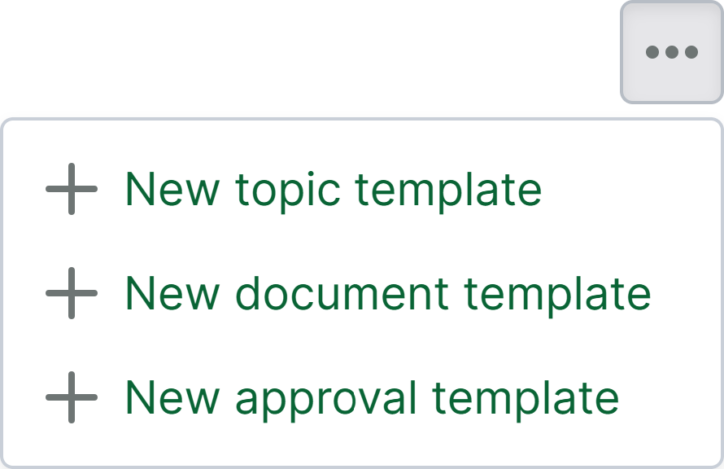
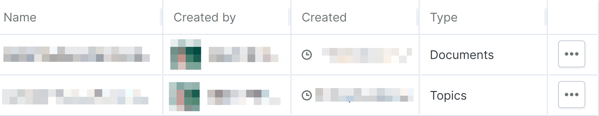
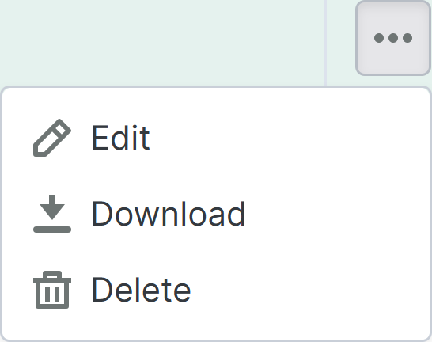

# Seite Berichtvorlagen

> **Hinweis 1:** Die Seite "Berichte" ist eine Opt-in-Funktion, die für laufende Projekte aktiviert werden kann.
> **Hinweis 2:** Neue Projekte, die auf der Grundlage eines Vorlagenprojekts erstellt werden, in dem diese Funktion aktiviert ist, haben diese Funktion nicht aktiviert.

Die Seite "Berichtvorlagen" ist eine Unterseite der [Berichtsseite](https://support.catenda.com/de/articles/12303098-berichterstattungsseite) im linken Navigationsmenü. Auf der Seite "Berichtvorlagen" können die Dokument-, Themen- und Genehmigungsvorlagen, die für das Projekt verfügbar sind, verwaltet werden. _Erforderlicher Zugriff:_ Administrator

So kann die Seite Berichtvorlagen aussehen:

## 1. **Aktionen auf der Seite Berichtvorlagen**

Die Aktionen auf der Seite Berichtvorlagen können Sie finden, indem Sie oben rechts auf der Seite Berichtvorlagen auf das Aktionsmenü klicken. So können die Aktionen auf der Seite Berichtvorlagen aussehen:

Diese Aktionen erstellen eine völlig neue Vorlage, beginnend mit einer leeren Seite. Es wird empfohlen, stattdessen mit einer der vorgefertigten Berichtvorlagen zu beginnen und diese an das Projekt anzupassen. Sie können von [Vorgefertigte Berichtvorlagen](https://support.catenda.com/de/articles/17778911-vorgefertigte-berichtsvorlagen) heruntergeladen werden _(nur für Berichteditor-Kunden)_.

### 1.1 **Neue Themenvorlage**

Verwenden Sie die Aktion "Neue Themenvorlage", um eine neue Themenvorlage zu erstellen

### 1.2 **Neue Dokumentvorlage**

Verwenden Sie die Aktion "Neue Dokumentvorlage", um eine neue Dokumentvorlage zu erstellen

### 1.3 **Neue Genehmigungsvorlage**

Verwenden Sie die Aktion "Neue Genehmigungsvorlage", um eine neue Genehmigungsvorlage für Berichte zu Genehmigungsanfragen zu erstellen.

## 2. **Nach Name filtern**

Geben Sie in der Suchleiste ein, um die Tabelle der Berichtvorlagen nach den Namen der Berichte zu filtern.

Textsuche - `search=test`

## 3. **Tabelle Berichtvorlagen**

Sobald eine Berichtvorlage erstellt wird, erscheint sie als Zeile in der Tabelle Berichtvorlagen. So kann die Tabelle Berichtvorlagen aussehen:

Klicken Sie [hier](https://support.catenda.com/de/articles/11748020-tabellen-in-catenda), um mehr darüber zu erfahren, wie Sie mit Tabellen in Catenda arbeiten.

### 3.1 **Zeileninhalt**

**Berichtzeile** Es ist zwar möglich, auf eine Zeile zu klicken, um sie auszuwählen und grün zu markieren, es können aber keine Aktionen durch Auswahl einer Zeile durchgeführt werden. Die Zeile wird ausgewählt, wenn das Zeilenaktionsmenü in der rechten Spalte ausgewählt wird.

### 3.2 **Spalten**

Je nach konfigurierter Spaltenreihenfolge werden die ersten Spalten angezeigt, während die Tabelle möglicherweise nach links gescrollt werden muss, um andere aktivierte Spalten anzuzeigen. Die Standardreihenfolge und -einstellung der Spalten auf der Seite Berichtvorlagen ist wie folgt:

Name - _Standard_ Der Name der Berichtvorlage

_Erstellt von_ - _Standard_ Der Ersteller der Berichtvorlage

Erstellt - _Standard_ Zeitpunkt und Datum der Erstellung der Themenvorlage

Typ - Standard Der Typ der Berichtvorlage: Dokumente, Themen oder Genehmigungen.

Aktionsmenü - Standard Klicken Sie auf das Aktionsmenü in der Spalte Aktionsmenü, um das Zeilenaktionsmenü zu öffnen. So kann das Zeilenaktionsmenü für Berichtvorlagen aussehen:

Bearbeiten Verwenden Sie die Bearbeitungsaktion, um die ausgewählte Berichtvorlage zu bearbeiten.

Download Verwenden Sie die Download-Aktion, um die ausgewählte Berichtvorlage mit dem Dateiformat `.mrt` herunterzuladen, das in jedem anderen Projekt erneut importiert werden kann.

Löschen Verwenden Sie die Löschaktion, um die ausgewählte Berichtvorlage zu löschen.
