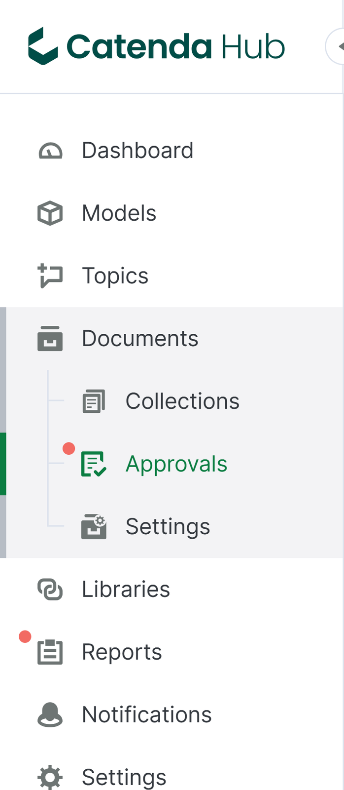
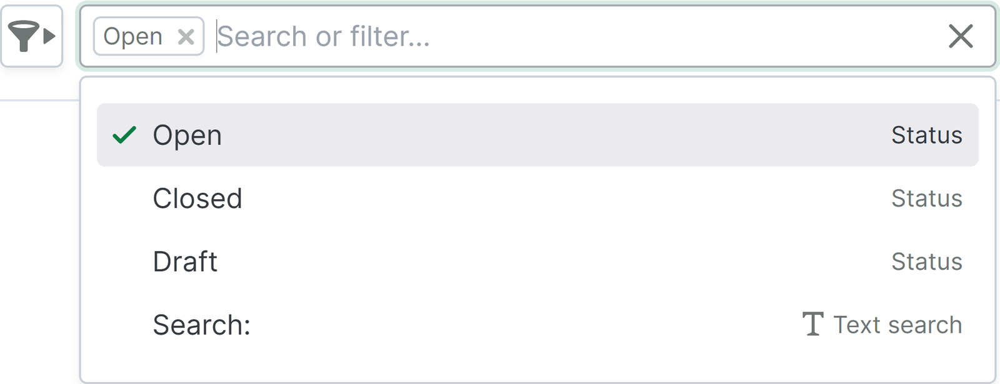
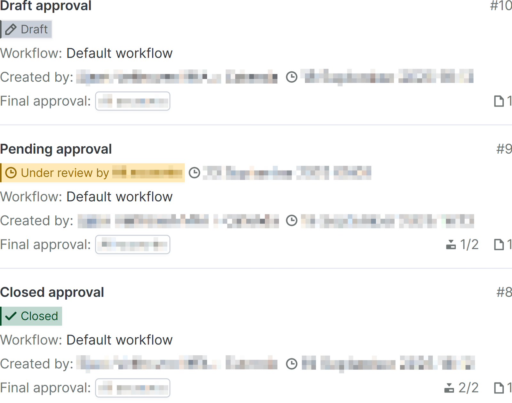
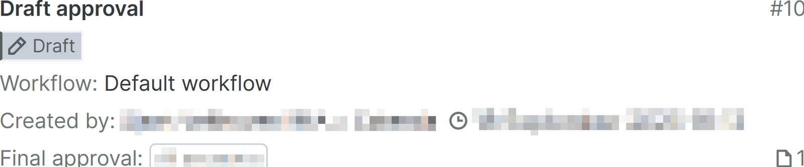
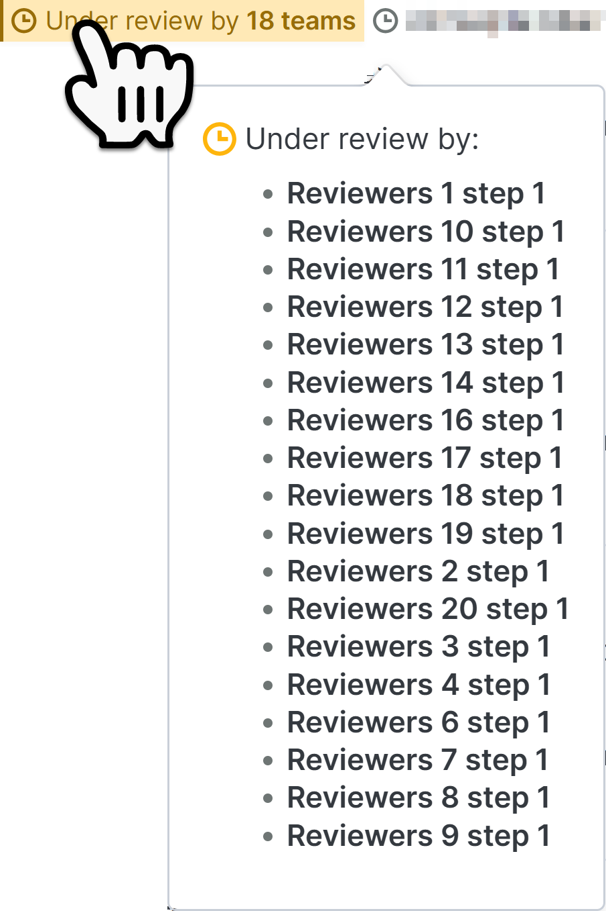
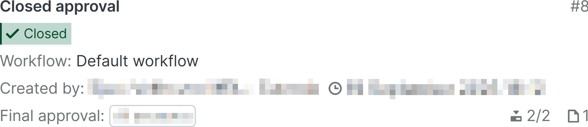

# Seite „Freigaben

Die Seite „Freigaben

Dieser Artikel enthält Informationen zu den folgenden Themen:

_[Suchen oder Filtern](https://support.catenda.com/de/articles/12495047-genehmigungsseite#h_95652579ee) - [Freigabeliste](https://support.catenda.com/de/articles/12495047-genehmigungsseite#h_aa4dfe69f5) - [Zeileninhalt](https://support.catenda.com/de/articles/12495047-genehmigungsseite#h_76de8831a3) - [Freigabeanfragekarten](https://support.catenda.com/de/articles/12495047-genehmigungsseite#h_e99a80135a)_

Projekte, bei denen freigegebene Überarbeitungen vor dem 2. Oktober 2025 aktiviert wurden, sehen stattdessen die [ältere Freigabenseite](https://support.catenda.com/de/articles/8349340-genehmigungsseite-legacy). Auf der Freigabenseite können folgende Aktionen durchgeführt werden:

- Jede Freigabeanfrage kann vom Team überprüft und validiert werden, bevor eine endgültige Validierung entscheidet, ob die angeforderten Überarbeitungen freigegeben werden sollen oder nicht.
- Die Konfiguration des Verlaufs und des Ergebnisses einer Freigabe kann durchgeführt werden.
- Es können neue Freigaben erstellt werden.

## 1. **Such- oder Filteroptionen**

Klicken Sie [hier](https://support.catenda.com/de/articles/12495060-filterung-auf-der-genehmigungsseite), um mehr über das Filtern auf der Genehmigungsseite zu erfahren.

## 2. **Freigabeliste**

Projekte, die auf der Grundlage eines Vorlagenprojekts erstellt wurden, enthalten die Genehmigungsworkflows und Themavorlagen dieses Vorlagenprojekts. Jede Zeile in der Genehmigungsliste enthält eine Genehmigungskarte mit visuellen Hinweisen auf den Inhalt jeder Genehmigungsanfrage.

So kann eine Freigabeanfrage mit vollständiger Aktivität aussehen:

Aktivitäten, die in der Freigabe auftreten, werden mit Mengen und Symbolen auf der Freigabenkarte angezeigt.

**Erforderlicher Zugriff:** Mitglied des Einreichers, des Prüfers oder des abschließenden Prüfteams oder Administrator.

## 3. **Zeileninhalt**

### 3.1 **Offene oder geschlossene Freigabenzeile**

Das Öffnen des Inhalts einer Freigabeanfrage, die überprüft wird oder geschlossen ist, öffnet die [Freigabenseite](https://support.catenda.com/de/articles/12494960-seite-offene-oder-geschlossene-freigabeanfrage) für diese Freigabe.

### 3.2 **Entwurffreigabenzeile**

Für Entwurffreigaben wird stattdessen die [Seite für Entwurffreigabeanfragen](https://support.catenda.com/de/articles/12495175-seite-fur-freigabeanfrage-entwurf) geöffnet.

## 4. **Freigabeanfragekarten**

### 4.1 **Titel**

Freigabentitel

### 4.2 **Entwurfstatus**

Wenn eine Freigabeanfrage den Status Entwurf hat, ist sie nur für die Person sichtbar, die den Entwurf auf der Freigabenseite erstellt hat.

Die Freigabeanfrage ist im Freigabemenü des rechten Menüs einer Überarbeitung nicht sichtbar.

### 4.3 **Offener Freigabenstatus**

Wenn eine Freigabeanfrage den Status Offen hat, ist sie für alle Mitglieder sichtbar, die Teil der beteiligten Teams sind. Bewegen Sie die Maus über den Status von Freigaben, die von mehr als einem Team überprüft werden, um ein Popup zu öffnen, das anzeigt, welche Teams ihren Überblick in der aktuellen Überprüfungsphase noch einreichen müssen.

Prüfteams, die bereits ihre Überprüfung durchgeführt haben, werden in dieser Liste nicht angezeigt und tragen nicht zu der Anzahl der Teams bei, von denen die Freigabenstufe derzeit überprüft wird.

Rechts neben dem Status der offenen Freigabe werden das Datum und die Uhrzeit angezeigt, bis zu denen die Freigabenstufe überprüft werden muss. Wenn für diesen Schritt die automatische Genehmigung konfiguriert ist, wechselt die Freigabe automatisch zu diesem Datum und dieser Uhrzeit zum nächsten Schritt.

### 4.4 **Geschlossener Status**

Wenn eine Freigabeanfrage ihre endgültige Freigabenstufe erreicht, bleibt sie offen. Auf der Grundlage der von jedem der Teams in jeder der Freigabenstufen gegebenen Genehmigungen und Ablehnungen kann ein Mitglied des abschließenden Freigabeteams seine endgültige Genehmigung oder Ablehnung geben. Wenn die Freigabeanfrage von einem Mitglied des abschließenden Freigabeteams endgültig genehmigt oder abgelehnt wird, wird sie geschlossen.

### 4.5 **Workflow**

Der Workflow, dem die Freigabe folgt

### 4.6 **Erstellt von**

Das Mitglied, das die Freigabe erstellt hat, und das Datum und die Uhrzeit der Erstellung.

### 4.7 **Finale Freigabe**

Das abschließende Freigabeteam, das das endgültige Wort bei der Veröffentlichung der freigegebenen Dokumente in der Freigabe hat, informiert durch die von den Einreicherteams in jeder der Freigabenstufen eingereichten Überprüfungen.

### 4.8 **Freigabenummer**

Die Nummer der Freigabe

### 4.9 **Untere Symbole**

Die aktuelle Überprüfungsphase des Workflows, dem die Freigabe folgt. Die Gesamtzahl der Schritte, die die Freigabe vor der Abfassung der Freigabe durchlaufen muss. Nur bei offenen und geschlossenen Freigaben sichtbar. Die Anzahl der Dokumente in der Freigabe unabhängig von den Zugriffseinstellungen.
