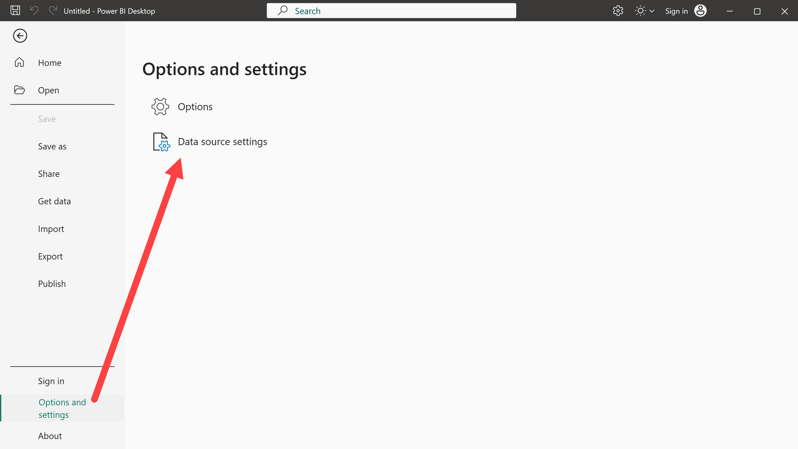
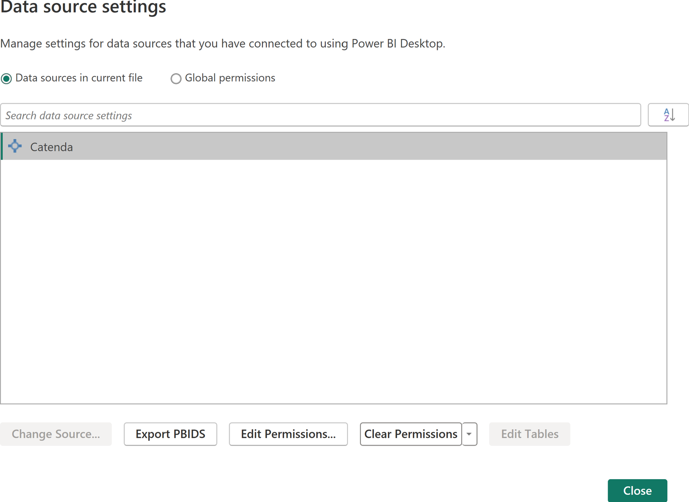

# Bei Catenda von Power BI anmelden

> Wie sich der Catenda-Connector für Power BI bei Catenda anmeldet und was zu tun ist, wenn die Anmeldung fehlschlägt oder abläuft.

Der Catenda-Connector für Power BI meldet sich bei Catenda mit dem eigenen Catenda-Konto des Benutzers an. Dies funktioniert auf die gleiche Weise im veröffentlichten [Catenda Power BI Connector](https://support.catenda.com/de/articles/5784721-catenda-power-bi-connector) und im [Catenda Power BI Connector (On Demand)](https://support.catenda.com/en/articles/17778871-catenda-power-bi-connector-on-demand).

## 1. **Erstmalige Anmeldung**

1. Gehen Sie in Power BI Desktop zu **Daten abrufen** > **Mehr** > **Sonstiges** > **Catenda**, und wählen Sie **Verbinden** aus.
1. Ein Browserfenster wird auf der Catenda-Anmeldeseite geöffnet.
1. Melden Sie sich mit dem Catenda-Konto an.

Die Catenda-Anmeldung selbst wird auf der Seite [Anmeldungsseite](https://support.catenda.com/de/articles/7891486-anmeldeseite) beschrieben.

Power BI Desktop merkt sich die Anmeldung dann, sodass spätere Aktualisierungen und neue Verbindungen nicht erneut gefragt werden. Der Navigator zeigt jedes Projekt an, auf das das Konto Zugriff hat.

## 2. **Erneute Anmeldung nach einem Upgrade**

Der Catenda-Connector wurde früher _Bimsync_ in Power BI genannt. Power BI Desktop speichert für jeden Namen eine separate Anmeldung, sodass die erste Verbindung nach einem Upgrade von einem _Bimsync_-Connector eine neue Anmeldung anfordert.

## 3. **Wenn die Anmeldung fehlschlägt oder abgelaufen ist**

Wenn die Anmeldung weiterhin fehlschlägt, weiterhin fragt oder ein Ladevorgang mit _Catenda-Anmeldung abgelaufen_ stoppt, muss die von Power BI Desktop gespeicherte Anmeldung gelöscht werden:

Gehen Sie zu **Datei** > **Optionen und Einstellungen** > **Datenquelleneinstellungen**.

Wählen Sie den Catenda-Eintrag aus und klicken Sie auf **Berechtigungen löschen**.

Verbinden Sie sich erneut und melden Sie sich an.

## 4. **Vor einem langen Ladevorgang**

Das gleichzeitige Laden vieler Tabellen kann lange dauern, und die Anmeldung erneuert sich dabei. Ein langer Ladevorgang wird am besten direkt nach einer neuen Anmeldung gestartet: Löschen Sie die Berechtigungen wie oben beschrieben und melden Sie sich an, und starten Sie dann den Ladevorgang.
