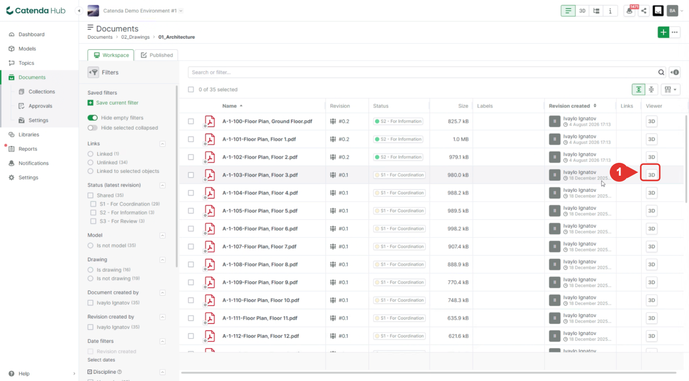
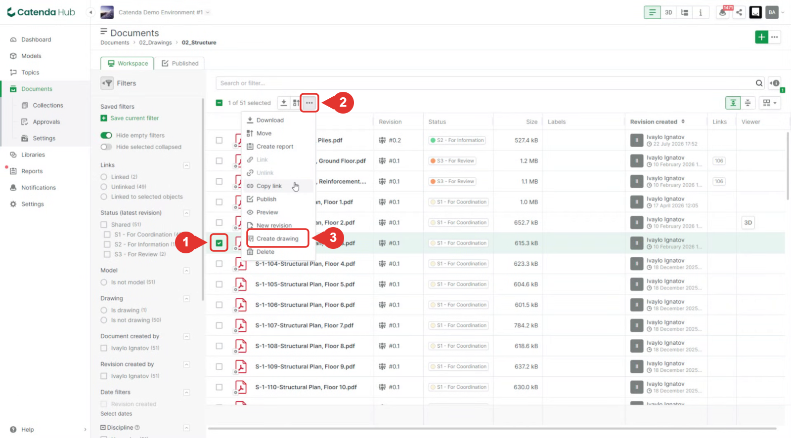

# 2D-Zeichnungen im 3D-Viewer

> So richten Sie PDF-Zeichnungen aus und zeigen sie zusammen mit den Modellen im 3D-Viewer an

2D-Zeichnungen sind ein wesentlicher Bestandteil jedes Bauprojekts. Auch wenn Zeichnungen häufig aus den 3D-Modellen erstellt werden, enthalten sie Details, die ergänzen, was die Modelle zeigen. Die Anzeige von 2D-Zeichnungen im 3D-Viewer bietet gleichzeitig den zwei- und dreidimensionalen Kontext. _Erforderliche Zugriffsrechte:_ Schreibzugriff auf das PDF-Dokument, um eine Zeichnung zu erstellen

[Sehen Sie sich das Video an: 2D-Zeichnungen im 3D-Viewer](https://eu.guidde.com/share/playbooks/jLcBnpr2UYKWMpgP2gK9jv)

## 1. **1. Kalibrierte und nicht kalibrierte Zeichnungen**

Gehen Sie zu den Dokumenten und navigieren Sie zu der PDF-Datei, die die 2D-Zeichnung enthält.

### 1.1 **Kalibrierte Zeichnungen**

PDF-Zeichnungen, die bereits ausgerichtet wurden, zeigen eine **3D**-Schaltfläche an. Klicken Sie darauf, um die Zeichnung zusammen mit den Modellen im 3D-Viewer anzuzeigen.

### 1.2 **Nicht kalibrierte Zeichnungen**

PDF-Zeichnungen, die noch nicht ausgerichtet wurden, müssen zuerst ausgerichtet werden, wie im nächsten Abschnitt beschrieben.

## 2. **2. Ausrichten einer Zeichnung**

### 2.1 **2.1 Zeichnung erstellen**

1. Wählen Sie die PDF-Zeichnung zum Ausrichten aus, indem Sie das zugehörige Kontrollkästchen aktivieren (zum Beispiel das dritte Geschoss der Tragwerkszeichnungen).
1. Öffnen Sie das [Aktionsmenü](https://support.catenda.com/de/articles/4670288-dokumenttabellen-aktionen) (**…**).
1. Wählen Sie **Zeichnung erstellen** aus.

### 2.2 **2.2 Auswahl der Höhe**

Im ersten Schritt wird die Höhe abgefragt, auf der die Zeichnung platziert wird.

- Wenn die Höhe bekannt ist, geben Sie den Wert direkt ein.
- Andernfalls wählen Sie eine Höhe aus einem der IFC-models aus, die im Projekt hochgeladen wurden.

Klicken Sie anschließend auf **Weiter: Ausrichtungspunkte setzen**.

### 2.3 **2.3 Ausrichtungsmethoden**

Die Zeichnung muss ausgerichtet werden, damit sie an der richtigen Position liegt. Es stehen vier Ausrichtungsmethoden zur Verfügung.

**Storey configurator** Wenn Elemente im [storey configurator](https://support.catenda.com/de/articles/6921756-geschosskonfigurator-seite) konfiguriert sind, wird die Zeichnung anhand der 2D-Generierung aus den models ausgerichtet.

**Models** Die Zeichnung wird an den models selbst ausgerichtet, zum Beispiel am architektonischen und am Tragwerks-model der jeweiligen Etage.

**Coordinates** Sind die Koordinaten bekannt, werden die Markierungen **A** und **B** diesen zugeordnet.

**Copy an existing alignment** Eine ausgerichtete Zeichnung derselben Etage kann für die neue Zeichnung wiederverwendet werden. Fügen Sie dieses Dokument hinzu und kopieren Sie dessen Ausrichtung, zum Beispiel von der architektonischen dritten Etage auf die statische dritte Etage.

Wenn Sie an Punkten ausrichten, etwa an Rasterlinienschnittpunkten, platzieren Sie die Markierungen **A** und **B** in beiden Zeichnungen an denselben Schnittpunkten. Zoomen Sie für mehr Genauigkeit hinein. Die Markierungen rasten an den Punkten ein.

Wenn die Zeichnung ausgerichtet ist, klicken Sie auf **Weiter: Ergebnis bestätigen**.

### 2.4 **2.4 Bestätigung der Ausrichtung**

1. Bestätigen Sie das Ergebnis und prüfen Sie, ob die Zeichnung korrekt ausgerichtet ist.
1. Klicken Sie auf **Erstellen**.

Die Zeichnung kann jetzt im 3D-Viewer eingeschaltet werden.

## 3. **3. Anzeige von Zeichnungen im 3D-Viewer**

1. Schalten Sie die Zeichnung ein. Sie wird automatisch im 3D-Viewer angezeigt.
1. Die Zeichnung ist auch im Picker verfügbar. Eine falsche Höhe kann dort geändert werden.
1. Passen Sie bei Bedarf die **Deckkraft** der Zeichnung an.
1. Schalten Sie die models ein, damit sie zusammen mit der Zeichnung angezeigt werden, zum Beispiel das architektonische und das Tragwerks-model.

> **Tipp:** Eine Schnittebene auf der Höhe der Zeichnung schneidet durch die models, sodass die 2D-Zeichnung zusammen mit den BIM models angezeigt wird, zum Beispiel die Tragwerkszeichnung mit dem Tragwerks-model.

Die Kombination von 2D-Zeichnungen mit BIM models schafft eine kohärente, kontextbezogene Sicht auf das Projekt und unterstützt das Verständnis und die Entscheidungsfindung im gesamten Projekt.

## 4. **Weiterführende Literatur**

[3D-Viewer](https://support.catenda.com/de/articles/8227211-3d-viewer) - [Darstellung des 2D-Viewers](https://support.catenda.com/de/articles/13615984-erscheinungsbild-des-2d-viewers) - [Storey configurator](https://support.catenda.com/de/articles/6921756-geschosskonfigurator-seite) - [Aktionen in der Dokumenttabelle](https://support.catenda.com/de/articles/4670288-dokumenttabellen-aktionen)
