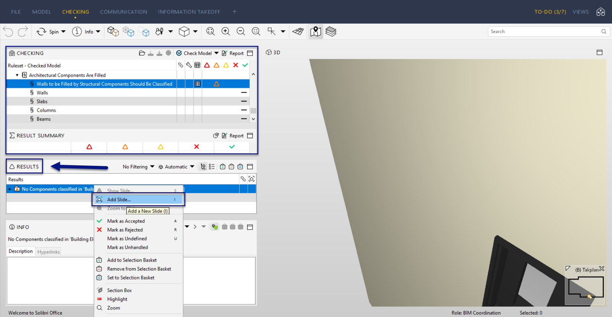
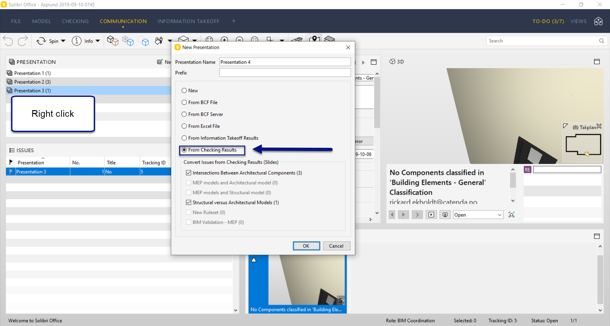
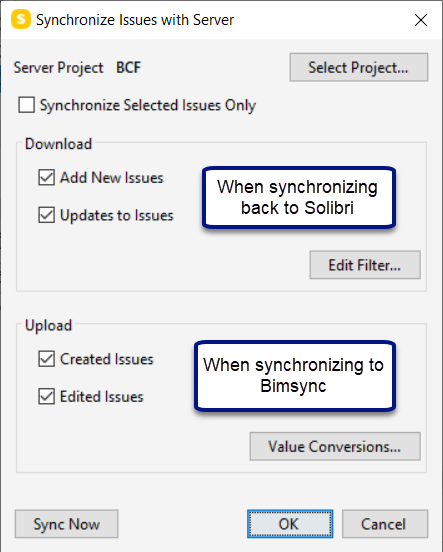
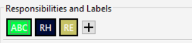
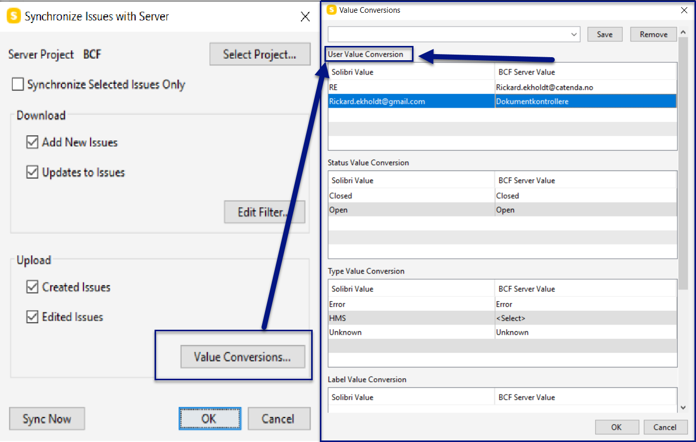

# Workflow Catenda Hub - Solibri

Dies ist ein Dokument, das den optimalen Workflow bei der Arbeit mit dem BCF-Server zwischen Solibri und Catenda Hub erläutert.

1\. Beginnen Sie mit der Verbindung zu Ihrem Catenda Hub-Projekt. [( siehe hier )](https://support.catenda.com/de/articles/4670340-solibri-topics-integration) 2\. Wenn die Verbindung hergestellt ist, starten Sie Ihre clash detection in Solibri und erstellen Sie eine Präsentation. Es gibt mehrere Möglichkeiten, in Solibri eine Präsentation zu erstellen. Ich erkläre Ihnen jedoch die beste Variante für die Kommunikation mit Catenda Hub. A. Führen Sie die Prüfung mit Ihrem Regelsatz aus. B. Suchen Sie ein Solibri-Issue, das Sie zu Ihrer Präsentation hinzufügen möchten. C. Anstatt in der Kommunikation die Folie zu Ihrer Präsentation hinzuzufügen, klicken Sie stattdessen in den Prüfergebnissen mit der rechten Maustaste auf das Issue und wählen Sie die Schaltfläche „Folie hinzufügen“. Auf diese Weise werden alle Objekte dieses Issues automatisch in das Issue in Catenda Hub übernommen und lassen sich leichter finden. Dies in Kombination mit „Andere ausblenden“ und „Andere in Catenda Hub transluzent machen“ ist eine gute Methode, um stets den Überblick darüber zu behalten, welche Objekte in den Issues enthalten sind. Beim Erstellen einer Folie auf diese Weise erhalten Sie dennoch das gleiche Issue-Layout wie in der Kommunikation, in dem Sie einen Titel, eine Beschreibung, zusätzliche Bilder und Kommentare hinzufügen können. Dasselbe gilt für die Zuweisung von Personen zum Issue.

D. Wenn Sie mit Ihrer Überprüfung fertig sind, gehen Sie zu "Kommunikation" und erstellen Sie eine Präsentation aus "Überprüfungsergebnissen". Alle Probleme, die Sie in den Überprüfungsergebnissen erstellt haben, erscheinen dann in Ihrer neuen Präsentation. Wenn Sie diese Folien zu einer vorhandenen Präsentation hinzufügen möchten, können Sie mit der rechten Maustaste auf diese Präsentation klicken und "Präsentation aus Ergebnissen aktualisieren" drücken. Auf diese Weise werden alle in den Ergebnissen erstellten Folien in diese Präsentation aufgenommen.

3\. Nachdem Sie die Präsentation erstellt haben, können Sie mit dem Synchronisieren mit Catenda Hub beginnen. Wenn Sie "Präsentation synchronisieren" drücken, erscheint ein Popup-Menü. Darin können Sie Kontrollkästchen aktivieren, um zu entscheiden, wie Sie synchronisieren möchten. Wenn Sie zu "Wertekonvertierung" gehen, können Sie verschiedene Werte festlegen, um die Werte in Ihrem Catenda Hub-Projekt anzupassen.

4\. Wertekonvertierung. Wenn Sie beispielsweise ein Problem direkt in Solibri einer Person zugewiesen haben und das Problem in Catenda Hub nicht zugewiesen wird, liegt der Grund darin, dass die Wertekonvertierung nicht korrekt eingestellt ist.

Diese im Problem festgelegten Verantwortlichkeiten können so festgelegt werden, dass sie mit den Benutzern im Catenda Hub-Projekt übereinstimmen. Dies wird hier in der Wertekonvertierung durchgeführt:

Die Wertekonvertierungsschaltfläche erscheint im Popup-Menü, wenn Sie mit der rechten Maustaste auf die Präsentation klicken und "Präsentation synchronisieren" drücken. Wenn diese Probleme in Solibri zugewiesen und mit dem Catenda Hub-Projekt synchronisiert werden, erhalten die zugewiesenen Benutzer Benachrichtigungen, wenn Benachrichtigungen aktiviert sind. Auf diese Weise müssen Sie die Probleme nach der Synchronisierung mit Solibri nicht manuell in Catenda Hub zuweisen.
