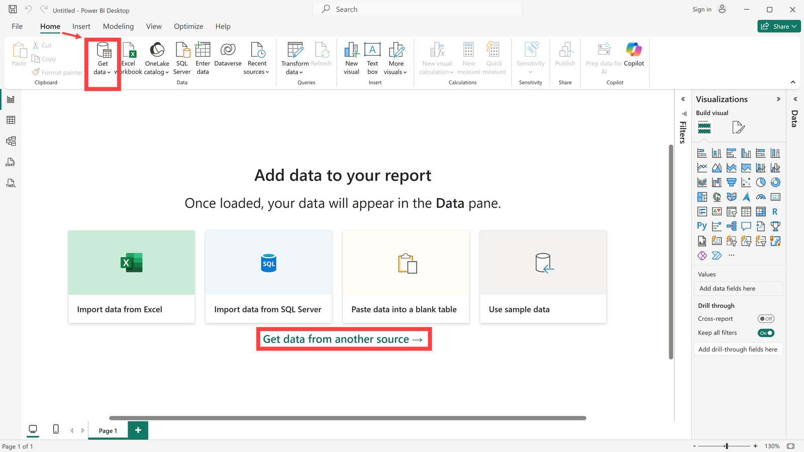
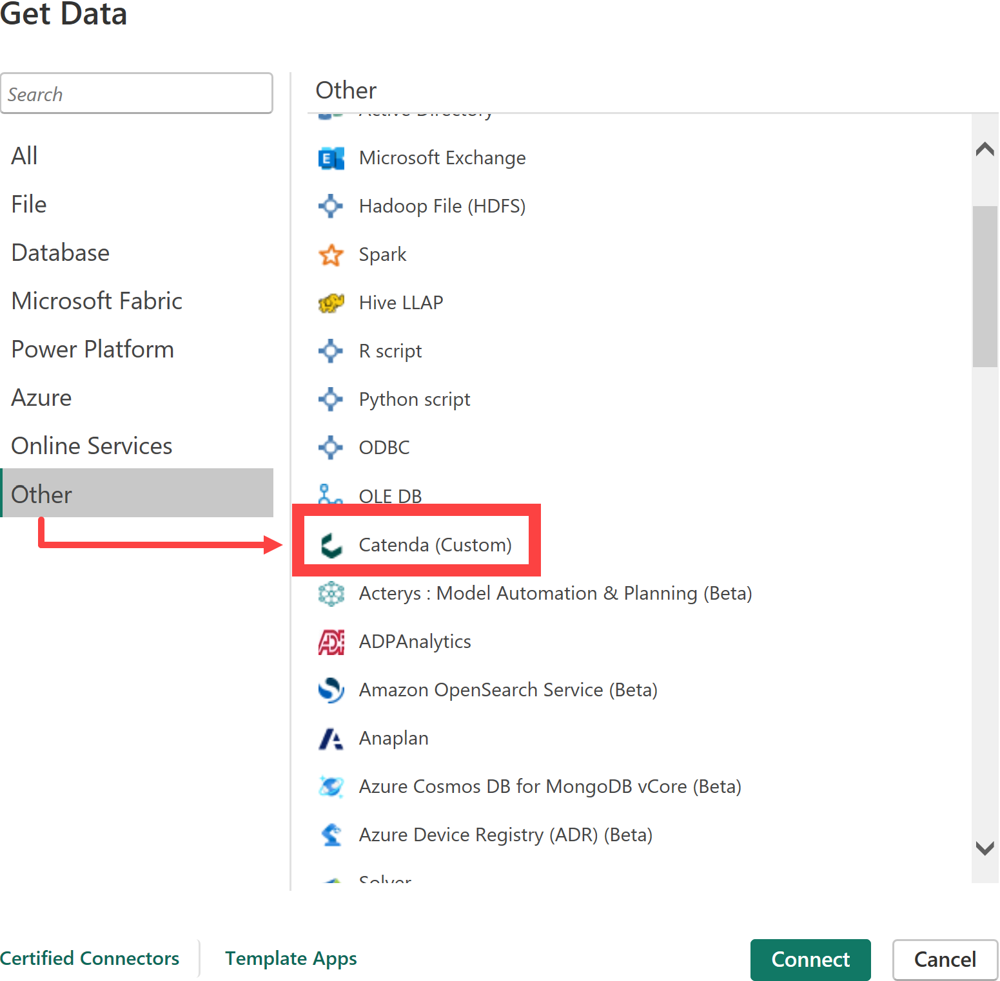
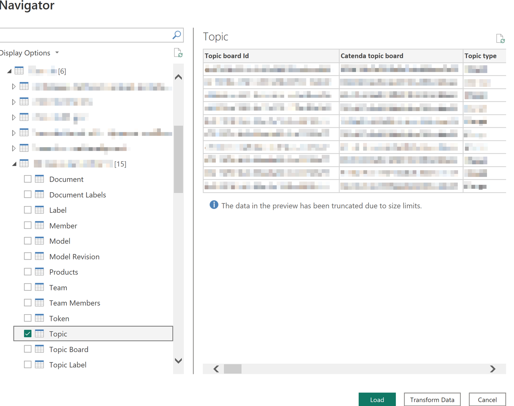
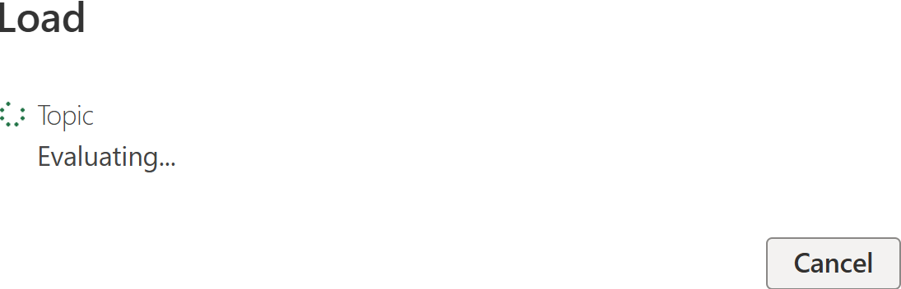
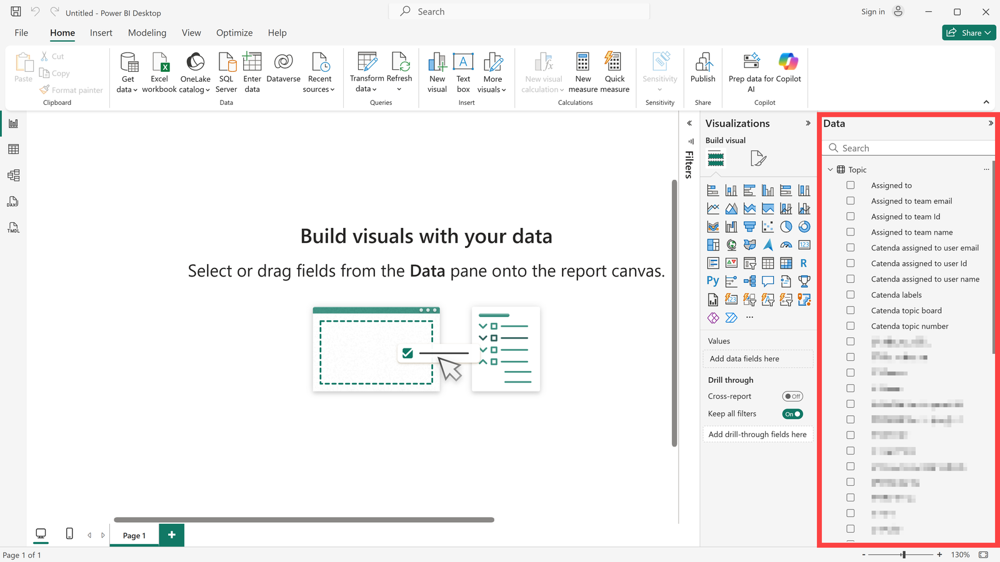
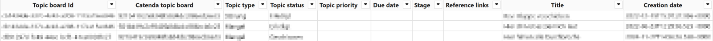
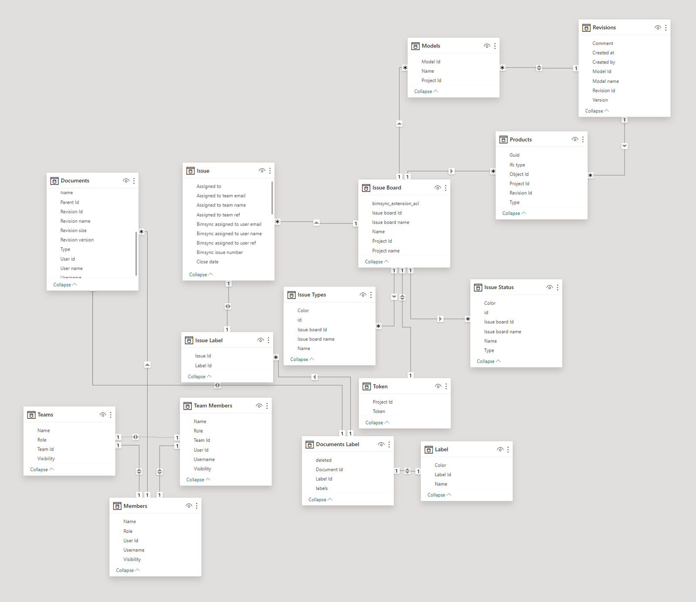

# Catenda Power BI Connector

> **Hinweis:** Die Installationsdatei für diese Anwendung finden Sie [hier](https://support.catenda.com/de/articles/8396532-catenda-plugins-integrationen)

In diesem Artikel erklären wir, wie die Catenda HUB-Datenbank mit PowerBI verknüpft werden kann. Durch die Verknüpfung kann direkter Zugriff auf die Daten auf Catenda HUB in PowerBI erhalten werden. Diese Daten können dann zur Bewertung von Aufgaben, Dokumente oder beispielsweise Teammitglieder verwendet werden.

## 1. **Installation**

Wenn der Catenda Desktop Connector auf Windows installiert wird, befinden sich die Installationsdateien im folgenden Ordner.

`C:\Users\<Username>\Dokumente\Power BI Desktop\Custom connectors`

### 1.1 **Deinstallation**

Gehen Sie zum Installationsordner, um das Plugin zu deinstallieren, und führen Sie die folgende Datei aus:

`uninstall.exe`

Wenn der Ordner gelöscht wurde und das Plug-in noch aktiv ist, installieren Sie das Plug-in bitte neu und deinstallieren Sie es mit der erstellten Deinstallationsdatei.

## 2. **Daten abrufen und verbinden**

Gehen Sie wie folgt vor, um eine Verbindung von PowerBI zur Catenda HUB-Datenbank herzustellen: Öffnen Sie PowerBI und klicken Sie in der Mitte des Bildschirms auf "Daten aus einer anderen Quelle abrufen" oder verwenden Sie die Aktion "Daten abrufen" im Startmenü des oberen Menübands. Das Menüband muss möglicherweise erweitert werden, um die Aktion zu sehen.

Wählen Sie die Zielquelle unter Sonstiges --> Catenda. Verwenden Sie "_Verbinden_", um die Verbindung zur Datenbank herzustellen. Die Anmeldung bei Catenda und was zu tun ist, wenn die Anmeldung fehlschlägt, werden unter [Bei Catenda von Power BI anmelden](https://support.catenda.com/de/articles/17778878-bei-catenda-von-power-bi-anmelden) beschrieben.

## 3. **Daten laden**

Ein Navigator wird geöffnet, in dem alle Projekte aufgelistet sind, auf die Sie Zugriff haben. Wählen Sie das entsprechende Projekt und die Tabelle aus, die verknüpft werden soll. In unserem Beispiel möchten wir [Themen](https://support.catenda.com/de/articles/4670271-themen-seite) in PowerBI auswerten. Klicken Sie auf "_Laden_", um den Datensatz zu laden.

Die folgenden Tabellen können geladen werden:

| Tabelle             | Inhalt                                                             |
| ------------------- | ------------------------------------------------------------------ |
| Dokumente           | Die Dokumente im Projekt.                          |
| Dokumente Etiketten | Die Etiketten für jedes Dokument.                  |
| Etikette            | Die im Projekt verwendeten Etiketten.              |
| Mitglied            | Die Mitglieder des Projekts.                       |
| Modell              | Die Modelle im Projekt.                            |
| Modellrevision      | Die Revisionen jedes Modells.                      |
| Produkte            | Die Objekte in den Modellen.                       |
| Team                | Die Teams im Projekt.                              |
| Teammitglieder      | Die Mitglieder jedes Teams.                        |
| Token               | Ein Viewer-Token für das Projekt.                  |
| Thema               | Die Themen im Projekt.                             |
| Themen-Board        | Die Themen-Boards im Projekt.                      |
| Thema Etiketten     | Die Etiketten für jedes Thema.                     |
| Themenstatus        | Die für die Themen-Boards verwendeten Status.      |
| Thementyp           | Die auf den Themen-Boards verwendeten Thementypen. |

Nach dem Klicken auf "Laden" beginnt der PowerBI Connector mit dem Abrufen der Themendaten aus der API.

Die Daten werden dann auf der rechten Seite angezeigt. Wählen Sie das entsprechende Datenfeld aus und erstellen Sie Ihre Analyse.

> **Hinweis:** Laden Sie verschiedene Datensätze und verknüpfen Sie diese miteinander. Damit können Sie interaktive Dashboards erstellen, die Ihnen einen vollständigen Überblick geben.

Abhängig von den in Ihrem Projekt vorhandenen Daten und den von Ihnen geladenen Daten werden automatisch verschiedene Beziehungen hergestellt.

## 4. **Tabellenansicht**

So können die Themendaten in der Tabellenansicht aussehen:

## 5. **Modellansicht**

Hier ist eine Karte, die zeigt, wie die Verbindungen in der Modellansicht aussehen, wenn alle Informationen in Ihrem Projekt vorhanden sind und Sie alle Projektdaten geladen haben:

