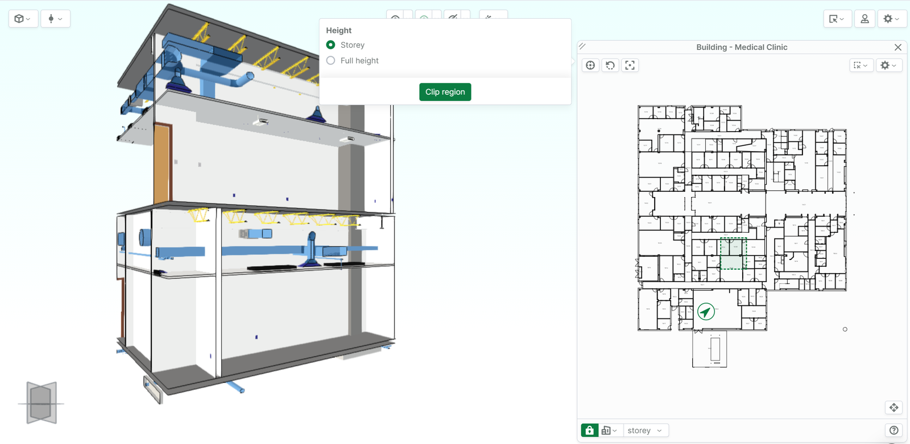

# Auswahl und Clipping aus 2D

### **Clipping im Modell aus 2D**

Richten Sie Ihren 2D-Plan zunächst wie gewünscht aus, indem Sie das [Rotate-Werkzeug](https://support.catenda.com/de/articles/4854537-2d-viewer#h_c70412a63f) verwenden. Wählen Sie anschließend [Section: Create clipping planes](https://support.catenda.com/de/articles/4854537-2d-viewer#h_2265eef562) und ziehen Sie ein Rechteck, um die vertikalen Schnittebenen festzulegen. Wählen Sie die Höhe des aktuellen Geschosses bzw. Stockwerks oder die volle Höhe. Klicken Sie auf „Clip region“.

Sie können nun die [Clipping-Ebenen verschieben](https://support.catenda.com/de/articles/4670253-schnittebenen#moving-the-clipping-plane) wie gewohnt, indem Sie die entsprechende Ebene im Clipping-Widget (unten links) auswählen oder indem Sie „Umschalt“ gedrückt halten und auf die Ebene im Viewer klicken. Ebenen können [einzeln entfernt](https://support.catenda.com/de/articles/4670253-schnittebenen#remove-clipping-planes) werden, indem Sie eine Ebene auswählen und „Entf“ drücken, oder alle auf einmal, indem Sie mit der rechten Maustaste irgendwo im 3D-Viewer klicken und „Clipping-Ebenen entfernen“ auswählen

### **Auswahl von Objekten aus 2D**

[Section: Select objects](https://support.catenda.com/de/articles/4854537-2d-viewer#h_9ba868389c) funktioniert ähnlich und wählt alle Objekte aus, die vom „virtuellen Quader“ berührt werden, der durch das Auswahlrechteck und die Höhe definiert wird. Um zur normalen Auswahl in 2D zurückzukehren, klicken Sie auf [Select](https://support.catenda.com/de/articles/4854537-2d-viewer#h_6e9b382c42).
