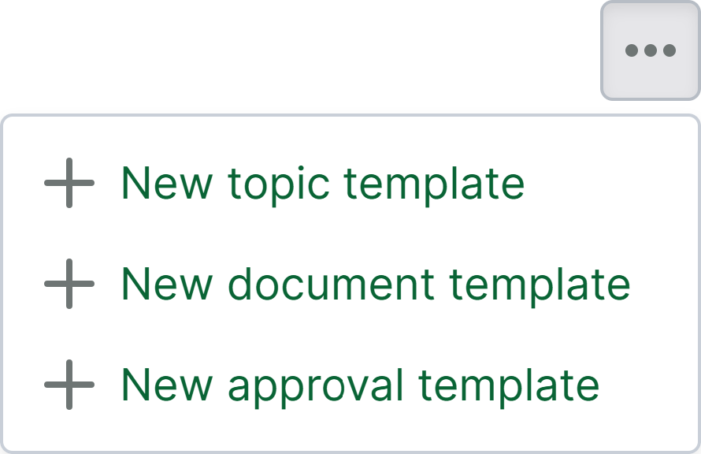
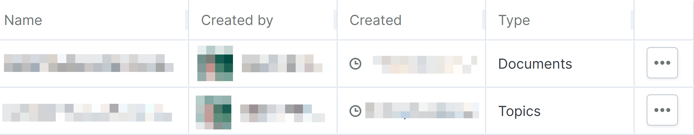
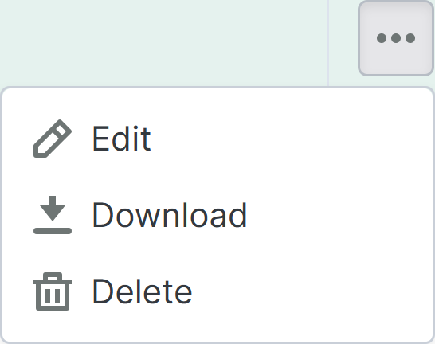

# Report templates page

> **Note 1:** The reports page is an opt-in feature that can be requested to be enabled for ongoing projects.
> **Note 2:** New projects that are created based on a template project where this feature is enabled do not have this feature enabled.

The report templates page can be found as a sub-page of the [reports page](https://support.catenda.com/en/articles/12303098-reports-page) in the left navigation menu. On the report templates page the document, topic and approval templates that are available to the project can be managed. _Access required:_ Administrator

This is what the report templates page can look something like this:

## 1. **Actions on the report templates page**

The report templates page actions can be found by clicking on the action menu on the top right of the report templates page. This is what the report templates page actions can look like:

These actions create a completely new template, starting from an empty page. It is recommended to start from one of the ready-made report templates instead, and adapt it to the project. They can be downloaded from [Ready-made report templates](https://support.catenda.com/en/articles/17778911-ready-made-report-templates) _(report editor customers only)_.

### 1.1 **New topic template**

Use the new topic template action to create a new topic template

### 1.2 **New document template**

Use the new document template action to create a new document template

### 1.3 **New approval template**

Use the new approval template action to create a new approval template, for reports on approval requests.

## 2. **Filter by name**

Write in the search bar to filter the reports template table by the names of the reports.

Text search - `search=test`

## 3. **Report templates table**

As soon as a report template is created it will show up as a row in the report templates table. This is what the report templates table can look like:

Click [here](https://support.catenda.com/en/articles/11748020-tables-on-catenda) to read more about how to work with tables in Catenda.

### 3.1 **Row content**

**Report row** While it is possible to click on a row to select it and highlight it in green there are no actions that can be performed by selecting a row. The row will be selected when the row action menu in the right column is selected.

### 3.2 **Columns**

Based on the configured column order the first columns are displayed while the table might have to be scrolled sideways to show other enabled columns. The default order and visibility setting of the columns on the report templates page is as follows:

Name - _Default_ The name of the report template

_Created by_ - _Default_ The creator of the report template

Created - _Default_ The time and date of when the topic template was created

Type - Default The type of report template: Documents, Topics or Approvals.

Action menu - Default Click on the action menu in the action menu column to open the row action menu. This is what the report template row action menu can look like:

Edit Use the edit action to edit the selected report template.

Download Use the download action to download the selected report template with the `.mrt` file format that can be imported again in any other project.

Delete Use the delete action to delete the selected report template.
