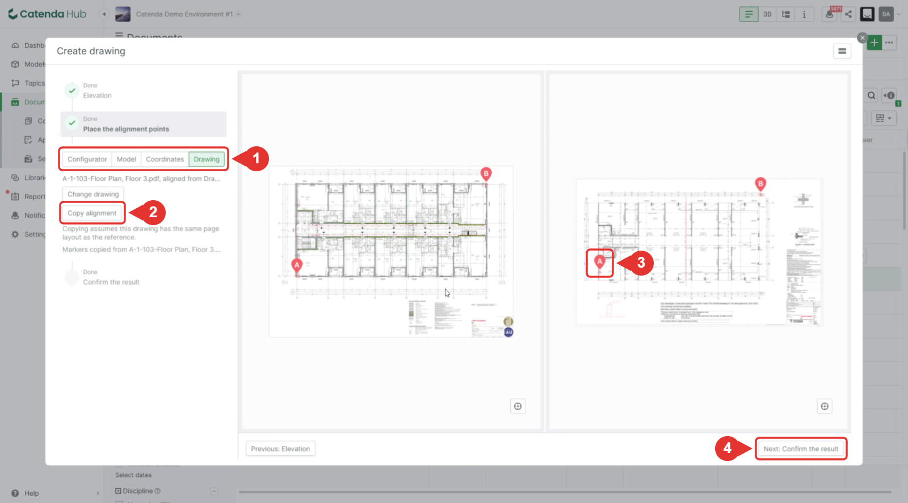
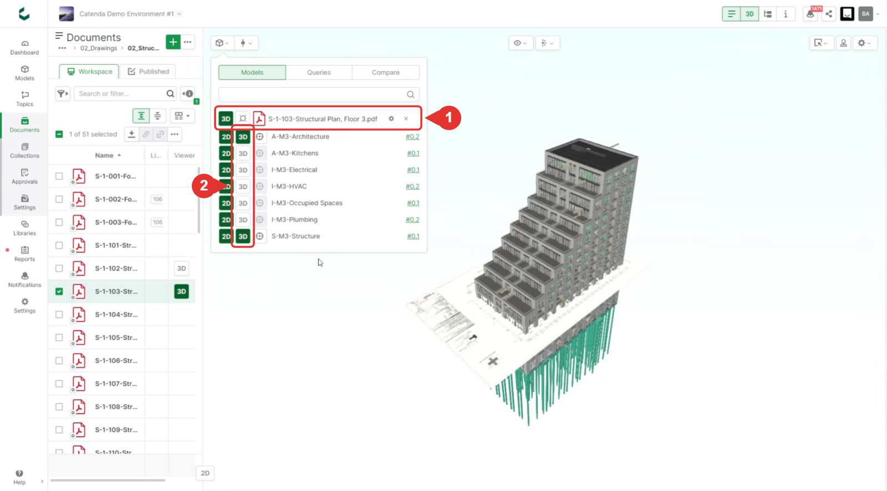

# 2D drawings in the 3D viewer

> How to align PDF drawings and display them together with the models in the 3D viewer

2D drawings are an essential part of any construction project. Even though drawings are often generated from the 3D models, they carry detail that complements what the models show. Displaying 2D drawings in the 3D viewer gives both the two- and three-dimensional context at the same time. _Access required:_ Write access to the PDF document to create a drawing

[Watch the video: 2D drawings in the 3D viewer](https://eu.guidde.com/share/playbooks/jLcBnpr2UYKWMpgP2gK9jv)

## 1. **1. Calibrated and uncalibrated drawings**

Go to the documents and navigate to the PDF file that contains the 2D drawing.

### 1.1 **Calibrated drawings**

PDF drawings that have already been aligned display a **3D** button. Click it to view the drawing in the 3D viewer alongside the models.

### 1.2 **Uncalibrated drawings**

PDF drawings that have not been aligned yet must be aligned first, as described in the next section.

## 2. **2. Aligning a drawing**

### 2.1 **2.1 Creating a drawing**

1. Select the PDF drawing to align by ticking its checkbox (for example, the third floor of the structural drawings).
2. Open the [action menu](https://support.catenda.com/en/articles/4670288-documents-table-actions) (**…**).
3. Select **Create drawing**.

### 2.2 **2.2 Choosing the elevation**

The first step asks for the elevation the drawing is placed on.

- When the elevation is known, enter the value directly.
- Otherwise, pick an elevation from one of the IFC models uploaded to the project.

Then click **Next: Place the alignment points**.

### 2.3 **2.3 Alignment methods**

The drawing needs to be aligned to sit in the correct position. Four alignment methods are available.

**Storey configurator** When items are configured in the [storey configurator](https://support.catenda.com/en/articles/6921756-storey-configurator-page), the drawing is aligned on the 2D generation from the models.

**Models** The drawing is aligned against the models themselves, for example the architectural and structural model at the relevant floor.

**Coordinates** When the coordinates are known, the **A** and **B** markers are mapped to them.

**Copy an existing alignment** An aligned drawing of the same floor can be reused for the new drawing. Add that document and copy its alignment, for example from the architectural third floor to the structural third floor.

When aligning on points, such as grid line intersections, place the **A** and **B** markers on both drawings at the same intersections. Zoom in for precision. The markers snap to the points.

When the drawing is aligned, click **Next: Confirm the result**.

### 2.4 **2.4 Confirming the alignment**

1. Confirm the result and check that the drawing is aligned correctly.
2. Click **Create**.

The drawing can now be turned on in the 3D viewer.

## 3. **3. Viewing drawings in the 3D viewer**

1. Turn on the drawing. It is displayed automatically in the 3D viewer.
2. The drawing is also available in the picker. An incorrect elevation can be changed there.
3. Adjust the **opacity** of the drawing as needed.
4. Turn on the models to show together with the drawing, for example the architectural and the structural model.

> **Tip:** A clipping plane at the height of the drawing cuts through the models, so the 2D drawing shows together with the BIM models, for example the structural drawing with the structural model.

Combining 2D drawings with BIM models gives a coherent, contextual view of the project and supports understanding and decision-making across the whole project.

## 4. **Further reading**

[3D viewer](https://support.catenda.com/en/articles/8227211-3d-viewer) - [2D viewer appearance](https://support.catenda.com/en/articles/13615984-2d-viewer-appearance) - [Storey configurator](https://support.catenda.com/en/articles/6921756-storey-configurator-page) - [Documents table actions](https://support.catenda.com/en/articles/4670288-documents-table-actions)
