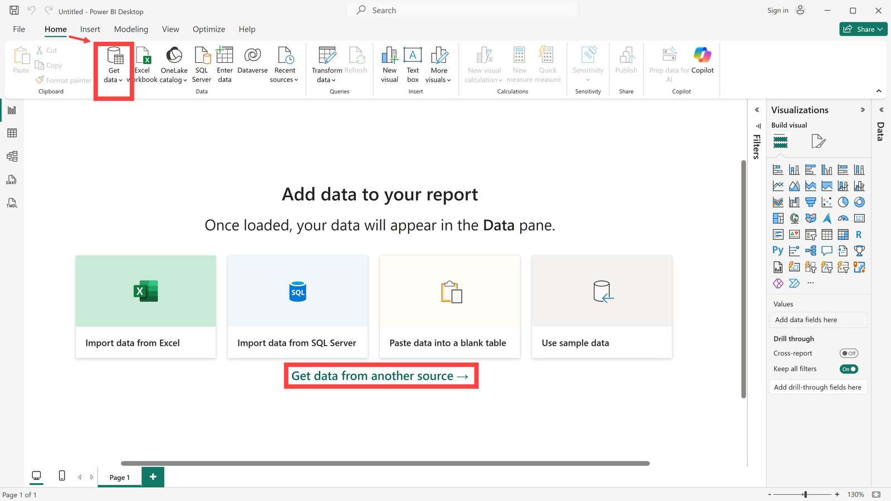
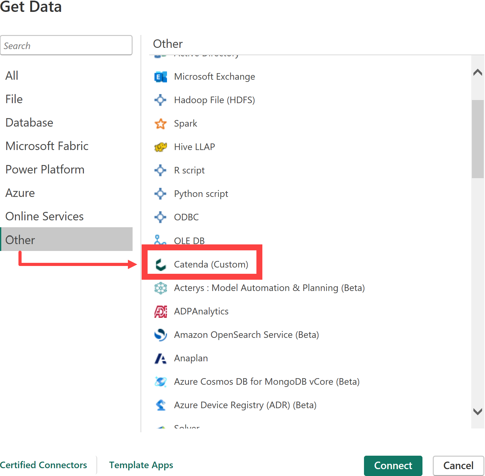
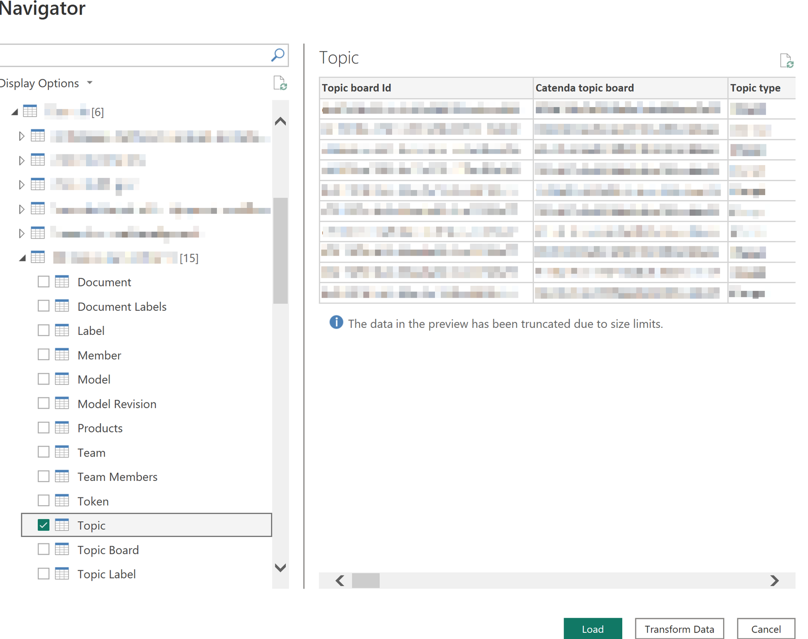
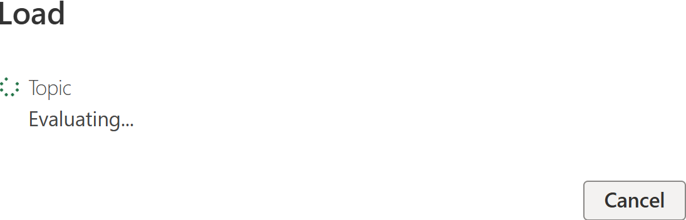
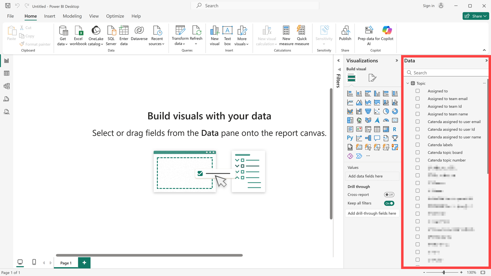
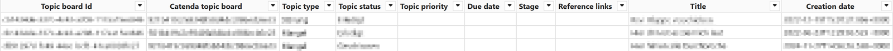
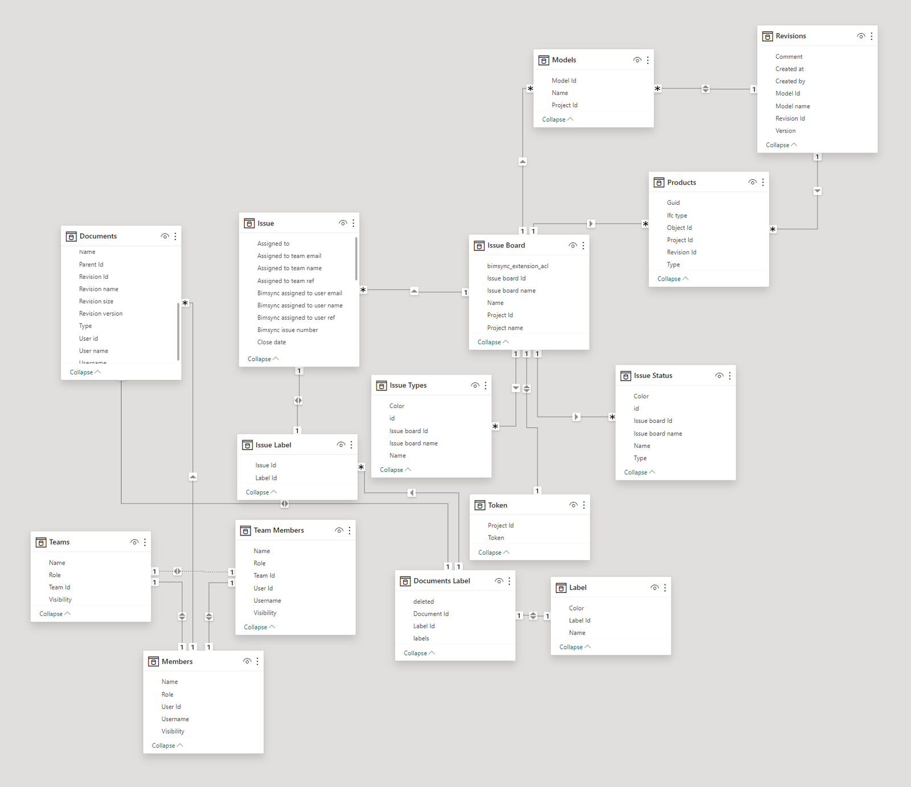

# Catenda Power BI Connector

> **Note:** The installation file for this application can be found [here](https://support.catenda.com/en/articles/8396532-catenda-plugins-integrations)

In this article we will explain how the Catenda HUB database can be linked with PowerBI. By linking direct access to the data on Catenda HUB can be obtained in PowerBI. This data can then be used to evaluate tasks, documents or, for example, team members.

## 1. **Installation**

When the Catenda Desktop Connector is installed on Windows its installation files will appear in the following folder.

`C:\Users\<Username>\Documents\Power BI Desktop\Custom connectors`

### 1.1 **Uninstalling**

To uninstall the plugin go to the installation folder and run the following file:

`uninstall.exe`

If the folder has been deleted and the plugin is still active, please re-install the plugin and uninstall it with the uninstall file that has been created.

## 2. **Get data and connect**

To create a connection from PowerBI to the Catenda HUB database, proceed as follows: Open PowerBI and click on "Get data from another source" in the middle of the screen or use the Get data action in the home menu of the top ribbon. The ribbon might have to be expanded to see the action.

Select the target source under Other --> Catenda. Use "_Connect_" to establish the connection to the database. Signing in to Catenda, and what to do when the sign-in fails, are described in [Sign in to Catenda from Power BI](https://support.catenda.com/en/articles/17778878-sign-in-to-catenda-from-power-bi).

## 3. **Load data**

A navigator opens in which all projects you have access to are listed. Select the corresponding project and the table to be linked. In our example we would like to evaluate [topics](https://support.catenda.com/en/articles/4670271-topics-page) in PowerBI. Click on "_Load_" to load the dataset.

The following tables can be loaded:

| Table           | Contents                                  |
| --------------- | ----------------------------------------- |
| Documents       | The documents in the project.             |
| Documents Label | The labels on each document.              |
| Label           | The labels used in the project.           |
| Member          | The members of the project.               |
| Model           | The models in the project.                |
| Model Revision  | The revisions of each model.              |
| Products        | The objects in the models.                |
| Team            | The teams in the project.                 |
| Team members    | The members of each team.                 |
| Token           | A viewer token for the project.           |
| Topic           | The topics in the project.                |
| Topic Board     | The topic boards in the project.          |
| Topic Label     | The labels on each topic.                 |
| Topic Status    | The statuses used on the topic boards.    |
| Topic Type      | The topic types used on the topic boards. |

After clicking on Load the PowerBI connector will start fetching the topic data from the API.

The data is then displayed it on the right-hand side. Select the appropriate data field and create your analysis.

> **Note:** Load different data sets and link them together. With this you will be able to make interactive dashboards that give you a complete overview.

Depending on what data is present in your project and what data you load, different relations will be made automatically.

## 4. **Table view**

This is what the topic data can look like in table view:

## 5. **Model view**

Here is a map of what the connections look like in model view when all information is present in your project and you have loaded all project data:

