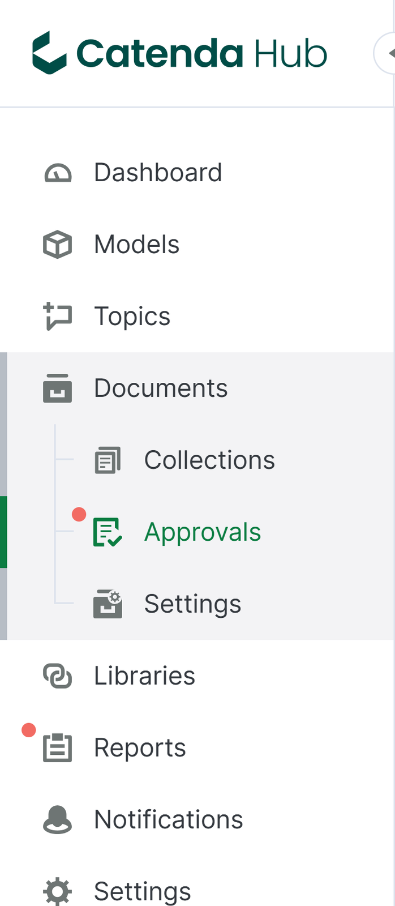
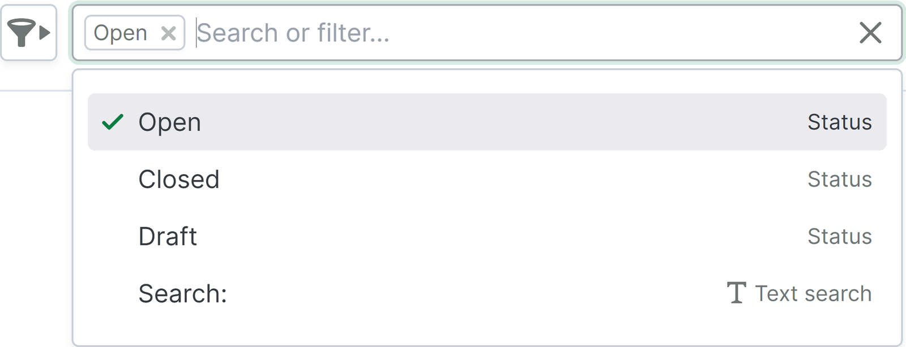
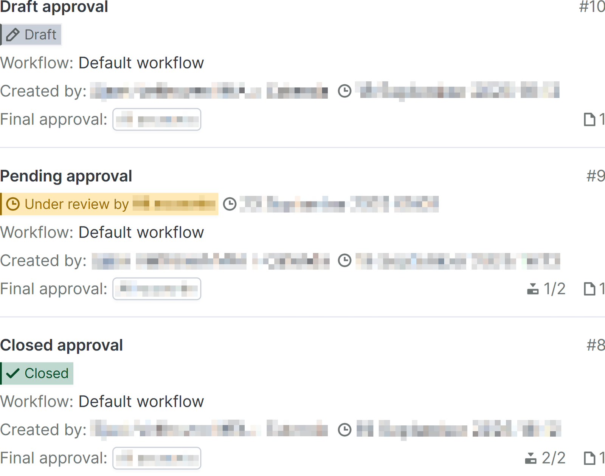
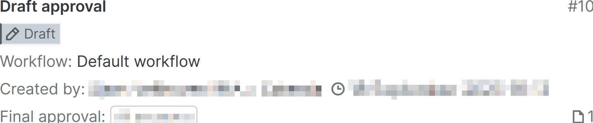
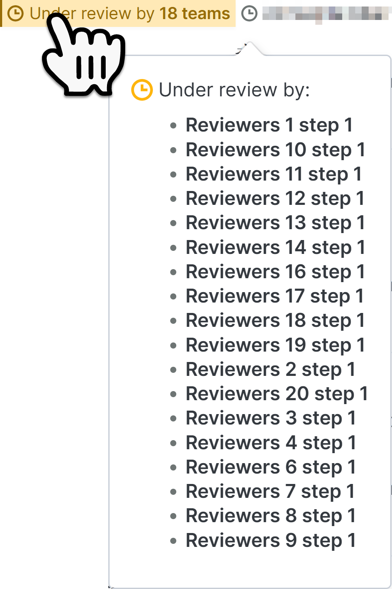
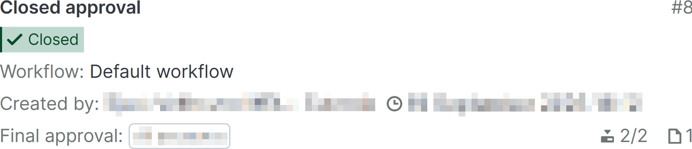

# Page des validations

La page des validations se trouve comme sous-page de la [page documents](https://support.catenda.com/fr/articles/8204673-page-documents) dans le menu de navigation de gauche. La page des validations est masquée par défaut et s'affiche lorsque le circuit de validation des statuts a été activé dans les [paramètres des documents](https://support.catenda.com/fr/articles/7831371-page-des-parametres-du-document) pour les projets ayant activé les révisions partagées après le 2 octobre 2025. Vous y trouverez un aperçu des demandes de validation du projet.

Cet article contient des informations sur les sujets suivants :

_[Rechercher ou filtrer](https://support.catenda.com/fr/articles/12495047-page-des-approbations#h_95652579ee) - [Liste des validations](https://support.catenda.com/fr/articles/12495047-page-des-approbations#h_aa4dfe69f5) - [Contenu de la ligne](https://support.catenda.com/fr/articles/12495047-page-des-approbations#h_76de8831a3) - [Cartes de demande de validation](https://support.catenda.com/fr/articles/12495047-page-des-approbations#h_e99a80135a)_

Les projets pour lesquels les révisions partagées ont été activées avant le 2 octobre 2025 verront la [page de validations héritée](https://support.catenda.com/fr/articles/8349340-page-des-validations-heritage) à la place. Sur la page des validations, les actions suivantes peuvent être effectuées :

- Chaque demande de validation peut être examinée et validée par l'équipe avant qu'une validation finale décide si les révisions demandées doivent être approuvées ou non.
- La configuration du déroulement et du résultat d'une validation peut être effectuée.
- De nouvelles validations peuvent être créées.

## 1. **Options de recherche ou de filtrage**

Cliquez [ici](https://support.catenda.com/fr/articles/12495060-filtrage-sur-la-page-des-approbations) pour en savoir plus sur le filtrage sur la page des approbations.

## 2. **Liste des validations**

Les projets créés à partir d'un projet modèle incluent les flux de travail d'approbation et les modèles de sujets de ce projet modèle. Chaque ligne de la liste des approbations contient une carte d'approbation avec des indices visuels sur le contenu de chaque demande d'approbation.

Voici à quoi peut ressembler une demande de validation avec une activité complète :

L'activité qui se produit dans la validation s'affiche avec des quantités et des icônes sur la carte de validation.

**Accès requis :** Membre de l'équipe du demandeur, examinateur ou équipe d'examen final ou administrateur.

## 3. **Contenu de la ligne**

### 3.1 **Ligne de validation ouverte ou fermée**

L'ouverture du contenu d'une ligne de demande de validation en cours d'examen ou fermée ouvre la [page de validation](https://support.catenda.com/fr/articles/12494960-page-de-demande-de-validation-ouverte-ou-fermee) pour cette validation.

### 3.2 **Ligne de validation brouillon**

Pour les validations en brouillon, la [page de demande de validation en brouillon](https://support.catenda.com/fr/articles/12495175-page-de-demande-de-validation-de-brouillon) s'ouvrira à la place.

## 4. **Cartes de demande de validation**

### 4.1 **Titre**

Titre de la validation

### 4.2 **Statut brouillon**

Lorsqu'une demande de validation a le statut brouillon, elle n'est visible que par la personne qui a créé le brouillon dans la page des validations.

La demande de validation n'est pas visible dans le menu des validations du menu droit d'une révision.

### 4.3 **Statut de validation ouverte**

Lorsqu'une demande de validation a le statut ouvert, elle est visible pour tous les membres des équipes impliquées dans la demande. Survolez les statuts des validations en cours d'examen par plus d'une équipe pour ouvrir une fenêtre contextuelle montrant quelle équipe doit encore soumettre son examen à l'étape actuelle.

Les équipes d'examen qui ont déjà donné leur examen n'apparaissent pas dans cette liste et ne sont pas comptabilisées dans le nombre d'équipes dont l'étape de validation est actuellement en cours d'examen.

À droite du statut de validation ouverte, la date et l'heure auxquelles l'étape de validation doit être examinée s'affichent. Si l'approbation automatique est configurée pour cette étape, la validation passera automatiquement à l'étape suivante à cette date et cette heure.

### 4.4 **Statut fermé**

Lorsqu'une demande de validation atteint son étape de validation finale, elle reste ouverte. En fonction des approbations et rejets donnés par chacune des équipes à chacune des étapes de validation, un membre de l'équipe de validation finale pourra donner son approbation ou son rejet final. Lorsque la demande de validation est finalement approuvée ou rejetée par le membre de l'équipe de validation finale, elle est fermée.

### 4.5 **Circuit de validation**

Le circuit de validation qui est suivi par la validation

### 4.6 **Créé par**

Le membre qui a créé la validation et la date et l'heure de sa création.

### 4.7 **Approbation finale**

L'équipe de validation finale qui aura le dernier mot sur la publication des documents partagés dans la validation, informée par les examens soumis par les équipes du demandeur à chacune des étapes de validation.

### 4.8 **Numéro de validation**

Le numéro de la validation

### 4.9 **Icônes en bas**

L'étape actuelle d'examen du circuit de validation que suit la validation. Le nombre total d'étapes que la validation doit compléter avant d'être finalisée. Visible uniquement sur les validations ouvertes et fermées. Le nombre de documents dans la validation indépendamment des paramètres d'accès.
