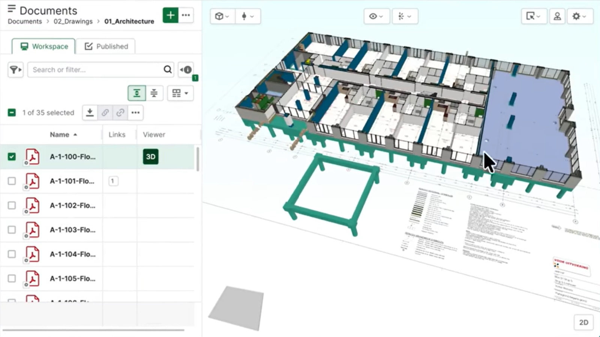
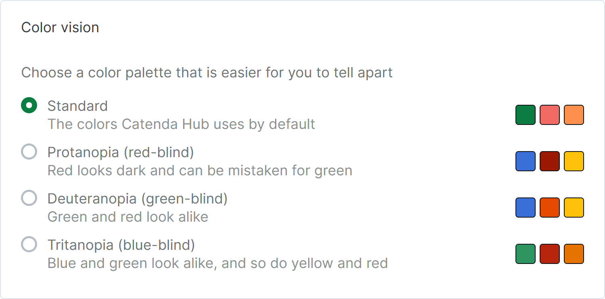

# Statuts des fonctionnalités Q4 2026

Pour éviter le spam de notifications et assurer un lancement en douceur, les nouveaux comportements ou les modifications des comportements existants peuvent être déployés progressivement et sans avertissement. Ceux qui remarquent des modifications dans le comportement d'une partie de la page qu'ils utilisent fréquemment ou ceux qui se demandent ce qui est nouveau peuvent consulter ces articles pour obtenir des mises à jour sur les modifications récentes du comportement pour tous les utilisateurs.

## 1. **Nouvelles fonctionnalités**

Chaque utilisateur utilise la plateforme différemment. Même si une nouvelle fonctionnalité est publiée ou des modifications sont apportées à une fonctionnalité, il se peut que les utilisateurs n'utilisent pas cette partie de la fonctionnalité. Pour ceux qui sont curieux de savoir ce qu'est « ce nouveau bouton » ou « cette nouvelle page » sur la plateforme, cet article contient une introduction sur ce que le changement concerne. Pour ces fonctionnalités, souvent seul du matériel d'assistance de base ou légèrement obsolète est disponible car cela est mis à jour au fur et à mesure. Parallèlement à l'aide apportée aux personnes dans le support, les articles sont souvent mis à jour et si les questions qui ont été posées peuvent être trouvées rapidement expliquées dans un article la semaine suivante.

### 1.1 **Dessins en 3D**

Les dessins PDF peuvent maintenant être affichés dans la [visionneuse 3D](https://support.catenda.com/fr/articles/8227211-visionneuse-3d), en place avec les modèles. Un dessin est aligné une fois, et à partir de là, il peut être ouvert en 3D aussi souvent que nécessaire.

**Aligner un dessin** Sélectionnez un seul PDF dans le tableau des documents sur la [page des documents](https://support.catenda.com/fr/articles/8204673-page-documents) et choisissez Créer un dessin dans le menu d'action en haut du tableau. Donnez au dessin une élévation, puis placez les marqueurs A et B pour définir sa position et sa rotation. Cela fonctionne de la même façon que dans le [configurateur d'étages](https://support.catenda.com/fr/articles/6921756-page-configurateur-d-etage). Il aligne le dessin avec un étage du configurateur d'étages ou d'un modèle IFC.

**Ouverture des dessins en 3D** Sélectionnez un ou plusieurs dessins alignés et choisissez 3D dans le menu d'action en haut du tableau des documents. La vue 3D d'un seul dessin aligné peut également être activée et désactivée avec le bouton 3D dans la [colonne Visionneuse](https://support.catenda.com/fr/articles/8204673-page-documents#h_face62c318). Si la colonne Visionneuse n'est pas visible, affichez-la d'abord, comme décrit dans [Colonnes de la page Documents](https://support.catenda.com/fr/articles/8466850-colonnes-sur-la-page-des-documents). Les dessins chargés dans la visionneuse 3D sont listés dans le menu déroulant du model en haut, de la même manière que les nuages de points et les fichiers GML. Les dessins en 3D fonctionnent avec les fichiers PDF. 📽️ **[Vidéo tutorielle](https://eu.guidde.com/playbooks/devAaKxijzjkFmKW8xcgLq?mode=videoAndDoc)**

### 1.2 **Accessibilité**

**Clavier et lecteur d'écran** Catenda Hub peut maintenant être utilisé avec un clavier seul et avec un lecteur d'écran. Un lien « passer au contenu principal » et la touche F6 se déplacent entre les zones principales de l'écran, et un contour visible indique où se trouve le focus. Les sujets, documents, approbations et modèles fonctionnent tous au clavier et au lecteur d'écran, y compris les tableaux, les formulaires, les pop-ups, la visionneuse 3D et la visionneuse PDF. Les boutons qui affichent uniquement une icône ont maintenant des noms que le lecteur d'écran lit à haute voix, dans la [langue d'interface](https://support.catenda.com/fr/articles/4670248-modification-de-la-langue-preferee) de l'utilisateur. Les messages d'erreur et de succès sont également lus à haute voix.

**Modes daltoniens** Trois modes daltoniens peuvent être choisis sous Vision des couleurs sur la [page du compte](https://support.catenda.com/fr/articles/6880968-page-du-compte) : protanopie, deutéranopie et tritanopie. Chaque mode utilise une palette de couleurs qui est plus facile à distinguer, et Standard conserve les couleurs par défaut.

## 2. **Fonctionnalités mises à jour**

### 2.1 **Améliorations des approbations**

**Étapes d'approbation cliquables** Les étapes du [ruban d'étapes](https://support.catenda.com/fr/articles/12495212-ruban-d-etapes-dans-une-demande-de-validation) en haut d'une approbation peuvent maintenant être cliquées. Cliquer sur une étape affiche son statut, ses équipes de révision et ses dates. L'étape actuelle conserve son contour vert, il reste donc clair où se trouve réellement la révision.

**Approbations héritées fermées après le basculement** Les projets qui ont basculé des approbations héritées vers le nouveau flux de travail d'approbation peuvent maintenant voir leurs approbations héritées fermées sur la [page des approbations](https://support.catenda.com/fr/articles/12495047-page-des-approbations). La documentation et la piste d'audit de ces approbations restent intactes après le basculement.

### 2.2 **Révisions partagées dans les collections**

[Les collections](https://support.catenda.com/fr/articles/6344318-page-collections) supportent maintenant les révisions partagées. C'était une demande de longue date des utilisateurs, et cela élargit les utilisations possibles des collections.

### 2.3 **Catenda AI Connect**

Catenda AI Connect a été mise à jour, et les modifications sont répertoriées dans le [journal des modifications de Catenda AI Connect](https://support.catenda.com/fr/articles/17778717-journal-des-modifications-de-catenda-ai-connect) _(Clients AI Connect uniquement)_.

### 2.4 **Visionneuse 3D**

**Performance** Une nouvelle version de la Visionneuse 3D charge les modèles plus rapidement et utilise moins de mémoire, notamment pendant le chargement. Cela permet d'ouvrir des projets plus volumineux qu'auparavant. Les outils de mesure réagissent plus rapidement et se figent moins sur les grands projets. Les modèles restent nets à n'importe quel niveau de zoom du navigateur. Les paramètres de qualité d'affichage dans les [paramètres de la Visionneuse 3D](https://support.catenda.com/fr/articles/5784718-parametres-de-la-visionneuse-3d) ont été renommés et fonctionnent différemment. La valeur par défaut est maintenant Qualité adaptative.

**Alignements** À partir du tableau d'alignement, le [plan de coupe](https://support.catenda.com/fr/articles/4670253-plans-de-coupe) peut maintenant être envoyé directement à un point sur un [alignement](https://support.catenda.com/fr/articles/4670327-menu-deroulant-du-plan-glissant). Il n'est plus nécessaire de créer un plan et de le faire glisser en place à la main. La distance exacte le long de l'alignement où se situe la coupe transversale est également affichée. L'entrée d'une distance déplace la coupe transversale directement à cet endroit.

**Signets publics** L'outil de mesure et le [plan de coupe](https://support.catenda.com/fr/articles/4670253-plans-de-coupe) peuvent maintenant être utilisés dans les [signets publics](https://support.catenda.com/fr/articles/8471481-page-de-contenu-des-signets).

### 2.5 **Langues de la visionneuse de documents**

La [visionneuse de documents](https://support.catenda.com/fr/articles/5001165-apercu-des-documents-et-annotations) suit maintenant la [langue d'interface](https://support.catenda.com/fr/articles/4670248-modification-de-la-langue-preferee) définie dans le compte utilisateur, dans toutes les langues prises en charge.

### 2.6 **Notifications**

La [page des notifications du compte](https://support.catenda.com/fr/articles/7439223-page-des-notifications-de-compte), la [page des notifications du projet](https://support.catenda.com/fr/articles/4670295-page-de-notifications-de-projet) et la fenêtre contextuelle qui s'ouvre à partir de la cloche dans le coin supérieur droit ont été reconstruites.

## 3. **Activation des fonctionnalités à la demande**

Chaque fonctionnalité à la demande est de qualité production et prête pour une utilisation réelle dans les projets. Bien que ces fonctionnalités aient été testées pour fonctionner comme prévu, le nombre de projets qui ont commencé à utiliser ces fonctionnalités peut varier, de sorte que des cas limites inconnus pourraient être trouvés. Bien que des modifications puissent être apportées au fur et à mesure que nous travaillons à la mise à disposition de ces fonctionnalités à tous les utilisateurs, les données soumises dans ces fonctionnalités ne seront pas supprimées.

### 3.1 **Demande d'activation des fonctionnalités à la demande**

Certaines fonctionnalités peuvent être demandées à être activées pour les projets existants par la personne contact de votre licence Catenda, tandis que d'autres peuvent être activées avec un paramètre dans le projet. Lorsqu'une fonctionnalité à la demande est demandée à être activée, une réunion sera organisée avec un représentant du support pour discuter du statut actuel de la fonctionnalité. Si un projet n'est pas déjà disponible où la fonctionnalité à la demande peut être testée, un projet fictif peut être créé pour une durée limitée où la fonctionnalité à la demande peut être testée pour déterminer si la fonctionnalité est prête à être utilisée.

### 3.2 **Éditeur de rapports**

Créez des modèles de rapport pour les sujets et les documents afin que les membres du projet puissent sélectionner des sujets ou des documents du tableau et utiliser l'action de rapport pour générer un rapport. La page des rapports est une fonctionnalité à la demande qui peut être demandée à être activée pour les projets en cours. Les nouveaux projets créés à partir d'un projet de modèle où cette fonctionnalité est activée n'ont pas cette fonctionnalité activée. Des modèles séparés peuvent être créés pour les sujets et les documents. Les rapports peuvent également être créés à partir des approbations avec l'[action de création de rapport](https://support.catenda.com/fr/articles/13973721-action-creer-un-rapport) _(clients de l'éditeur de rapports uniquement)_. Lorsqu'un modèle est disponible dans un projet, l'action de rapport peut être utilisée avec les sujets et documents sélectionnés pour générer un rapport basé sur le modèle sélectionné. Catenda offre un support sur la façon dont différentes valeurs peuvent être affichées sur la page. Si vous souhaitez un rapport personnalisé adapté à votre entreprise, nous pouvons vous mettre en contact avec un consultant qui peut vous aider. Des exemples de rapports pour les sujets, documents et approbations sont maintenant disponibles dans les [modèles de rapport prêts à l'emploi](https://support.catenda.com/fr/articles/17778911-modeles-de-rapport-prets-a-l-emploi) _(clients de l'éditeur de rapports uniquement)_. Le fonctionnement de l'éditeur de rapports est décrit dans l'[Éditeur de rapports](https://support.catenda.com/fr/articles/17778656-editeur-de-rapport) _(clients de l'éditeur de rapports uniquement)_.

### 3.3 **Catenda pour Power BI (À la demande)**

Une version à la demande de Catenda pour Power BI est maintenant disponible. Elle peut être demandée de la même manière que les autres fonctionnalités à la demande. Ce qu'elle est pour est décrit dans l'[Introduction à Catenda pour Power BI (À la demande)](https://support.catenda.com/fr/articles/17778865-introduction-a-catenda-pour-power-bi-a-la-demande) _(clients connectés uniquement)_. La configuration est décrite dans [Catenda pour Power BI (À la demande)](https://support.catenda.com/fr/articles/17778868-catenda-pour-power-bi-a-la-demande) _(sur demande uniquement)_.

### 3.4 **Connecteur de bureau Catenda pour images système (À la demande)**

Une version à la demande du Connecteur de bureau Catenda pour images système est maintenant disponible. Elle peut être demandée de la même manière que les autres fonctionnalités à la demande. Ce qu'elle est pour est décrit dans l'[Introduction au Connecteur de bureau Catenda pour images système](https://support.catenda.com/fr/articles/17778688-introduction-au-connecteur-bureau-catenda-pour-images-systeme) _(clients connectés uniquement)_. La configuration est décrite dans [Connecteur de bureau Catenda pour images système (À la demande)](https://support.catenda.com/fr/articles/17778690-catenda-desktop-connector-pour-les-images-systeme-a-la-demande) _(sur demande uniquement)_.

## 4. **Programme de co-création**

Certaines fonctionnalités sont construites en collaboration avec un petit groupe de clients tandis qu'elles sont encore en développement. Ces clients participent au programme de co-création : ils utilisent la fonctionnalité dans leurs propres projets et leurs commentaires façonnent ce qu'elle devient.

Une fonctionnalité de co-création est différente d'une fonctionnalité à la demande. Une fonctionnalité à la demande est de qualité production et n'attend que d'être mise à disposition de tous les utilisateurs, tandis qu'une fonctionnalité de co-création n'est pas encore finalisée. Les pages et les boutons peuvent être déplacés, renommés ou remplacés d'une version à l'autre, et les articles qui les décrivent sont mis à jour au fur et à mesure que la fonctionnalité change. Une fonctionnalité de co-création deviendra une fonctionnalité payante une fois qu'elle sera entièrement disponible.

### 4.1 **Rejoindre le programme de co-création**

La personne contact de votre licence Catenda peut demander à rejoindre le programme de co-création. Une réunion sera organisée avec un représentant Catenda pour discuter du statut actuel de la fonctionnalité et de ce que cela implique de participer au programme.

### 4.2 **Catenda Mobile**

[Catenda Mobile](https://support.catenda.com/fr/articles/17601630-telechargez-votre-application-mobile-catenda) est une nouvelle application mobile pour téléphones et tablettes, disponible en accès anticipé pour iPhone et iPad via TestFlight et pour Android sur Google Play. Elle couvre les Sujets, les emplacements, les formulaires et les Documents, et au fil du temps elle intégrera toutes les fonctionnalités de [Catenda Site](https://support.catenda.com/fr/articles/6530821-telechargez-votre-application-mobile-catenda-site), et plus encore. Les Sujets et les Documents fonctionnent dans tous les projets dont l'utilisateur est membre. Les formulaires et les emplacements ne peuvent être utilisés que dans les projets où ils ont été activés, et pour le moment il s'agit uniquement des projets des clients du programme de co-création.

L'application n'est pas définitive et peut encore changer considérablement. Catenda Site peut toujours être utilisée aux côtés de celle-ci, et reste l'application à utiliser lorsqu'une fonctionnalité est nécessaire qui ne figure pas encore dans Catenda Mobile.
