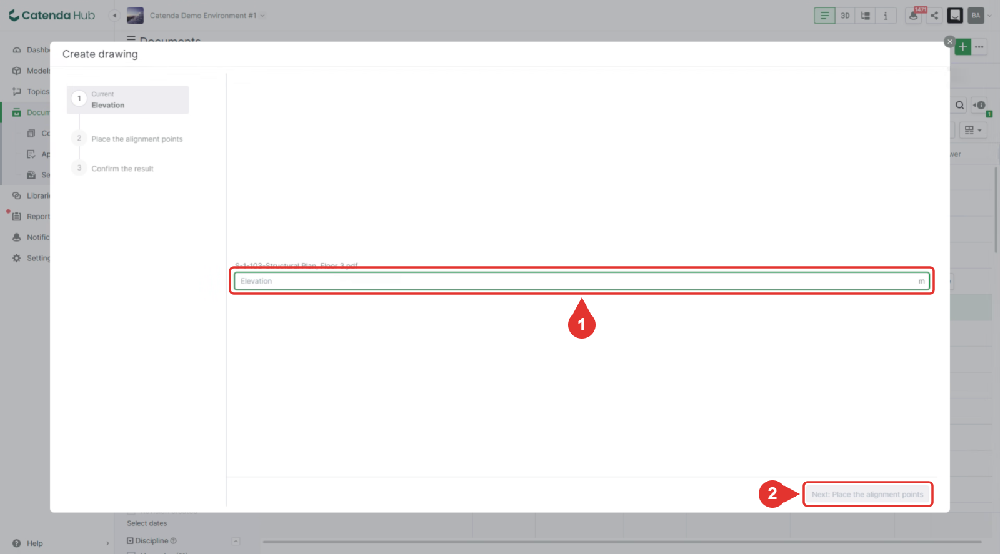

# Dessins 2D dans la visionneuse 3D

> Comment aligner des dessins PDF et les afficher avec les models dans la visionneuse 3D

Les dessins 2D sont un élément essentiel de tout projet de construction. Même s'ils sont souvent générés à partir des models 3D, ils contiennent des détails qui complètent ce que montrent les models. Afficher les dessins 2D dans la visionneuse 3D offre simultanément le contexte bidimensionnel et tridimensionnel. _Accès requis :_ accès en écriture au document PDF pour créer un dessin

[Regardez la vidéo : Dessins 2D dans la visionneuse 3D](https://eu.guidde.com/share/playbooks/jLcBnpr2UYKWMpgP2gK9jv)

## 1. **1. Dessins calibrés et non calibrés**

Accédez aux documents et naviguez jusqu'au fichier PDF contenant le dessin 2D.

### 1.1 **Dessins calibrés**

Les dessins PDF déjà alignés affichent un bouton **3D**. Cliquez dessus pour afficher le dessin dans la visionneuse 3D avec les models.

### 1.2 **Dessins non calibrés**

Les dessins PDF qui n'ont pas encore été alignés doivent d'abord être alignés, comme décrit dans la section suivante.

## 2. **2. Aligner le dessin**

### 2.1 **2.1 Créer un dessin**

1. Sélectionnez le dessin PDF à aligner en cochant sa case (par exemple, le troisième étage des dessins de structure).
1. Ouvrez le [menu d'actions](https://support.catenda.com/fr/articles/4670288-actions-du-tableau-documents) (**…**).
1. Sélectionnez **Créer un dessin**.

### 2.2 **2.2 Choix de l'élévation**

La première étape demande l'élévation sur laquelle le dessin est placé.

- Lorsque l'élévation est connue, saisissez directement la valeur.
- Sinon, sélectionnez une élévation parmi l'un des modèles IFC importés dans le projet.

Cliquez ensuite sur **Suivant : placer les points d'alignement**.

### 2.3 **2.3 Méthodes d'alignement**

Le dessin doit être aligné pour être dans la bonne position. Quatre méthodes d'alignement sont disponibles.

**Configurateur d'étages** Lorsque des éléments sont configurés dans le [configurateur d'étages](https://support.catenda.com/fr/articles/6921756-page-configurateur-d-etage), le dessin est aligné sur la génération 2D à partir des modèles.

**Modèles** Le dessin est aligné sur les modèles eux-mêmes, par exemple le modèle architectural et le modèle structurel à l'étage concerné.

**Coordonnées** Lorsque les coordonnées sont connues, les marqueurs **A** et **B** sont associés à ces coordonnées.

**Copier un alignement existant** Un dessin aligné du même étage peut être réutilisé pour le nouveau dessin. Ajoutez ce document et copiez son alignement, par exemple du troisième étage architectural au troisième étage structurel.

Lors de l'alignement sur des points, tels que les intersections de lignes de trame, placez les marqueurs **A** et **B** sur les deux dessins aux mêmes intersections. Zoomez pour plus de précision. Les marqueurs s'accrochent aux points.

Lorsque le dessin est aligné, cliquez sur **Suivant : confirmer le résultat**.

### 2.4 **2.4 Confirmation de l'alignement**

1. Confirmez le résultat et vérifiez que le dessin est correctement aligné.
1. Cliquez sur **Créer**.

Le dessin peut maintenant être activé dans la Visionneuse 3D.

## 3. **3. Affichage des dessins dans la Visionneuse 3D**

1. Activez le dessin. Il s'affiche automatiquement dans la Visionneuse 3D.
1. Le dessin est également disponible dans le sélecteur. Une élévation incorrecte peut y être modifiée.
1. Ajustez l'**opacité** du dessin selon vos besoins.
1. Activez les modèles pour les afficher avec le dessin, par exemple le modèle architectural et le modèle structurel.

> **Astuce :** Un plan de coupe à la hauteur du dessin coupe les modèles, de sorte que le dessin 2D s'affiche avec les modèles BIM, par exemple le dessin structurel avec le modèle structurel.

Combiner des dessins 2D avec des modèles BIM offre une vue cohérente et contextuelle du projet et favorise la compréhension et la prise de décision à l'échelle de l'ensemble du projet.

## 4. **Pour aller plus loin**

[Visionneuse 3D](https://support.catenda.com/fr/articles/8227211-visionneuse-3d) - [Apparence de la Visionneuse 2D](https://support.catenda.com/fr/articles/13615984-apparence-de-la-visionneuse-2d) - [Configurateur d'étages](https://support.catenda.com/fr/articles/6921756-page-configurateur-d-etage) - [Actions du tableau des documents](https://support.catenda.com/fr/articles/4670288-actions-du-tableau-documents)
