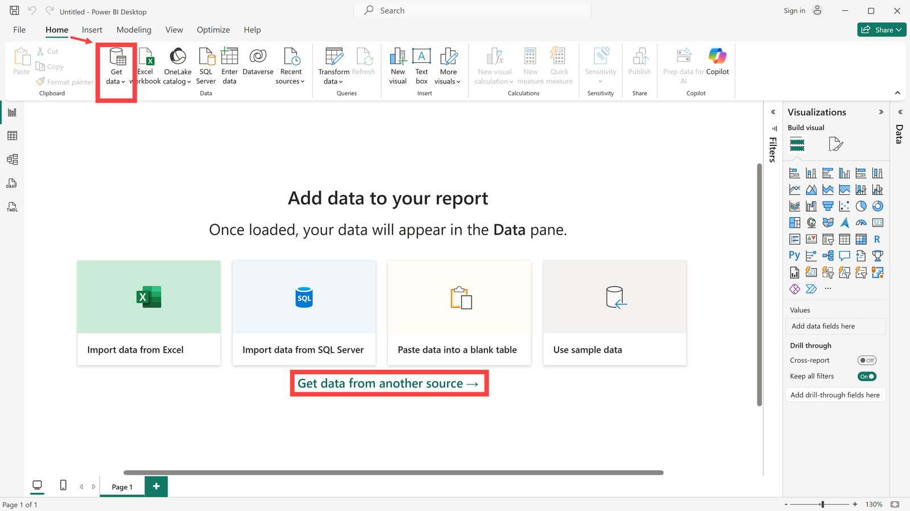
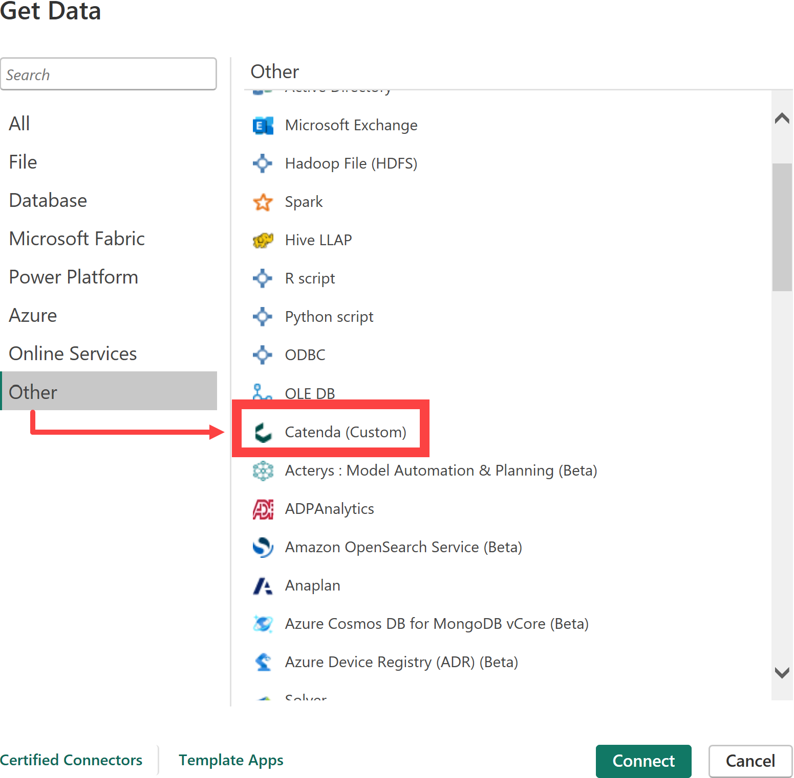
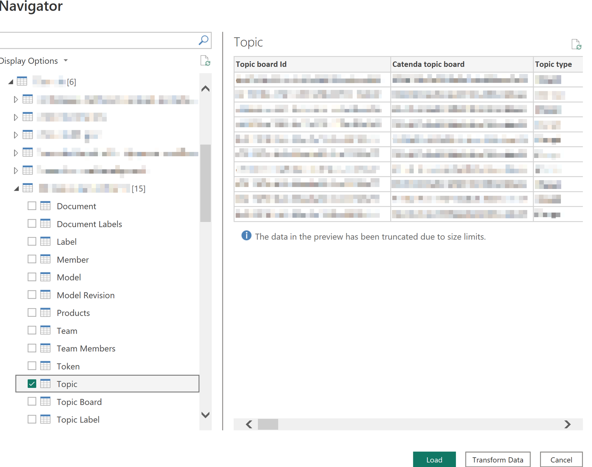
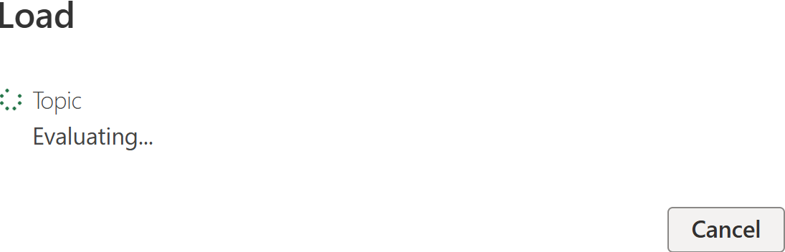
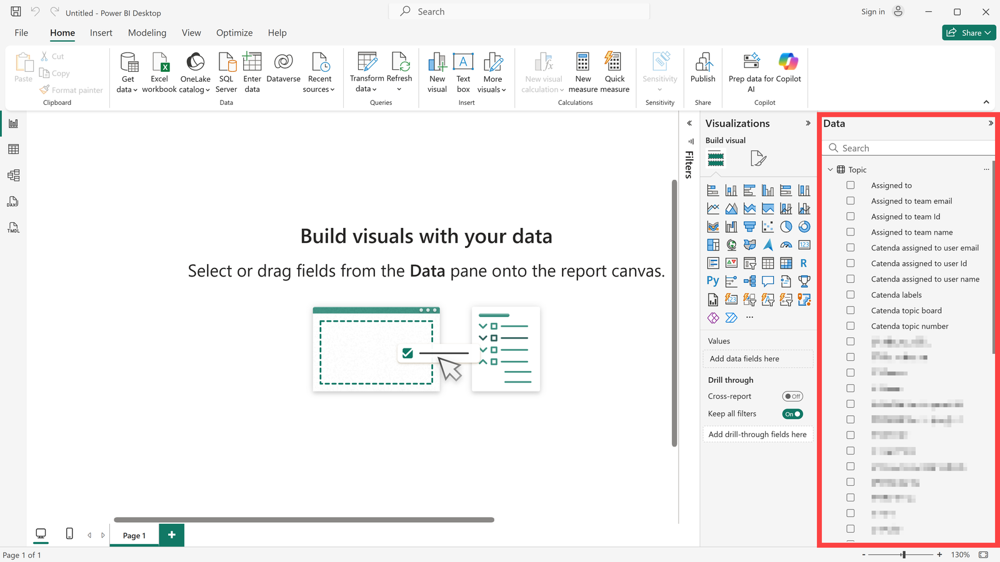
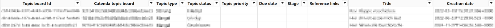
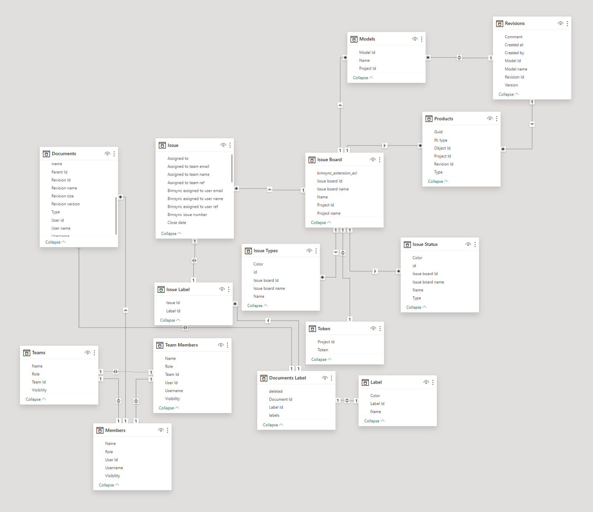

# Connecteur Catenda Power BI

> **Remarque :** Le fichier d'installation de cette application se trouve [ici](https://support.catenda.com/fr/articles/8396532-plugins-et-integrations-catenda)

Dans cet article, nous expliquerons comment la base de données Catenda HUB peut être liée à PowerBI. En établissant un lien, vous pouvez accéder directement aux données de Catenda HUB dans PowerBI. Ces données peuvent ensuite être utilisées pour évaluer les tâches, les Documents ou, par exemple, les Membres.

## 1. **Installation**

Lorsque le Connecteur Catenda Desktop est installé sur Windows, ses fichiers d'installation apparaissent dans le dossier suivant.

`C:\Users\<Username>\Documents\Power BI Desktop\Custom connectors`

### 1.1 **Désinstallation**

Pour désinstaller le plug-in, accédez au dossier d'installation et exécutez le fichier suivant :

`uninstall.exe`

Si le dossier a été supprimé et que le plugin est toujours actif, veuillez réinstaller le plugin et le désinstaller à l'aide du fichier de désinstallation qui a été créé.

## 2. **Obtenir les données et se connecter**

Pour créer une connexion entre PowerBI et la base de données Catenda HUB, procédez comme suit : Ouvrez PowerBI et cliquez sur « Obtenir les données à partir d'une autre source » au centre de l'écran ou utilisez l'action Obtenir les données dans le menu Accueil du ruban supérieur. Le ruban peut devoir être développé pour voir l'action.

Sélectionnez la source cible sous Autre --> Catenda. Utilisez « _Connexion_ » pour établir la connexion à la base de données. La connexion à Catenda et les actions à effectuer en cas d'échec de connexion sont décrites dans [Se connecter à Catenda à partir de Power BI](https://support.catenda.com/fr/articles/17778878-se-connecter-a-catenda-depuis-power-bi).

## 3. **Charger les données**

Un navigateur s'ouvre dans lequel tous les projets auxquels vous avez accès sont répertoriés. Sélectionnez le projet correspondant et la table à lier. Dans notre exemple, nous aimerions évaluer les [Sujets](https://support.catenda.com/fr/articles/4670271-page-sujets) dans PowerBI. Cliquez sur "_Charger_" pour charger l'ensemble de données.

Les tableaux suivants peuvent être chargés :

| Tableau                 | Contenu                                                                |
| ----------------------- | ---------------------------------------------------------------------- |
| Documents               | Les documents du projet.                               |
| Étiquettes de documents | Les étiquettes de chaque document.                     |
| Intitulé du champ       | Les étiquettes utilisées dans le projet.               |
| Membre                  | Les membres du projet.                                 |
| Modèle                  | Les modèles du projet.                                 |
| Révision du modèle      | Les révisions de chaque modèle.                        |
| Produits                | Les objets dans les modèles.                           |
| L'équipe                | Les équipes du projet.                                 |
| Membres de l'équipe     | Les membres de chaque équipe.                          |
| Jeton                   | Un jeton de visionneuse pour le projet.                |
| Sujet                   | Les sujets du projet.                                  |
| Liste de sujets         | Les listes de sujets du projet.                        |
| Étiquette de sujet      | Les étiquettes de chaque sujet.                        |
| Statut du sujet         | Les statuts utilisés sur les listes de sujets.         |
| Type de sujet           | Les types de sujets utilisés sur les listes de sujets. |

Après avoir cliqué sur Charger, le connecteur PowerBI commencera à récupérer les données du sujet à partir de l'API.

Les données sont ensuite affichées sur le côté droit. Sélectionnez le champ de données approprié et créez votre analyse.

> **Remarque :** Chargez différents ensembles de données et liez-les ensemble. Avec cela, vous serez en mesure de créer des tableaux de bord interactifs qui vous donnent un aperçu complet.

Selon les données présentes dans votre projet et les données que vous chargez, différentes relations seront créées automatiquement.

## 4. **Vue tableau**

Voici à quoi les données du sujet peuvent ressembler en vue tableau :

## 5. **Vue modèle**

Voici une carte de ce à quoi les connexions ressemblent en vue modèle lorsque toutes les informations sont présentes dans votre projet et que vous avez chargé toutes les données du projet :

