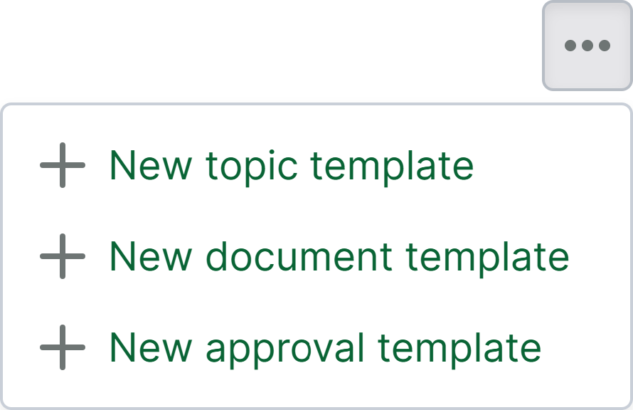
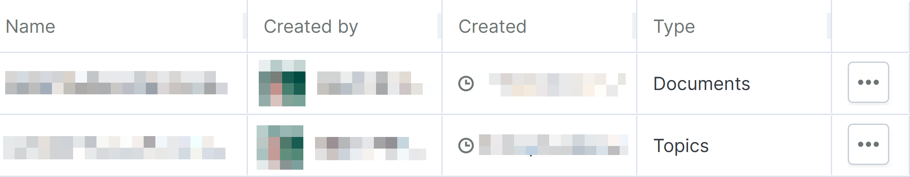
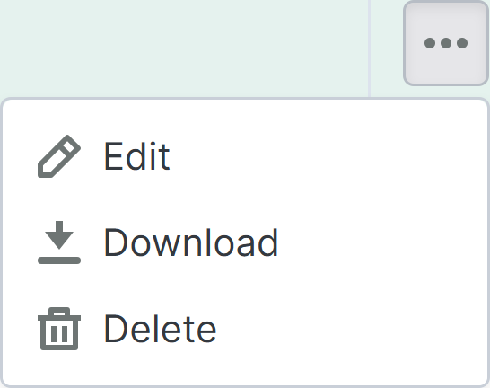

# レポートテンプレートページ

> **注1:** レポートページはオプト‐インの機能であり、進行中のプロジェクトに対して有効にするようリクエストできます。**注2:** この機能が有効になっているテンプレートプロジェクトに基づいて作成された新規プロジェクトには、この機能は有効になっていません。

レポートテンプレートページは、左側のナビゲーションメニューの[レポートページ](https://support.catenda.com/ja/articles/12303098-レポートページ)のサブページにあります。レポートテンプレートページでは、プロジェクトで利用可能なドキュメント、トピック、および承認テンプレートを管理できます。_アクセス権限:_ 管理者

レポートテンプレートページは次のような表示になります：

## 1. **レポートテンプレートページのアクション**

レポートテンプレートページのアクションは、レポートテンプレートページの右上のアクションメニューをクリックして確認できます。レポートテンプレートページのアクションは次のような表示になります：

これらのアクションは、空のページから始まる、まったく新しいテンプレートを作成します。代わりに、既製のレポートテンプレートのいずれかから始めて、プロジェクトに適応させることをお勧めします。[既製のレポートテンプレート](https://support.catenda.com/en/articles/17778911-ready-made-report-templates)からダウンロードできます _(レポートエディタ顧客のみ)_。

### 1.1 **新規トピックテンプレート**

新規トピックテンプレートアクションを使用して、新しいトピックテンプレートを作成します

### 1.2 **新規ドキュメントテンプレート**

新規ドキュメントテンプレートアクションを使用して、新しいドキュメントテンプレートを作成します

### 1.3 **新規承認テンプレート**

新しい承認テンプレートアクションを使用して、承認リクエストに関するレポート用の新しい承認テンプレートを作成します。

## 2. **名前でフィルタ**

検索バーに入力して、レポート名でレポートテンプレートテーブルをフィルタリングします。

テキスト検索 - `search=test`

## 3. **レポートテンプレートテーブル**

レポートテンプレートが作成されると、すぐにレポートテンプレートテーブルの行として表示されます。レポートテンプレートテーブルは次のような表示になります：

[ここ](https://support.catenda.com/ja/articles/11748020-catendaのテーブル)をクリックして、Catendaのテーブルの使用方法をご覧ください。

### 3.1 **行のコンテンツ**

**レポート行**行をクリックして選択し、緑でハイライトすることは可能ですが、行を選択して実行できるアクションはありません。右列の行アクションメニューを選択すると、行が選択されます。

### 3.2 **列**

設定された列の順序に基づいて、最初の列が表示されます。テーブルを横にスクロールして、有効な他の列を表示する必要がある場合があります。レポートテンプレートページの列のデフォルトの順序と可視性の設定は次の通りです：

名前 - _デフォルト_ レポートテンプレートの名前

_作成者_ - _デフォルト_ レポートテンプレートの作成者

作成 - _デフォルト_ トピックテンプレートが作成された時間と日付

タイプ - デフォルト レポートテンプレートのタイプ：ドキュメント、トピック、または承認。

アクションメニュー - デフォルト アクションメニュー列のアクションメニューをクリックして、行アクションメニューを開きます。レポートテンプレートの行アクションメニューは次のような表示になります：

編集 編集アクションを使用して、選択したレポートテンプレートを編集します。

ダウンロード ダウンロードアクションを使用して、選択したレポートテンプレートを`.mrt`ファイル形式でダウンロードします。これは、他のプロジェクトで再度インポートできます。

削除 削除アクションを使用して、選択したレポートテンプレートを削除します。
