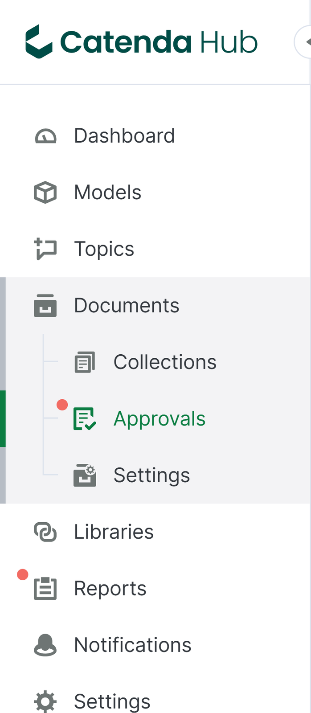
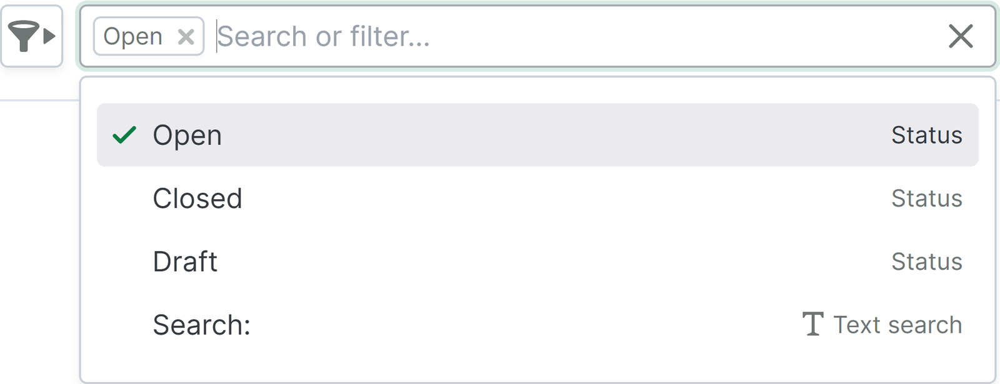
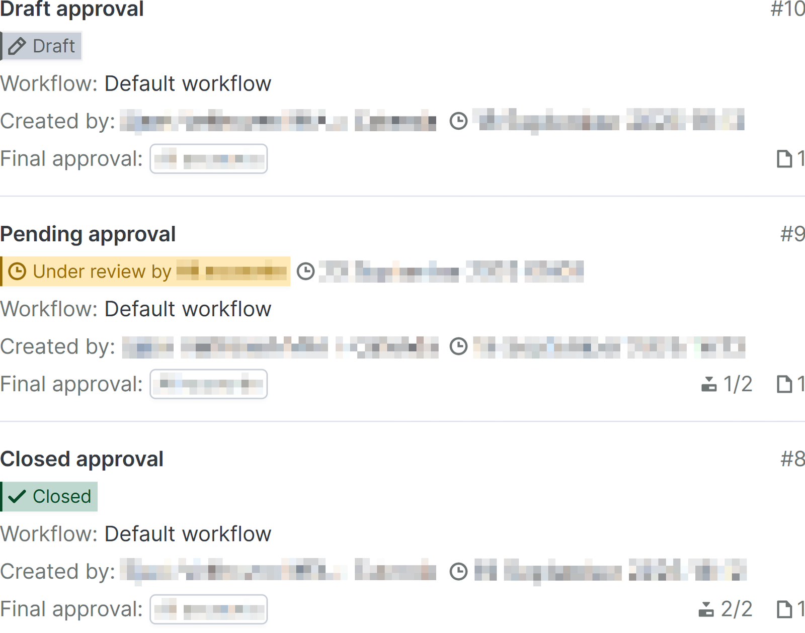
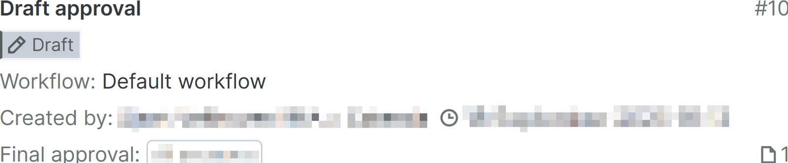
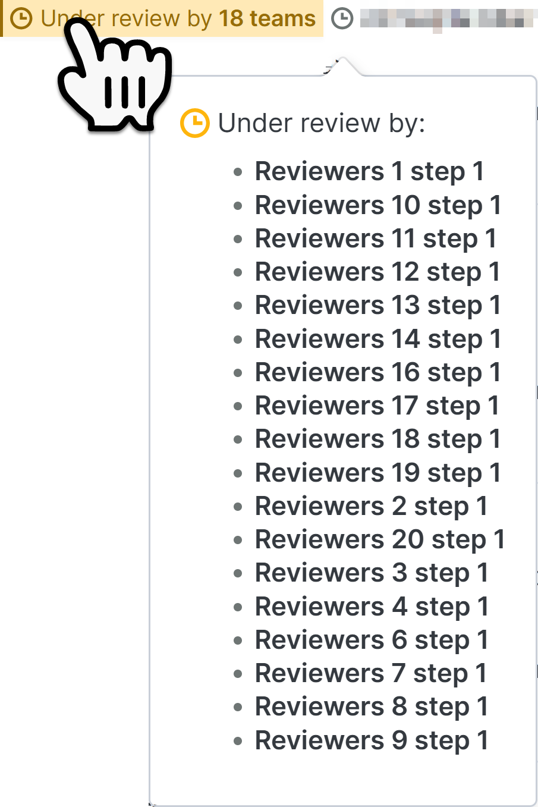
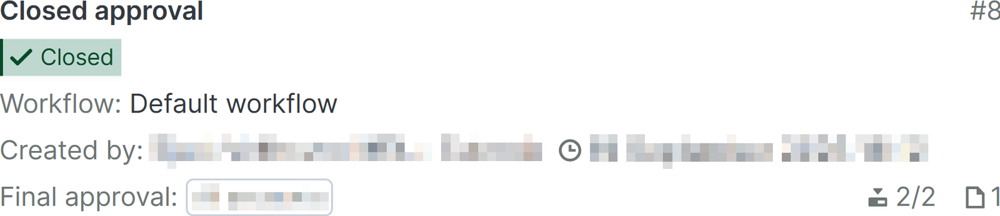

# 承認ページ

承認ページは、左ナビゲーションメニューの[ドキュメントページ](https://support.catenda.com/ja/articles/8204673-ドキュメントページ)のサブページとして表示されます。承認ページはデフォルトで非表示で、2025年10月2日以降に共有リビジョンを有効にしたプロジェクトの[ドキュメント設定](https://support.catenda.com/ja/articles/7831371-ドキュメント設定ページ)でステータスワークフローが有効になると表示されます。ここでは、プロジェクト内の承認リクエストの概要を確認できます。

この記事には、次のトピックに関する情報が含まれています:

_[検索またはフィルター](https://support.catenda.com/ja/articles/12495047-承認ページ#h_95652579ee) - [承認リスト](https://support.catenda.com/ja/articles/12495047-承認ページ#h_aa4dfe69f5) - [行の内容](https://support.catenda.com/ja/articles/12495047-承認ページ#h_76de8831a3) - [承認リクエストカード](https://support.catenda.com/ja/articles/12495047-承認ページ#h_e99a80135a)_

2025年10月2日より前に共有リビジョンが有効になったプロジェクトでは、代わりに[レガシー承認ページ](https://support.catenda.com/ja/articles/8349340-承認ページ-レガシー)が表示されます。承認ページでは、以下の操作が可能です:

- 各承認リクエストは、最終確認者がリビジョンを承認するかどうかを決定する前に、チームによってレビューおよび検証できます。
- 承認のプロセスと結果の設定を行うことができます。
- 新しい承認を作成できます。

## 1. **検索またはフィルターオプション**

[ここ](https://support.catenda.com/ja/articles/12495060-承認ページでのフィルタリング)をクリックして、承認ページのフィルタリングの詳細をご覧ください。

## 2. **承認リスト**

テンプレートプロジェクトに基づいて作成されたプロジェクトには、そのテンプレートプロジェクトの承認ワークフローとトピックテンプレートが含まれています。承認リスト内の各行には、各承認リクエストの内容に関する視覚的な手がかりを含む承認カードが含まれています。

完全なアクティビティを持つ承認リクエストはこのようなものです:

承認内で発生したアクティビティは、承認カード上の数量とアイコンで表示されます。

**必要なアクセス:** 送信者、レビュアー、最終レビューチーム、または管理者のメンバー。

## 3. **行の内容**

### 3.1 **オープンまたはクローズされた承認行**

レビュー中またはクローズされた承認リクエスト行の内容を開くと、その承認の[承認ページ](https://support.catenda.com/ja/articles/12494960-オープンまたはクローズされた承認依頼ページ)が開きます。

### 3.2 **ドラフト承認行**

ドラフト承認の場合、代わりに[ドラフト承認リクエストページ](https://support.catenda.com/ja/articles/12495175-ドラフト承認依頼ページ)が開きます。

## 4. **承認リクエストカード**

### 4.1 **タイトル**

承認タイトル

### 4.2 **ドラフトステータス**

承認リクエストがドラフトステータスを持つ場合、承認ページでドラフトを作成した人にのみ表示されます。

承認リクエストはリビジョンの右メニューの承認メニューに表示されません。

### 4.3 **オープン承認ステータス**

承認リクエストがオープンステータスを持つ場合、リクエストに関わるチームの一部であるすべてのメンバーに表示されます。複数のチームによってレビュー中の承認のステータスにカーソルを合わせると、現在のレビューステップで確認をまだ提出していないチームを示すポップアップが開きます。

既にレビューを提出したレビュアーチームはこのリストに表示されず、承認ステップが現在レビュー中のチーム数にカウントされません。

オープン承認ステータスの右側には、承認ステップをレビューする必要がある日時が表示されます。このステップに対して自動承認が設定されている場合、承認は自動的にこの日時に次のステップに進みます。

### 4.4 **クローズドステータス**

承認リクエストが最終承認ステップに達すると、オープンのままです。各承認ステップで各チームによって与えられた承認と却下に基づいて、最終承認チームのメンバーは最終的な承認または却下を行うことができます。最終承認チームメンバーによって承認リクエストが最終的に承認または却下されると、クローズされます。

### 4.5 **ワークフロー**

承認によって従うワークフロー

### 4.6 **作成者**

ドラフトを作成したメンバーと、それが作成された日時。

### 4.7 **最終承認**

各承認ステップで送信者チームによって提出されたレビューによって知らされた、共有ドキュメントの発行に関して最終的な発言権を持つ最終承認チーム。

### 4.8 **承認番号**

承認の番号

### 4.9 **下部のアイコン**

承認が従うワークフローの現在のレビューステップ。承認が完成する前に完了する必要があるステップの総数。オープンおよびクローズされた承認にのみ表示されます。アクセス設定に関係なく、承認内のドキュメントの数。
