# ドキュメント テーブル アクション

アクセス権とドキュメント・フォルダの選択によって、[ドキュメント ページ](https://support.catenda.com/ja/articles/8204673-ドキュメントページ)で異なるアクションが表示されます。

## 1. **新規アイテム アクション**

プラス ボタンとハンバーガー メニュー アイテムはページの右上に表示され、次のようになります：

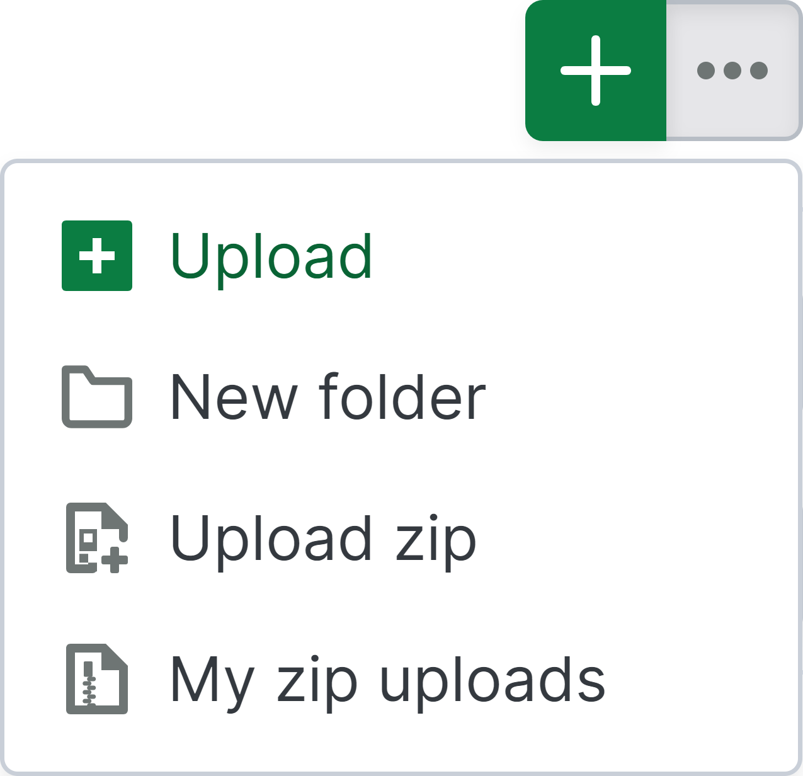

ここで見つけることができるアクションはすべて新しい情報の作成に関するものです。ページ上の既存のアイテムに関する[選択アイテム アクション](#h_fb4e9ef375)も、選択後のリストの上部に表示されます。

### 1.1 **アップロード**

プラス ボタンとアップロード アクションの両方は、アップロード「ドキュメント メニューをアップロード」ダイアログを開きます。アップロード ダイアログの動作を確認するには、[ここ](https://support.catenda.com/ja/articles/4670278-ドキュメントをアップロード#h_00fa77db3e)をクリックしてください。_必要なアクセス：_ 現在のフォルダまたはフォルダ内のドキュメント(s) もしくはフォルダ(s) への書き込みアクセス。[読み取り専用アクセスでドラフト リビジョンをアップロード](https://support.catenda.com/ja/articles/4670273-プロジェクト設定ページ#h_f82a1850f3)へのアクセスはプロジェクト設定でも付与できます。

### 1.2 **新規フォルダ**

現在のドキュメント位置に新規フォルダを作成するには、新規フォルダ アクション ボタンを使用します。開くことができる新規フォルダ ダイアログは次のようになります：

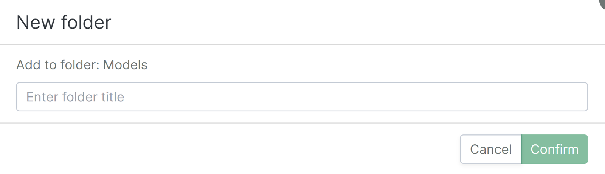

ドキュメント構造を作成している、または一度に多くのフォルダを作成する必要がある場合、新規フォルダ ボタンを何度もクリックするのは面倒です。一度に多くのフォルダを作成するには、フォルダを外部で準備し、Zip アップロード アクションで一度にすべてをアップロードするのに役立ちます。_必要なアクセス:_ 現在のフォルダへの書き込みアクセス

> **注意:** フォルダ名には次の文字を含めることができません: `< > : " / \ | ? *` 新しい名前にこれらの文字のいずれかが含まれている場合、保存できません。

### 1.3 **Zip ファイルをアップロード**

Zip ファイルをアップロード アクションは、ドキュメント構造内に Zip ファイルの内容を抽出させます。アップロード アクション ボタンで Zip ドキュメントをアップロードすることもできますが、その場合は圧縮ファイルとして取得され、Zip ファイルの内容は表示されません。Catenda に Zip ファイルをアップロードする方法についてもっと詳しく知るには、[ここ](https://support.catenda.com/ja/articles/7945410-zipファイル-ファイル構造をアップロード#h_54ace27f24)をクリックしてください。

**必要なアクセス:**現在のフォルダへの書き込みアクセス。新しいドラフト オプションを作成する場合は、Zip 相対的にアップロードする場所から Zip 内のフォルダと同じ名前および構造位置のフォルダへの書き込みアクセス。リビジョンを追加する可能性があるドキュメントへの書き込みアクセス。

### 1.4 **Zip アップロード履歴**

Zip アップロード履歴 アクションは、以前の Zip アップロードの概要を確認できます

## 2. **選択アイテム アクション**

1 つ以上のドキュメント(s) を選択した後、ドキュメント テーブルの上部に次のアクション メニューが表示されます。既存のアイテム アクション メニューは次のようになります：

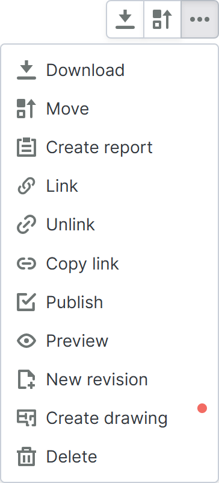

### 2.1 **ダウンロード**

ダウンロード アクションで、選択したアイテムとその内容は、上部のダウンロード アイコンをクリックするか、アクション メニューを開いてドロップダウン メニューのダウンロード アクションをクリックしてダウンロードできます。

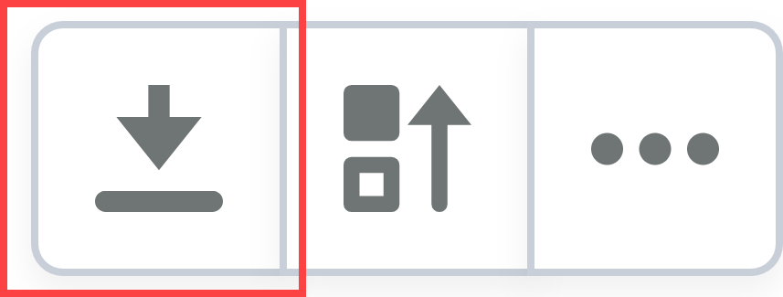

ドキュメント行を一つ選択すると、そのドキュメントを一つ受け取ります。フォルダー行または複数の行を選択すると、選択内容を含むzipファイルを受け取ります。ダウンロードされるファイル名は、[ドキュメントのダウンロードタイトルオプション](https://support.catenda.com/ja/articles/8224886-組織オプション#h_5564d6602f)の影響を受ける場合があります。このオプションはプロジェクトオーナーが組織全体に対して設定するため、プロジェクトメンバーが自分で要求または変更することはできません。_必要なアクセス権:_ 選択したドキュメント(s)および/またはフォルダー(s)へのフルアクセス

**ドキュメントの検出**ダウンロード ボタンが押されると、ページの左下に向かってダイアログが開きます。最初に、システムはダウンロード内の別のファイルを検出し始めます。準備中のダウンロード ダイアログは次のようになります：

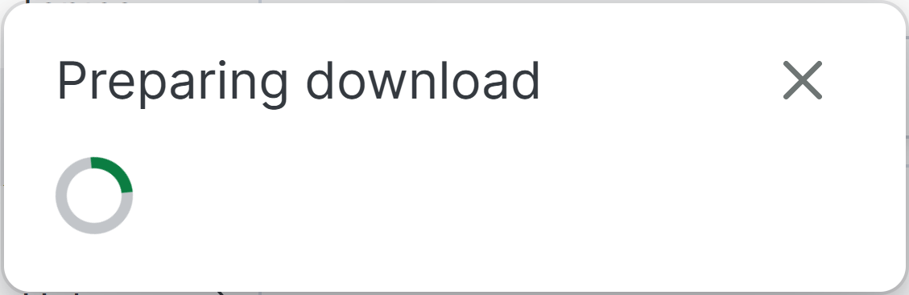

この時点で Catenda の別のページに移動するのは安全です。ダウンロードの準備ができるとすぐに、ファイルがローカル システムへのダウンロードを開始します。複数のダウンロードが同時に開始される場合、同じダイアログに追加されます。システムを完全にシャットダウンして、ダウンロードの準備ができた後に戻るのも安全です。ダウンロードが準備できたときに作成される通知から、準備されたドキュメントをダウンロードするのは常に可能です。

_ファイルの圧縮_ ファイルの総数が検出されるとすぐに、ダイアログにリストされたファイルの数が表示されます。ドラフト リビジョンまたは撤回されたリビジョンはこの数に含まれていません。Catenda はファイルを一緒に Zip ファイルにまとめ始めます。準備ができるとダウンロードできます：

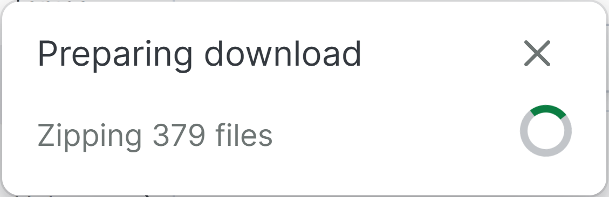

_ダウンロード準備完了_ Zip ファイルの準備が完了すると、システムのファイル ナビゲーターが開きます。ナビゲーターは、Zip ファイルをローカル マシン上のどこかに保存するよう求めます。

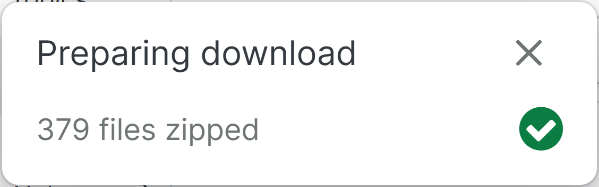

Zip の準備が完了すると、Zip ダウンロードの準備ができたという通知が送信されます。通知内の「ダウンロード(...MB)をクリック」というテキストをクリックしてドキュメントをダウンロードしてください。

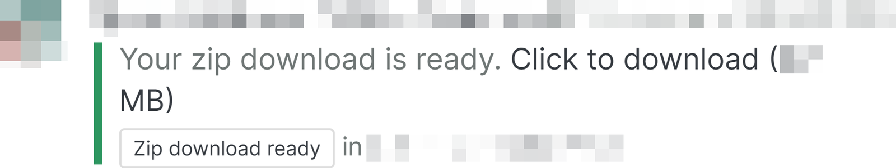

### 2.2 **移動**

移動 アクションで、ドキュメントを別の場所に移動できます。上部の移動 アイコンを押すか、ハンバーガー メニューの移動 アクションをクリックしてください。

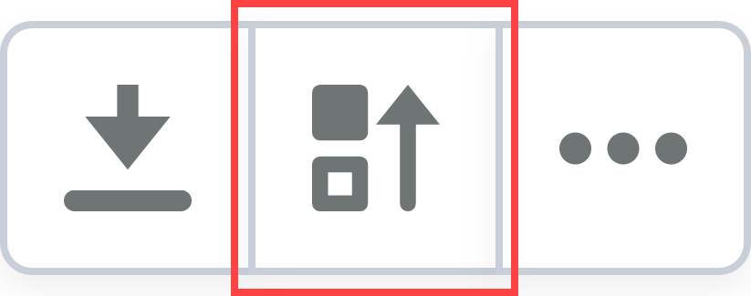

移動 ボタンを押すと、ドキュメント(s) およびまたはフォルダ(s) をどこに移動するかを尋ねるウィンドウが表示されます。_必要なアクセス：_ 選択したドキュメント(s) およびまたはフォルダ(s) へのフル アクセス、および移動先の場所への書き込みアクセス。

### 2.3 **リンク設定と解除**

ドキュメントを選択すると、ダウンロード アイコンの横またはハンバーガー メニューにリンク設定と解除のアイコンが表示されます。3D パネルでモデルのオブジェクトを選択していない場合、これらのオプションはグレーアウトされる可能性があります。

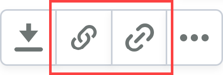

コンテンツ パネルのドキュメント セクションでドキュメント(s) を選択し、3D ビューアでモデル(s) のオブジェクト(s) を選択した後、オブジェクト(s) をドキュメント(s) にリンク設定および解除できます。_必要なアクセス：_ 選択したドキュメント(s) への読み取りまたは書き込みアクセス、および少なくとも 1 つのドキュメント-モデルへの読み取りアクセス

### 2.4 **レポート**

レポートアクションを使用して、選択したドキュメントのレポートを作成できます。このアクションはレポートページが有効になっているプロジェクトでのみ利用可能です。レポートページは、プロジェクト単位で有効にするようにリクエストできます。

[こちら](https://support.catenda.com/ja/articles/13973721-レポート作成アクション)をクリックすると、レポート機能の詳細を確認できます _(レポートエディターをご利用のお客様向け)_。_必要なアクセス権:_ ドキュメントへの読み取りアクセス

### 2.5 **公開**

[revisionの公開](https://support.catenda.com/ja/articles/9874698-新しいステータスワークフロー-iso-19650)を有効にすると、モデルページの上部に「ワークスペース」タブと「公開済み」タブが表示されます。

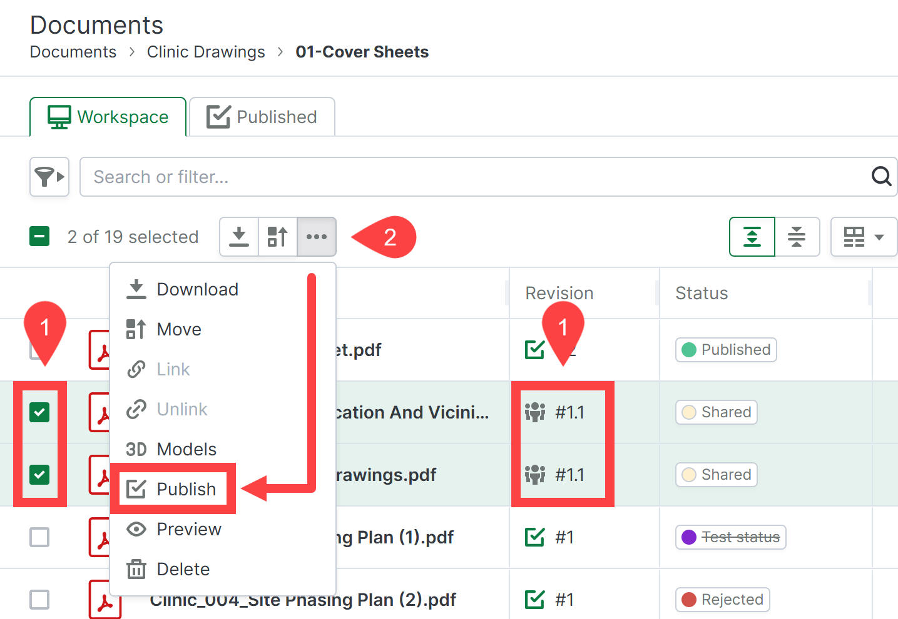

ワークスペースタブでは共有revisionを確認できます。共有revisionは、revision列のアイコンと、マイナーrevision番号(0.1、0.2、1.1 などのような番号)によって、公開済みrevisionと区別できます。_必要なアクセス権:_ document-modelのアクセス設定で共有revisionを表示。ステータスワークフローを有効にすると、ドキュメント内の新しいrevisionはすべて共有revisionとして開始され、公開することができます。最新のrevisionが共有revisionであるドキュメントを一つ以上選択すると、アクションメニューに公開アクションが表示されます。_必要なアクセス権:_ ドキュメントのアクセス設定で「公開可能」。公開アクションを使用すると、最新の共有revisionを公開できます。以前の共有revisionを公開したい場合は、[revisionプレビュー](https://support.catenda.com/ja/articles/9323521-ドキュメント-revision-アクション)から公開できます。

### 2.6 **プレビュー**

選択したドキュメント(s) をプレビューするには、ハンバーガー メニューのプレビュー アクション ボタンをクリックするか、ドキュメント リスト内のドキュメントのアイコンをクリックします。プレビュー ダイアログが表示され、各ドキュメントのページを開く必要がなく、異なるドキュメントを簡単にプレビューできます。複数の画像をプレビューしようとしている場合に特に便利ですが、プレビューを固定して開いたままにできるため、2 つのドキュメントを横に並べて表示する必要がある場合にも役立ちます。_必要なアクセス：_ 読み取りアクセス

> **注:** フォルダーと下書きドキュメントはプレビューダイアログでプレビューできません。下書きドキュメントは、[ドキュメントページ](https://support.catenda.com/ja/articles/8461918-ドキュメントバナー-ナビゲーション)でプレビューできます。

### 2.7 **3D モデル**

ドキュメントを 3D ビューアに読み込める場合、3D アクション ボタンをクリックして、選択したドキュメント-モデルおよびまたはポイント クラウドを 3D ビューアに読み込むことができます。このアクションは、モデル セクションのモデルにリンクされている IFC（IFC および IFCZip）、ポイント クラウド（Las および e57）およびまたは Gml ドキュメントを選択している場合にのみ利用可能です。3D ビューアのモデルにリンクされていない IFC ドキュメントのプレビューを読み込むこともできますが、ドキュメント内のリビジョン ドロップダウンから読み込む必要があります。_必要なアクセス：_ IFC、IFCZip、Las、E57 またはGML ドキュメントへの読み取りアクセス

### 2.8 **新規リビジョン**

1 つのドキュメントを選択している場合、ハンバーガー メニューの新規リビジョン アクションをクリックして新しいリビジョンをアップロードできます。これにより、ファイル エクスプローラーが開き、アップロードするファイルを選択できます。このようにファイルをアップロードすると、新しいドキュメントではなく新しいリビジョンが作成されます。アクション ボタンでは一度に 1 つのドキュメントに新しいリビジョンをアップロードのみ可能です。複数のドキュメントに複数のリビジョンをアップロードする場合は、アップロード アクション ボタンで実行できます。_必要なアクセス：_ 選択したドキュメントへの書き込みアクセス

### 2.9 **モデルの作成と削除**

**モデルの作成**拡張子が`.ifc`または`.ifczip`の選択したドキュメントは、「モデルの作成」アクションを使用して、モデルセクションのmodelにモデルリンクできます。ドキュメントに対して初めてモデルリンクを作成すると、モデルページに表示されるmodelの名前は、作成元のドキュメントと同じ名前になります。モデルページのmodel名とドキュメント名は、後から変更できます。以前にモデルリンクを設定したことがあるドキュメントは、削除されたmodelの以前の名前を記憶しており、現在のドキュメント名が異なっていても、新しいモデルリンクを作成する際にその以前の名前を適用します。_必要なアクセス権:_ プロジェクト設定の[モデルの作成と削除](https://support.catenda.com/ja/articles/4670273-プロジェクト設定ページ#h_f82a1850f3)への書き込みアクセス

**モデルの削除**モデルにリンクされているドキュメントのリンクは、モデル削除 アクションで削除できます。

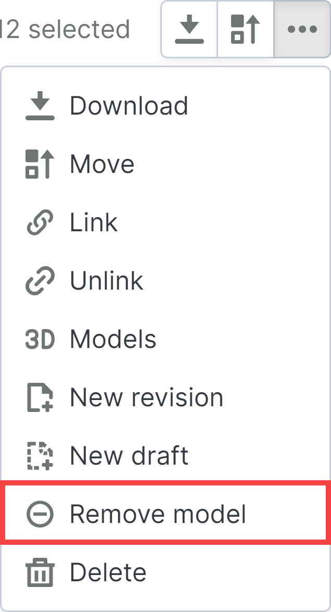

モデルリンクを削除すると、modelはモデルセクションから消えますが、ドキュメントはドキュメントセクションに残ります。同じドキュメントから後で再度モデルリンクを作成することもできます。_必要なアクセス権:_ プロジェクト設定の[モデルの作成と削除](https://support.catenda.com/ja/articles/4670273-プロジェクト設定ページ#h_f82a1850f3)への書き込みアクセス

### 2.10 **図面を配置**

選択したPDFドキュメントを、modelとともに3Dビューアに表示される図面に変換できます。図面を配置するアクションでは、まず図面の標高を指定するよう求められます。その後、図面は**A**と**B**のマーカーを使用して、階設定ツール、model、既知の座標、または同じ階の既存の図面に対して位置合わせされます。図面を作成すると、PDFに**3D**ボタンが表示され、クリックすると3Dビューアで開きます。手順については[3Dビューアでの2D図面](https://support.catenda.com/ja/articles/18552923-3dビューアの2d図面)を参照してください。_必要なアクセス権:_ 選択したドキュメントへの書き込みアクセス

### 2.11 **リンクをコピー**

リンクをコピーアクションを使用すると、選択したテーブルの行のみを表示するリンクをコピーできます。リンクのコピーについて詳しくは[こちら](https://support.catenda.com/ja/articles/14323982-リンクコピーアクション)をクリックしてください。

### 2.12 **削除と復元**

選択したアイテムで削除 アクションを使用してそれを削除します。アイテムの削除を確認するよう求めるウィンドウが表示されます。_必要なアクセス：_ 選択したドキュメント(s) へのフル アクセス 選択したフォルダ(s) およびその内容へのフル アクセス 削除されたアイテムは復元できます。削除をフィルターして、アイテムを選択し、復元 アクションを使用します。_必要なアクセス：_ 管理者

**トピック関連**トピックにリンクされていた削除されたドキュメントは、トピックの関連ドキュメント エリアで疑問符として表示されます。復元されたドキュメントは再度トピックに表示されます。

_モデル リンク_ モデルにリンクされていた削除されたドキュメントは削除時にリンク解除されます。復元されたドキュメントはそのため、モデルにリンクされなくなります。モデル作成 アクションを再度使用して、それをモデルに再度接続します。モデル名やプロセッシングなどの以前のモデル設定は保存されるため、再度設定する必要はありません。

**ストーリー構成ツール**ストーリー構成ツールでストーリーのアンダーレイとして構成されていた削除されたドキュメントは、プロジェクト メンバーの 2D ビューから消えます。ストーリー構成ツールでストーリーのアンダーレイとして構成されていた復元されたドキュメントは、そのストーリーの 2D ビューに再度表示されます。

_オブジェクト関連_ オブジェクトにリンクされていた削除されたドキュメントは削除時にリンク解除されます。復元されたドキュメントはそのため、どのオブジェクトにもリンクされません。

## 3. **現在のフォルダ アクション**

フォルダーを開いていて何も選択していない場合、[右側の情報メニュー](https://support.catenda.com/ja/articles/8302244-リビジョンの右メニュー-リビジョン情報)に、現在のフォルダーのアクションが表示されます。右側の情報メニューが閉じている場合は、右側の矢印をクリックして開く必要があります。これらのアクションは次のように表示される場合があります:

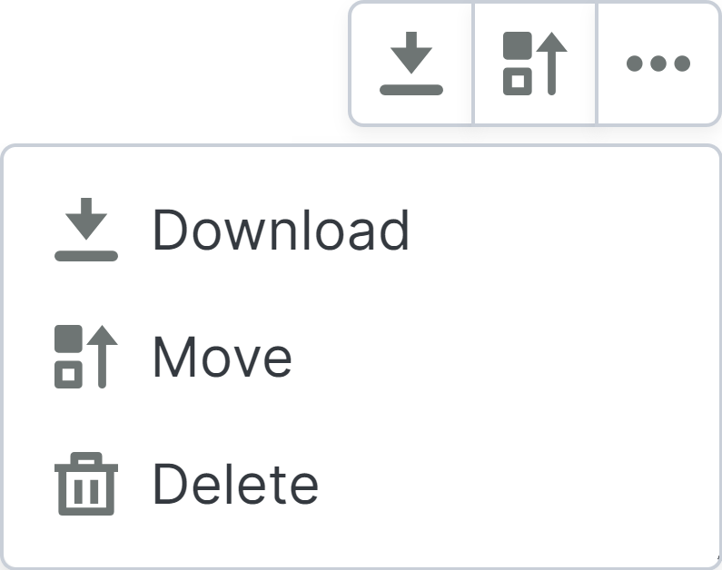

何も選択していないため、ドキュメントテーブルの上部には選択項目のアクションは表示されません。代わりに、[右側の情報メニュー](https://support.catenda.com/ja/articles/8302244-リビジョンの右メニュー-リビジョン情報)にあるアイコンとハンバーガーメニューを使用して、現在のフォルダーに対するアクションを実行できます。

**必要なアクセス:**ダウンロード: 現在のフォルダへの読み取りアクセス。移動: 現在のフォルダへのフル アクセスおよびフォルダを移動する場所への書き込みアクセス。削除: 現在のフォルダおよびその内容へのフル アクセス。
