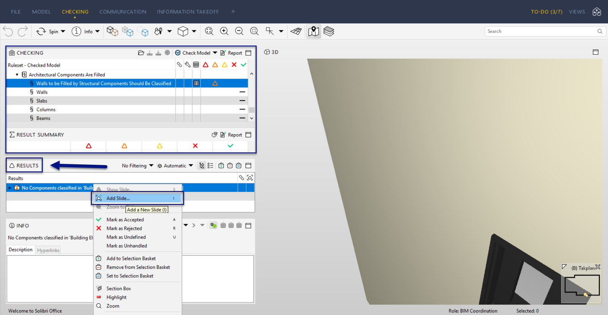
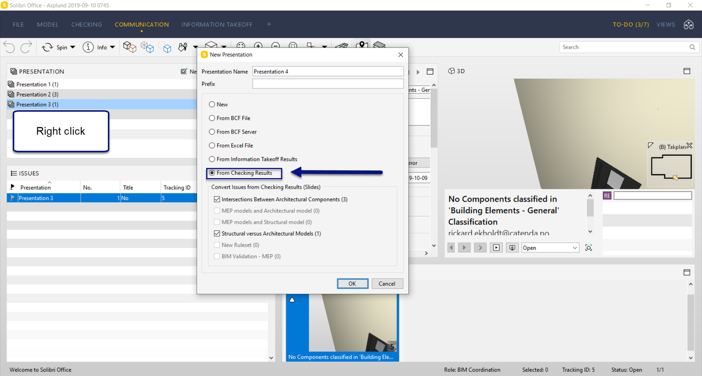
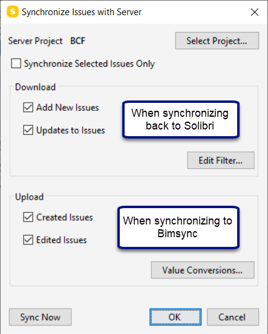
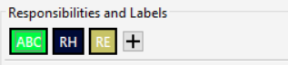
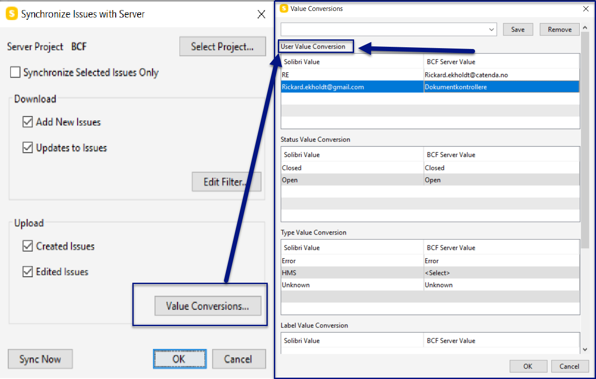

# Catenda Hub - Solibri ワークフロー

これは、Solibri と Catenda Hub 間の BCF サーバーを使用する場合の最適なワークフローを説明するドキュメントです。

1\. Catenda Hubプロジェクトへの接続から始めます。[( こちら )](https://support.catenda.com/ja/articles/4670340-solibri-topics統合) 2\. 接続が完了したら、まずSolibriでclash detectionを実行し、プレゼンテーションを作成します。Solibriでプレゼンテーションを作成する方法は複数ありますが、ここではCatenda Hubとのやり取りに最適なタイプを説明します。A. ルールセットを使ってチェックを実行します。B. プレゼンテーションに追加したいSolibriの問題を見つけます。C. コミュニケーションに移動してプレゼンテーションにスライドを追加する代わりに、チェック結果内の問題を右クリックし、“Add slide”ボタンを押します。この方法では、その問題に含まれるすべてのオブジェクトがCatenda Hubの対応する問題に自動的に含まれ、見つけやすくなります。これに「hide others」と、Catenda Hubで他のオブジェクトを半透明にする操作を組み合わせると、どのオブジェクトがどの問題に含まれているかを常に把握できるため効果的です。この方法でスライドを作成しても、コミュニケーションと同じ問題のレイアウトになり、タイトル、説明、追加の画像、コメントを追加できます。担当者を問題に割り当てる場合も同様です。

D. チェックが完了したら、コミュニケーションに移動して「チェック結果」からプレゼンテーションを作成します。その後、チェック結果で作成したすべての問題が新しいプレゼンテーションに表示されます。これらのスライドを既存のプレゼンテーションに追加する場合は、そのプレゼンテーションを右クリックして「結果からプレゼンテーションを更新」を押すことができます。これにより、結果で作成されたすべてのスライドがそのプレゼンテーションに含まれます。

3\. プレゼンテーションを作成したら、Catenda Hub との同期を開始できます。「プレゼンテーションを同期」を押すと、ポップアップメニューが表示されます。ここで、チェックボックスをオンにして同期方法を決定できます。「値の変換」に移動すると、Catenda Hub プロジェクトの値に一致するように異なる値を設定できます。

4\. 値の変換。例えば、Solibri で問題を直接人に割り当てたのに Catenda Hub で問題が割り当てられない場合、理由は値の変換が正しく設定されていないことです。

問題に設定されたこれらの責任は、Catenda Hub プロジェクトのユーザーに一致するように設定できます。これは次の値の変換で実行されます：

値の変換ボタンは、プレゼンテーションを右クリックして「プレゼンテーションを同期」を押すときに表示されるポップアップメニューに表示されます。これらの問題が Solibri で割り当てられ、Catenda Hub プロジェクトと同期されると、通知がオンになっている場合、割り当てられたユーザーが通知を受け取ります。この方法により、Solibri と同期した後に Catenda Hub で問題を手動で割り当てる必要がありません。
