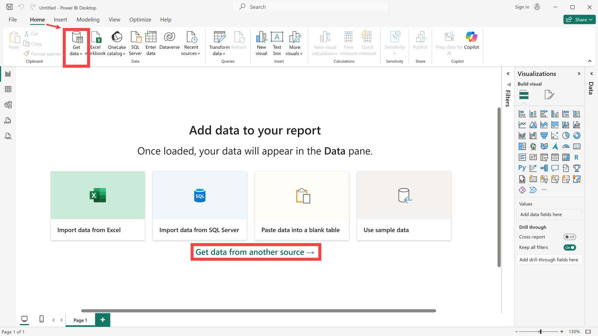
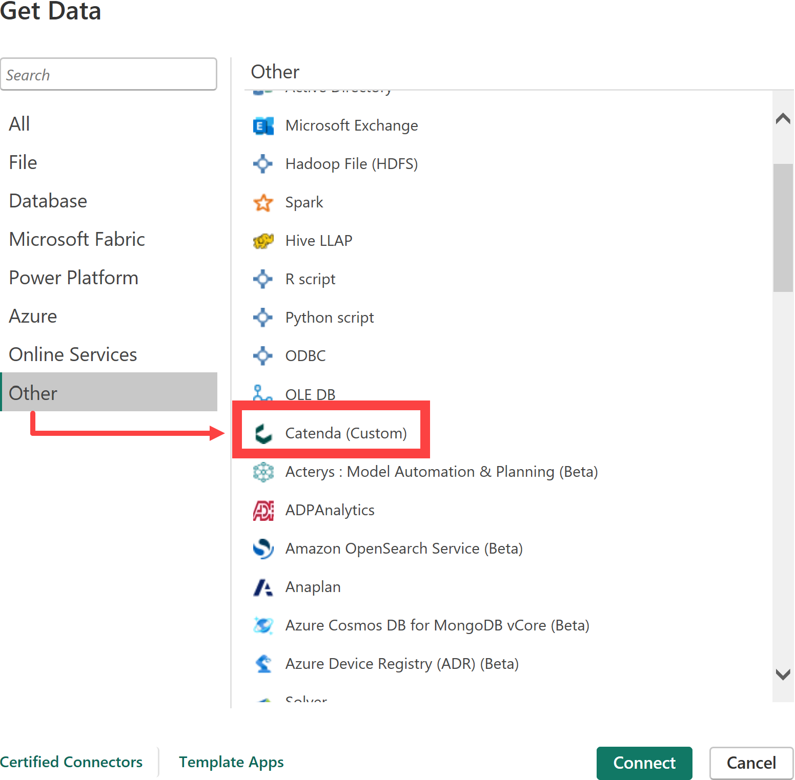
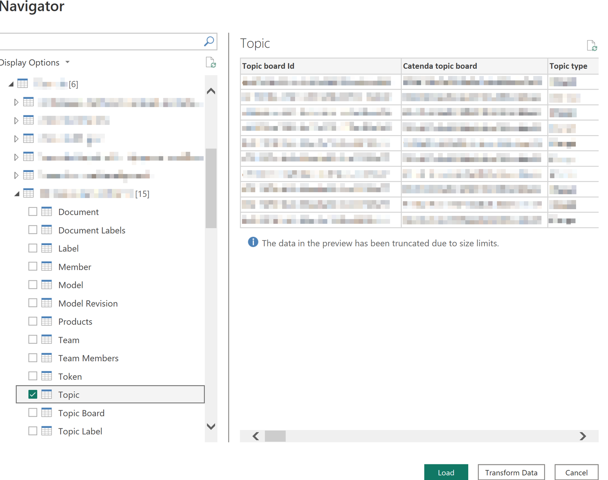
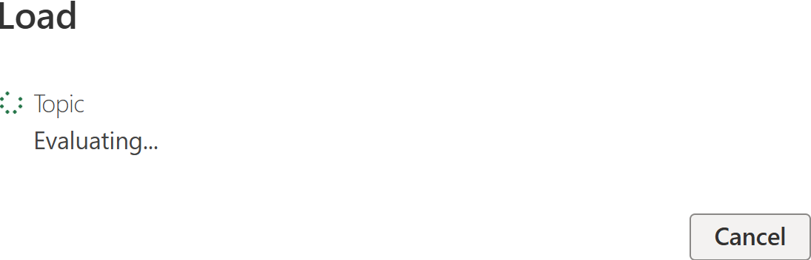
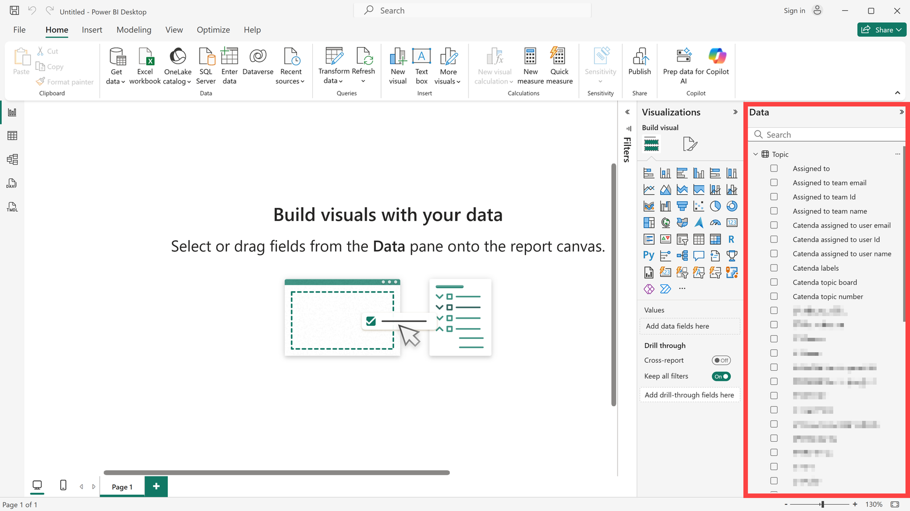
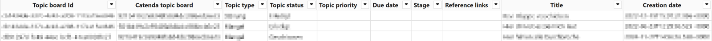
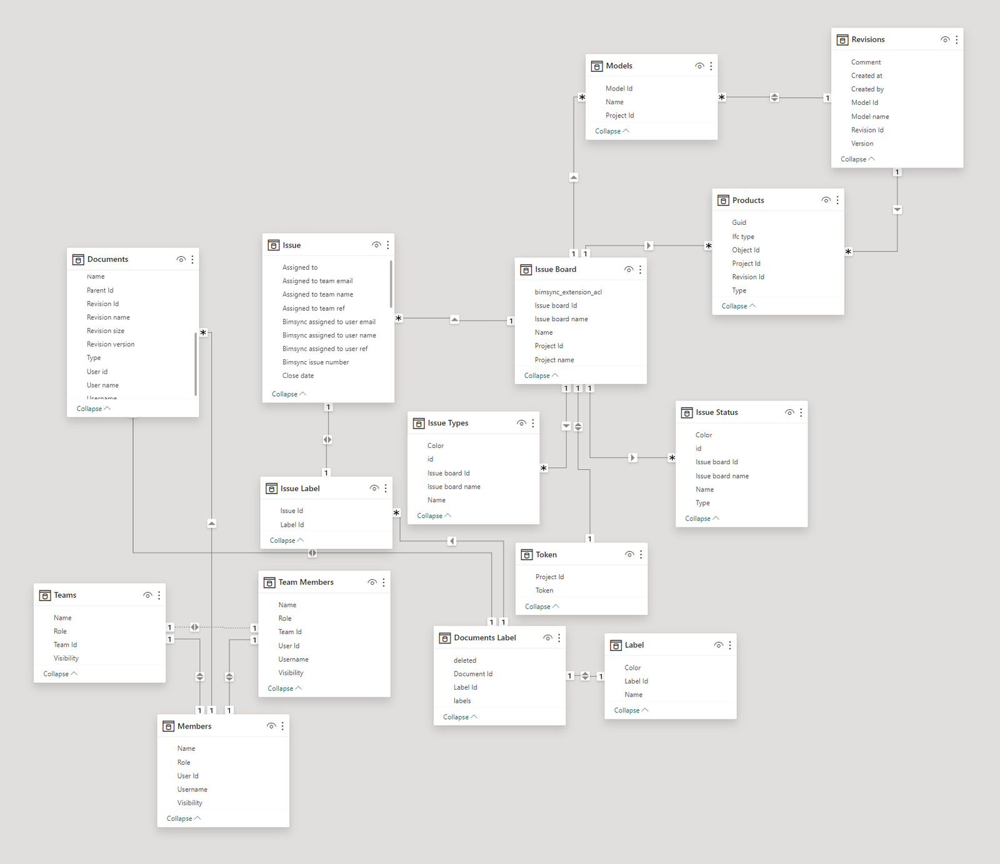

# Catenda Power BI コネクタ

> **注:** このアプリケーションのインストールファイルは[こちら](https://support.catenda.com/ja/articles/8396532-catenda-プラグイン-統合)にあります

この記事では、Catenda HUBデータベースをPowerBIとリンクする方法について説明します。リンクすることで、Catenda HUB上のデータへの直接アクセスをPowerBIで取得できます。このデータは、タスク、ドキュメント、またはメンバーなどを評価するために使用できます。

## 1. **インストール**

Catenda Desktop ConnectorがWindowsにインストールされると、インストールファイルは次のフォルダに表示されます。

`C:\Users\<Username>\Documents\Power BI Desktop\Custom connectors`

### 1.1 **アンインストール**

プラグインをアンインストールするには、インストールフォルダに移動して、次のファイルを実行します:

`uninstall.exe`

フォルダが削除されてプラグインがまだアクティブな場合は、プラグインを再度インストールして、作成されたアンインストールファイルでアンインストールしてください。

## 2. **データを取得して接続**

PowerBIからCatenda HUBデータベースへの接続を作成するには、以下の手順に従います: PowerBIを開き、画面の中央にある「別のソースからデータを取得」をクリックするか、上部リボンのホームメニューの「データを取得」アクションを使用します。アクションを表示するためにリボンを展開する必要がある場合があります。

「その他」の下のターゲットソースを選択し、「Catenda」を選択します。「_接続_」を使用してデータベースへの接続を確立します。Catendaへのサインインおよびサインインが失敗した場合の対処方法については、[Power BIからCatendaにサインイン](https://support.catenda.com/en/articles/17778878-sign-in-to-catenda-from-power-bi)を参照してください。

## 3. **データを読み込む**

アクセス権のあるすべてのプロジェクトが一覧表示されるナビゲータが開きます。対応するプロジェクトとリンクするテーブルを選択します。この例では、PowerBIで[トピック](https://support.catenda.com/ja/articles/4670271-トピックページ)を評価したいと思います。"_読み込む_"をクリックしてデータセットを読み込みます。

以下のテーブルをロードできます:

| テーブル      | コンテンツ                 |
| --------- | --------------------- |
| ドキュメント    | プロジェクト内のドキュメント。       |
| ドキュメントラベル | 各ドキュメント上のラベル。         |
| ラベル       | プロジェクトで使用されるラベル。      |
| メンバー      | プロジェクトのメンバー。          |
| モデル       | プロジェクト内のモデル。          |
| モデルリビジョン  | 各モデルのリビジョン。           |
| プロダクト     | モデル内のオブジェクト。          |
| チーム       | プロジェクト内のチーム。          |
| チームメンバー   | 各チームのメンバー。            |
| トークン      | プロジェクトのビューアトークン。      |
| トピック      | プロジェクト内のトピック。         |
| トピックリスト   | プロジェクト内のトピックリスト。      |
| トピックラベル   | 各トピック上のラベル。           |
| トピックステータス | トピックリストで使用されるステータス。   |
| トピックタイプ   | トピックリストで使用されるトピックタイプ。 |

読み込みをクリックすると、PowerBIコネクタはAPIからトピックデータのフェッチを開始します。

データは右側に表示されます。適切なデータフィールドを選択して、分析を作成します。

> **注:** 異なるデータセットを読み込んでリンクさせます。これにより、完全な概要を提供するインタラクティブなダッシュボードを作成できます。

プロジェクトに存在するデータと読み込むデータに応じて、異なるリレーションが自動的に作成されます。

## 4. **テーブル表示**

トピックデータがテーブル表示でどのように表示されるかの例は次のとおりです：

## 5. **モデル表示**

プロジェクトにすべての情報が存在し、すべてのプロジェクトデータを読み込んだときに、モデル表示で接続がどのように見えるかを示すマップです：

