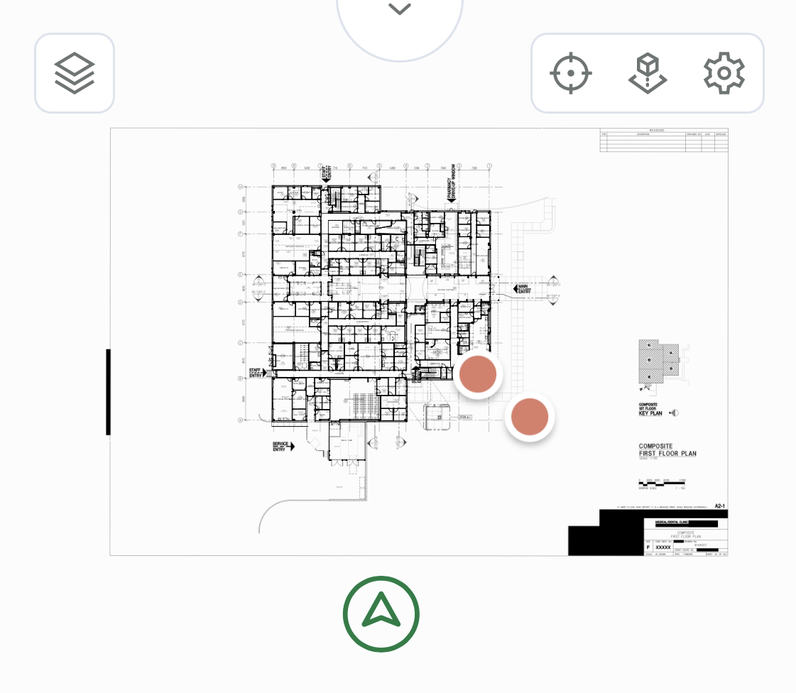
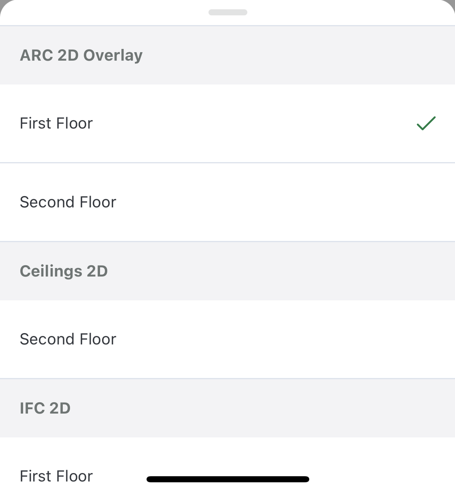
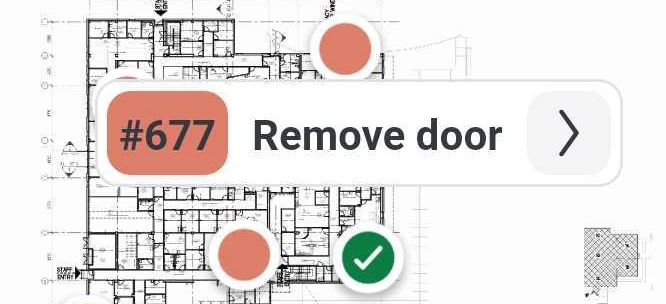
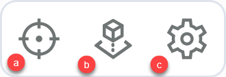
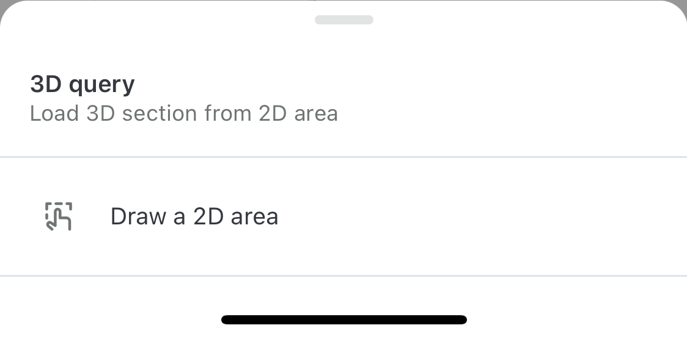
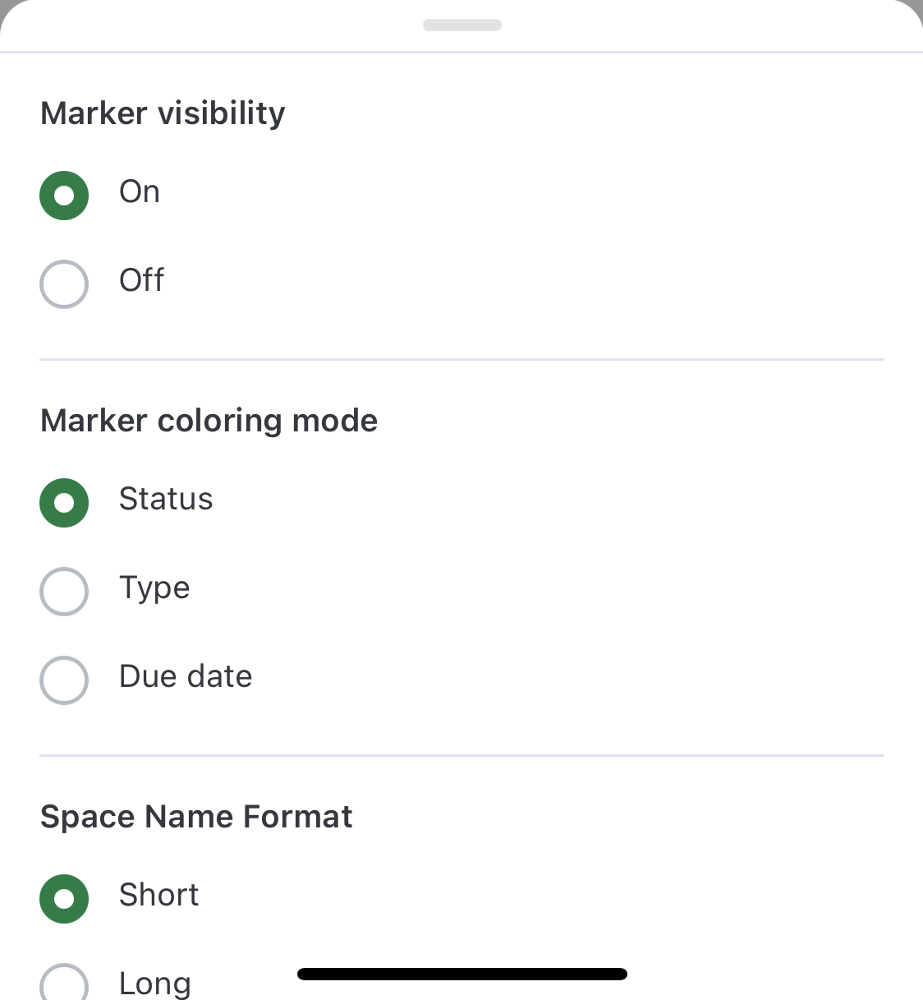

# 2Dビューア - Catenda Site

Catenda SiteのCatenda 2Dビューアは、[2D / 3Dページ](https://support.catenda.com/ja/articles/7734138-2d-3d-catenda-site)で見つけることができます

## 1. **2Dビューア**

CatendaのCatenda 2Dビューアで、プロジェクトで利用可能な階を確認できます。

### 1.1 **床セレクター**

2Dビューアに表示する床を選択します。

プロジェクト内の異なるIFCモデルからの階、およびCatenda Hubの階コンフィギュレータで構成されたビルの階がリストに表示されます。ビルの一部ではない階は、最後のビルの最下階の下に表示されます。

### 1.2 **2Dビューアの外観**

[マーカーが有効](https://support.catenda.com/ja/articles/4854537-2dビューア#h_381a9d4098)な場合、IFCまたは構成されたビルの階に指定された場所を持つトピックが表示されます。マーカーをタップして選択します。これは、Catenda Siteで選択されたマーカーがどのように見えるかを示しています。

選択されたトピック番号とタイトルが表示されます。矢印をタップしてトピックメニューでトピックを開きます。トピックの2D位置の詳細については、[ここ](https://support.catenda.com/ja/articles/4854523-トピックの2d位置)をクリックしてください。

> **警告 1:** トピックメニューが開かれると、結果の最初の 250 個のトピックからのマーカーが更新され、保存されます。2D ビューアが開かれると、トピックメニューの結果と一致する以前に更新されたトピックからのマーカーが表示されます。トピックからのマーカーは、アクティブなストーリー以外のストーリーに分散する可能性があることに注意してください。
> **警告 2:** トピックメニュー結果に 250 以上のトピックがある場合、マーカーが読み込まれていないか、古い可能性があります。リストを下にスクロールして、マーカーを表示/更新してください。ボードをフィルタリングして結果のトピック数を減らすことも、フィルタリングされた結果のトピックに属するマーカーが追加で更新され、表示されることを確認するのに役立ちます。
> **警告 3:** アプリケーションからサインアウトして再度サインインすると、読み込まれたトピックの履歴が失われ、以前に読み込まれたトピックを再度読み込む必要がある場合があります。

### 1.3 **ツールバー**

a. 階の全体を表示 - 概要を取得します b. [3Dクエリ](#h_8a2c752641) - 2Dビューの一部を3Dに読み込みます c. 2Dビューア[設定](#h_63e1728758)

**3Dクエリ** 3Dモデルを読み込む際にエラーが発生した場合、モバイルデバイスが1つまたは複数のmodelからのすべてのデータを処理できないことが原因である可能性があります。

このオプションでは、modelの一部を読み込むことができるため、モバイルデバイスで使用可能なリソースが少ない場合でも表示できます。

**2Dビューア設定** ここで異なる2Dビューアオプションを構成できます

- _マーカーの可視性 -_ マーカーをオンまたはオフにします
- _マーカーの色モード -_ マーカーが持つ色の種類を変更します
- _スペース名形式 -_ ルームはIFCファイルに短い名前または長い名前を持つことができます
