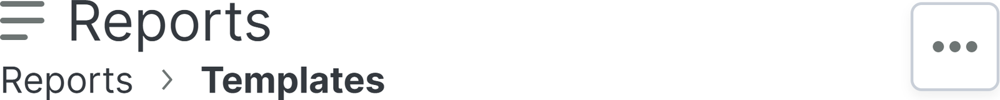
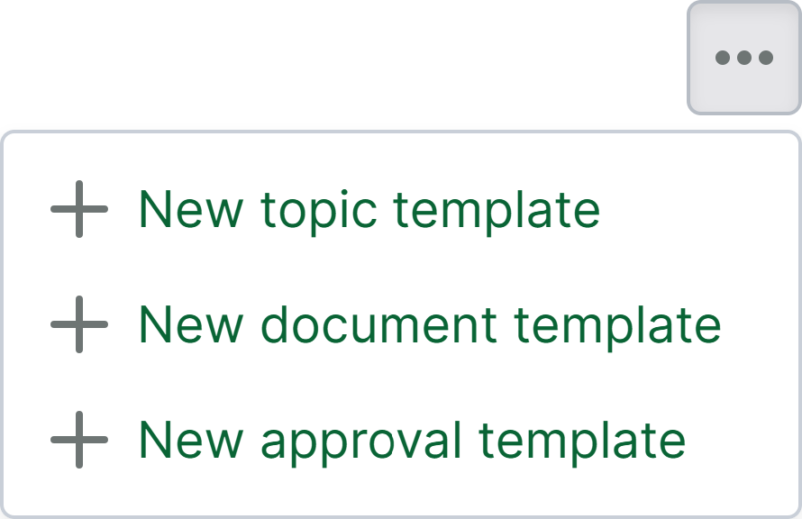
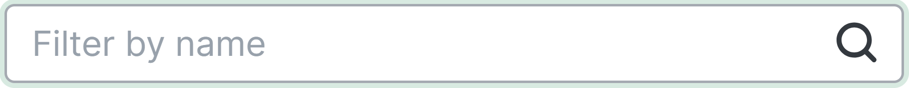
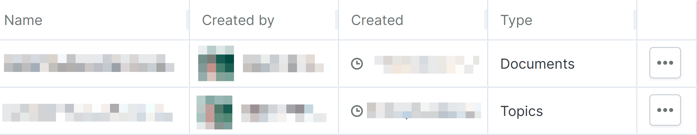
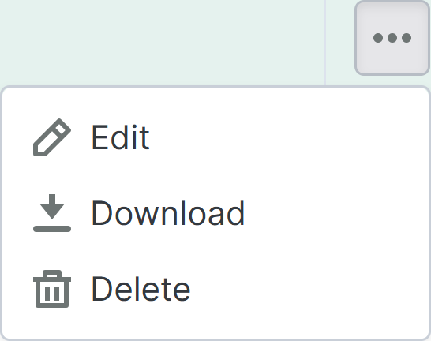

# Rapportmalsider

> **Notat 1:** Rapportsiden er en valgfri funksjon som kan aktiveres for pågående prosjekter. **Notat 2:** Nye prosjekter som opprettes basert på et malprosjekt der denne funksjonen er aktivert, har ikke denne funksjonen aktivert.

Siden for rapportmaler kan finnes som en underside av [rapportsiden](https://support.catenda.com/nb/articles/12303098-rapportsside) i den venstre navigeringsmenyen. På siden for rapportmaler kan dokumenter, saker og gjennomgangsmalene som er tilgjengelige for prosjektet administreres. _Påkrevd tilgang:_ Administrator

Dette er hvordan rapportmalsiden kan se ut:

## 1. **Handlinger på rapportmalsiden**

Handlingene på rapportmalsiden finner du ved å klikke på handlingsmenyen øverst til høyre på rapportmalsiden. Dette er hvordan handlingene på rapportmalsiden kan se ut:

Disse handlingene oppretter en helt ny mal, med utgangspunkt i en tom side. Det anbefales å starte fra en av de ferdige rapportmalene i stedet, og tilpasse den til prosjektet. De kan lastes ned fra [Ferdige rapportmaler](https://support.catenda.com/en/articles/17778911-ready-made-report-templates) _(kun for report editor-kunder)_.

### 1.1 **Ny saksmal**

Bruk handlingen for ny saksmal for å opprette en ny saksmal

### 1.2 **Ny dokumentmal**

Bruk handlingen for ny dokumentmal for å opprette en ny dokumentmal

### 1.3 **Ny mal for gjennomgang**

Bruk handlingen for ny mal for gjennomgang til å opprette en ny mal for gjennomgang for rapporter om gjennomgangsforespørsler.

## 2. **Filtrer på navn**

Skriv i søkelinjen for å filtrere rapportmaltabellen etter navn på rapportene.

Tekstsøk - `search=test`

## 3. **Rapportmalstabell**

Så snart en rapportmal opprettes, vises den som en rad i rapportmaltabellen. Dette er hvordan rapportmaltabellen kan se ut:

Klikk [her](https://support.catenda.com/nb/articles/11748020-tabeller-pa-catenda) for å lese mer om hvordan du arbeider med tabeller i Catenda.

### 3.1 **Radinnhold**

_Rapportrad_ Selv om det er mulig å klikke på en rad for å velge den og markere den med grønn farge, er det ingen handlinger som kan utføres ved å velge en rad. Raden velges når handlingsmenyen i den høyre kolonnen velges.

### 3.2 **Kolonner**

Basert på den konfigurerte kolonneordenen vises de første kolonnene, mens tabellen må rulles sideveis for å vise andre aktiverte kolonner. Standardordenen og synlighetsinnstillingen for kolonnene på rapportmalsiden er som følger:

Navn - _Standard_ Navnet på rapportmalen

_Opprettet av_ - _Standard_ Skaperen av rapportmalen

Opprettet - _Standard_ Tidspunktet og datoen for når saksmalten ble opprettet

Type - Standard Typen på rapportmalen: Dokumenter, Saker eller Gjennomganger.

Handlingsmeny - Standard Klikk på handlingsmenyen i handlingsmenyvkolonnen for å åpne radhandlingsmenyen. Dette er hvordan radhandlingsmenyen for rapportmal kan se ut:

Rediger Bruk rediger-handlingen for å redigere den valgte rapportmalen.

Last ned Bruk last ned-handlingen for å laste ned den valgte rapportmalen med `.mrt` filformat som kan importeres igjen i et hvilket som helst annet prosjekt.

Slett Bruk slett-handlingen for å slette den valgte rapportmalen.
