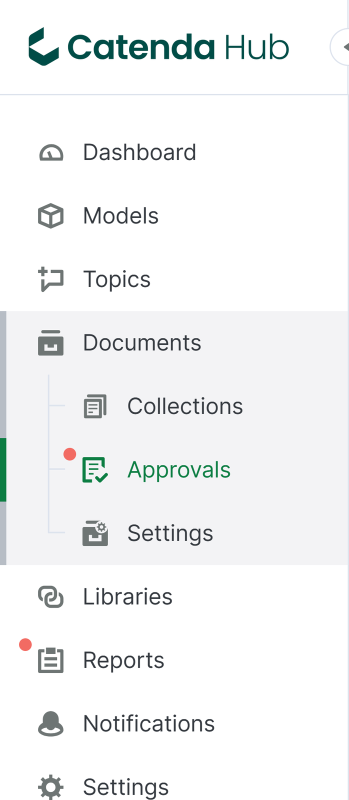
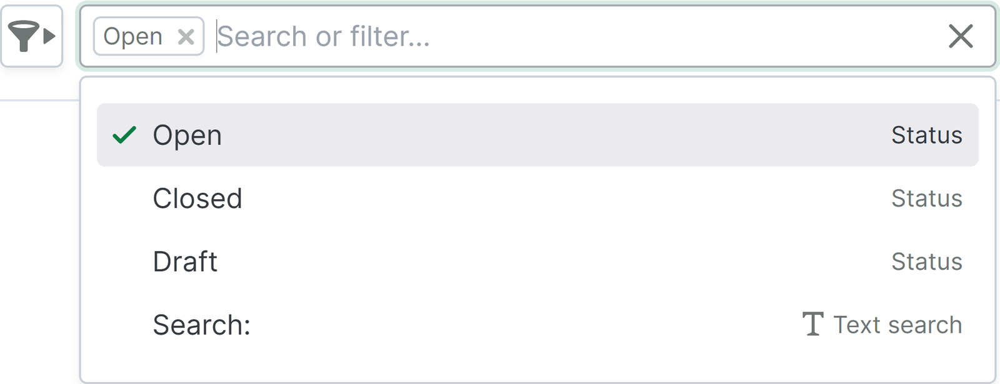
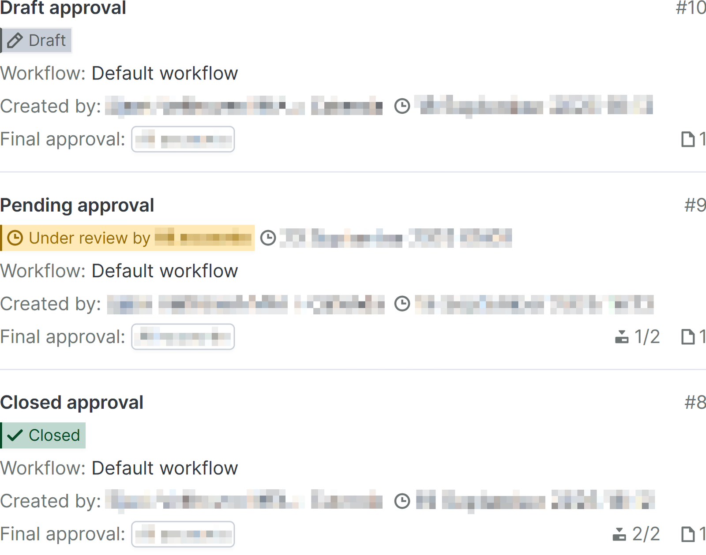
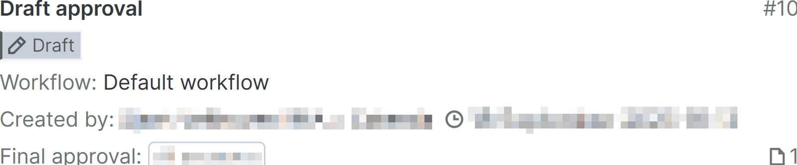
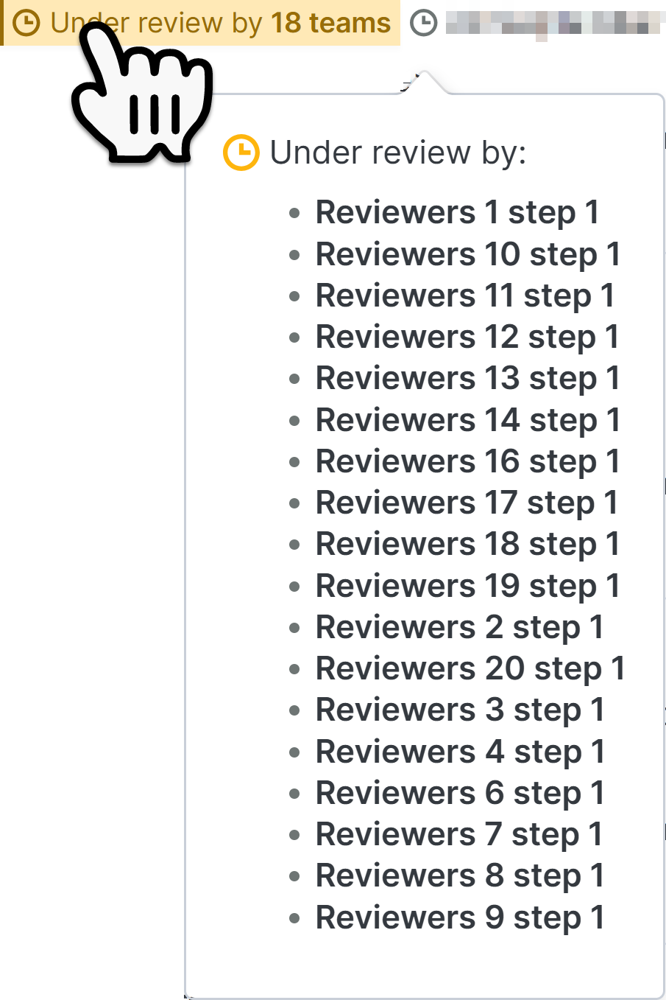
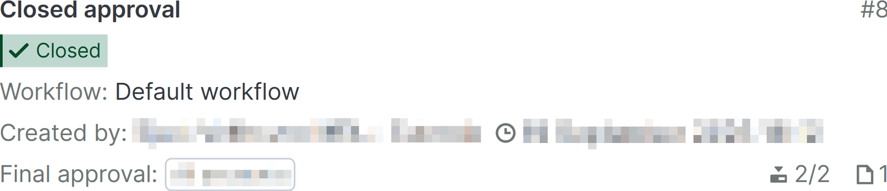

# Gjennomgangsside

Gjennomgangssiden finnes som en underside til [dokumentsiden](https://support.catenda.com/nb/articles/8204673-dokumenter-side) i venstremenyen. Gjennomgangssiden er skjult som standard og vises når statusarbeidsflyten er aktivert i [dokumentinnstillinger](https://support.catenda.com/nb/articles/7831371-dokumentinnstillinger) for prosjekter som aktiverte delte revisjoner etter 2. oktober 2025. Her finner du en oversikt over gjennomgangsforespørslene i prosjektet.

Denne artikkelen inneholder informasjon om følgende saker:

_[Søk eller filtrer](https://support.catenda.com/nb/articles/12495047-gjennomgangsside#h_95652579ee) - [Gjennomgangsliste](https://support.catenda.com/nb/articles/12495047-gjennomgangsside#h_aa4dfe69f5) - [Radinnhold](https://support.catenda.com/nb/articles/12495047-gjennomgangsside#h_76de8831a3) - [Gjennomgangskort](https://support.catenda.com/nb/articles/12495047-gjennomgangsside#h_e99a80135a)_

Prosjekter der delte revisjoner ble aktivert før 2. oktober 2025, vil se [eldre gjennomgangsside](https://support.catenda.com/nb/articles/8349340-gjennomgangsside-eldre-versjon) i stedet. På gjennomgangssiden kan du gjøre følgende:

- Hver gjennomgangsforespørsel kan gjennomgås og valideres av teamet før en endelig validering avgjør om revisjonene som forespørres godkjent skal godkjennes eller ikke.
- Konfigurasjon av forløp og resultat av en gjennomgang kan gjøres.
- Nye gjennomganger kan opprettes.

## 1. **Søk eller filtreringsalternativer**

Klikk [her](https://support.catenda.com/nb/articles/12495060-filtrering-pa-godkjenningssiden) for å lese mer om filtrering på gjennomgingssiden.

## 2. **Gjennomgangsliste**

Prosjekter opprettet basert på et malprosjekt inkluderer gjennomgangsarbeidsflyten og saksmalene fra det malprosjektet. Hver rad i gjennomgangslisten inneholder et gjennomgangskort med visuelle indikatorer om innholdet i hver gjennomgingsforespørsel.

Slik kan en gjennomgangsforespørsel med full aktivitet se ut:

Aktivitet som oppstår i gjennomgangen vises med mengder og ikoner på gjennomgangskortet.

**Nødvendig tilgang:** Medlem av innsender-, anmelder- eller endelig vurderingsteam eller administrator.

## 3. **Radinnhold**

### 3.1 **Åpen eller lukket gjennomgangsrad**

Hvis du åpner innholdet i en gjennomgangsforespørselrad som er under gjennomgang eller lukket, åpnes [gjennomgangssiden](https://support.catenda.com/nb/articles/12494960-apen-eller-lukket-gjennomgangsforesporsel) for den gjennomgangen.

### 3.2 **Utkast gjennomgangsrad**

For gjennomganger i utkast åpnes [utkast gjennomgangsforespørselssiden](https://support.catenda.com/nb/articles/12495175-side-for-utkast-til-gjennomgangsforesporsel) i stedet.

## 4. **Gjennomgangskort**

### 4.1 **Tittel**

Gjennomgangtittel

### 4.2 **Utkast status**

Når en gjennomgangsforespørsel har statusen utkast, er den bare synlig for personen som opprettet utkastet på gjennomgangssiden.

Gjennomgangsforespørselen er ikke synlig i gjennomgangsmenyen på høyre meny for en revisjon.

### 4.3 **Åpen gjennomgangsstatus**

Når en gjennomgangsforespørsel har statusen åpen, er den synlig for alle medlemmer som er del av teams involvert i forespørselen. Hvis du holder musepekeren over statuser for gjennomganger som gjennomgås av mer enn ett team, åpnes et popup-vindu som viser hvilket team som ennå må sende inn sin gjennomgang i gjeldende gjennomgangstrinn.

Anmelderteam som allerede har gitt sin vurdering vises ikke i denne listen eller telles med i antallet teams som gjennomgangstrinnet for øyeblikket gjennomgås av.

Til høyre for den åpne gjennomgangsstatusen vises datoen og klokkeslettet når gjennomgangstrinnet må gjennomgås. Hvis automatisk godkjennelse er konfigurert for dette trinnet, går gjennomgangen automatisk til neste trinn på denne datoen og klokkeslettet.

### 4.4 **Lukket status**

Når en gjennomgangsforespørsel når sitt endelige gjennomgangstrinn, forblir den åpen. Basert på godkjennelsene og avvisningene gitt av hvert av teamene i hvert av gjennomgangstrinnet, vil et medlem av det endelige gjennomgangssteamet kunne gi sin endelige godkjennelse eller avvisning. Når gjennomgangsforespørselen endelig godkjennes eller avvises av medlemmet i det endelige gjennomgangssteamet, blir den lukket.

### 4.5 **Arbeidsflyt**

Arbeidsflyten som følges av gjennomgangen

### 4.6 **Opprettet av**

Medlemmet som opprettet gjennomgangen og datoen og klokkeslettet for når det ble opprettet.

### 4.7 **Sluttgjennomgang**

Det endelige gjennomgangssteamet som vil ha det endelige ordet om publisering av de delte dokumentene i gjennomgangen, informert av anmeldelsene sendt inn av innsenderteamene i hvert av gjennomgangstrinnet.

### 4.8 **Gjennomgangsnummer**

Nummeret på gjennomgangen

### 4.9 **Ikoner nederst**

Gjeldende gjennomgangstrinn i arbeidsflyten som gjennomgangen følger. Det totale antallet trinn gjennomgangen må gjennomføre før gjennomgangen blir avsluttet. Bare synlig på åpne og lukkede gjennomganger. Antall dokumenter i gjennomgangen uavhengig av tilgangsinnstillinger.
