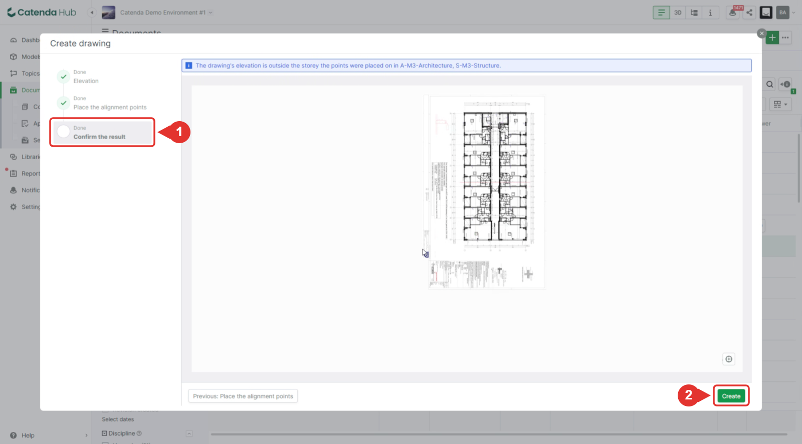
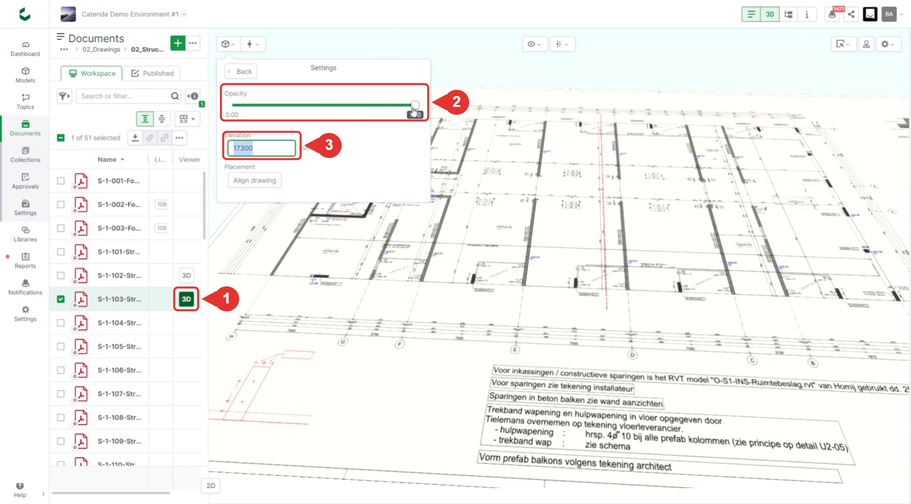

# 2D-tegninger i 3D-viseren

> Slik plasserer du PDF-tegninger og viser dem sammen med modellene i 3D-viseren

2D-tegninger er en viktig del av ethvert byggeprosjekt. Selv om tegninger ofte genereres fra 3D-modellene, inneholder de detaljer som utfyller det modellene viser. Visning av 2D-tegninger i 3D-viseren gir både todimensjonal og tredimensjonal kontekst samtidig. _Nødvendig tilgang:_ Skrivetilgang til PDF-dokumentet for å opprette en tegning

[Se videoen: 2D-tegninger i 3D-viseren](https://eu.guidde.com/share/playbooks/jLcBnpr2UYKWMpgP2gK9jv)

## 1. **1. Kalibrerte og ukalibrerte tegninger**

Gå til dokumentene og naviger til PDF-filen som inneholder 2D-tegningen.

### 1.1 **Kalibrerte tegninger**

PDF-tegninger som allerede er plassert, viser en **3D**-knapp. Klikk på den for å vise tegningen i 3D-viseren sammen med modellene.

### 1.2 **Ukalibrerte tegninger**

PDF-tegninger som ikke er plassert ennå, må plasseres først, som beskrevet i neste avsnitt.

## 2. **2. Plassere en tegning**

### 2.1 **2.1 Opprette en tegning**

1. Velg PDF-tegningen som skal plasseres, ved å krysse av i avmerkingsboksen (for eksempel tredje etasje i konstruksjonstegningene).
1. Åpne [handlingsmenyen](https://support.catenda.com/nb/articles/4670288-handlinger-i-dokumenttabellen) (**…**).
1. Velg **Opprett tegning**.

### 2.2 **2.2 Velge kote**

Det første trinnet ber om koten tegningen skal plasseres på.

- Når koten er kjent, skriv inn verdien direkte.
- Ellers velger du en kote fra en av IFC-modellene som er lastet opp til prosjektet.

Klikk deretter på **Neste: Plasser justeringspunktene**.

### 2.3 **2.3 Justeringsmetoder**

Tegningen må justeres slik at den står på riktig plass. Det finnes fire justeringsmetoder.

_Etasjekonfigurator_ Når elementer er konfigurert i [etasjekonfiguratoren](https://support.catenda.com/nb/articles/6921756-storey-configurator-side), justeres tegningen etter 2D-genereringen fra modellene.

_Modeller_ Tegningen justeres mot modellene selv, for eksempel arkitekt- og konstruksjonsmodellen på den aktuelle etasjen.

_Koordinater_ Når koordinatene er kjent, knyttes markørene **A** og **B** til dem.

_Kopier en eksisterende justering_ En justert tegning for samme etasje kan brukes på nytt for den nye tegningen. Legg til det dokumentet og kopier justeringen, for eksempel fra arkitektonisk tredje etasje til konstruksjonsmessig tredje etasje.

Når du justerer etter punkter, for eksempel skjæringspunkter i akselinjer, plasser markørene **A** og **B** på begge tegningene i de samme skjæringspunktene. Zoom inn for presisjon. Markørene fester seg til punktene.

Når tegningen er justert, klikk på **Neste: Bekreft resultatet**.

### 2.4 **2.4 Bekrefte justeringen**

1. Bekreft resultatet og kontroller at tegningen er justert riktig.
1. Klikk **Opprett**.

Tegningen kan nå slås på i 3D-viser.

## 3. **3. Visning av tegninger i 3D-viser**

1. Slå på tegningen. Den vises automatisk i 3D-viser.
1. Tegningen er også tilgjengelig i velgeren. En feil kote kan endres der.
1. Juster **opasiteten** til tegningen etter behov.
1. Slå på modellene som skal vises sammen med tegningen, for eksempel arkitekt- og konstruksjonsmodellen.

> **Tips:** Et klippeplan i høyde med tegningen skjærer gjennom modellene, slik at 2D-tegningen vises sammen med BIM-modellene, for eksempel konstruksjonstegningen med konstruksjonsmodellen.

Å kombinere 2D-tegninger med BIM-modeller gir en sammenhengende, kontekstuell visning av prosjektet og støtter forståelse og beslutningstaking gjennom hele prosjektet.

## 4. **Les mer**

[3D-viser](https://support.catenda.com/nb/articles/8227211-3d-viser) - [Utseende for 2D-viser](https://support.catenda.com/nb/articles/13615984-2d-viser-utseende) - [Etasjekonfigurator](https://support.catenda.com/nb/articles/6921756-storey-configurator-side) - [Handlinger i dokumenttabellen](https://support.catenda.com/nb/articles/4670288-handlinger-i-dokumenttabellen)
