# Handlinger i dokumenttabellen

Avhengig av din tilgang og valg kan du se ulike handlinger for dokumentene og mappene dine på [dokumentsiden](https://support.catenda.com/nb/articles/8204673-dokumenter-side).

## 1. **Nye vareopplastinger**

Plus-knappen og hamburger-menyalternativene finnes øverst til høyre på siden og kan se omtrent slik ut:

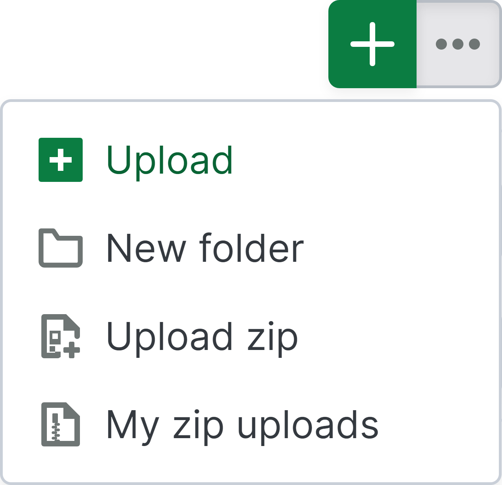

Handlingene du finner her omhandler alle opprettelse av ny informasjon. [Valgte vareopplastinger](#h_fb4e9ef375) som omhandler eksisterende elementer på siden kan også finnes øverst på listen etter å ha gjort et valg.

### 1.1 **Last opp**

Både plus-knappen og Last opp-handlingen åpner en "Last opp et dokument"-meny. Klikk [her](https://support.catenda.com/nb/articles/4670278-laster-opp-et-dokument#h_00fa77db3e) for å se hvordan Last opp-dialogboksen fungerer. _Nødvendig tilgang:_ Skrivetilgang til mappen du er i eller til dokumentet(ene) eller mappen(e) i mappen du er i. Tilgang til [lasting av utkastrevisjoner med skrivebeskyttet tilgang](https://support.catenda.com/nb/articles/4670273-prosjektinnstillinger#h_f82a1850f3) kan også gis i prosjektinnstillinger.

### 1.2 **Ny mappe**

For å lage en ny mappe på dokumentplasseringen du er i nå, kan du bruke knappen for ny mappe-handling. Dialogboksen for ny mappe som åpnes kan se omtrent slik ut:

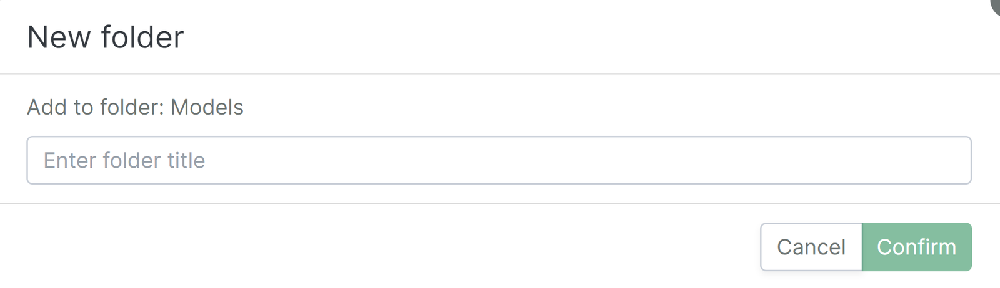

Når du oppretter en dokumentstruktur eller må lage mange mapper på en gang, kan det være kjedelig å måtte klikke på knappen for ny mappe mange ganger. For å lage mange mapper på en gang kan det være nyttig å forberede mappene eksternt og laste dem opp alle på en gang med handlingen Last opp zip. _Nødvendig tilgang:_ Skrivetilgang til mappen du er i nå

> **Merk:** Mappenavn kan ikke inneholde noen av følgende tegn: `< > : " / \ | ? *` Hvis det nye navnet inneholder noen av disse tegnene, kan det ikke lagres.

### 1.3 **Last opp zip**

Handlingen Last opp zip lar deg pakke ut innholdet i en zip-fil i dokumentstrukturen. Det er også mulig å laste opp et zip-dokument med knappen Last opp-handling, men da får du det bare som en zippet fil og du ser ikke innholdet i zip-filen. Klikk [her](https://support.catenda.com/nb/articles/7945410-last-opp-en-zip-filstruktur#h_54ace27f24) for å lese mer om hvordan du laster opp en zip til Catenda.

_Nødvendig tilgang:_ Skrivetilgang til mappen du er i nå. Hvis du bruker alternativet Opprett nytt utkast: Skrivetilgang til mappene med samme navn og strukturplassering som mapper i zipen i forhold til hvor du laster opp zipen Skrivetilgang til dokumentene du kanskje legger til revisjoner for.

### 1.4 **Mine zip-opplastinger**

Handlingen Mine zip-opplastinger lar deg se en oversikt over dine tidligere zip-opplastinger

## 2. **Valgte vareopplastinger**

Etter å ha valgt et eller flere dokument(er) vil du kunne se følgende handlingsmeny vises øverst i dokumenttabellen. Menyen for eksisterende vareopplastinger kan se omtrent slik ut:

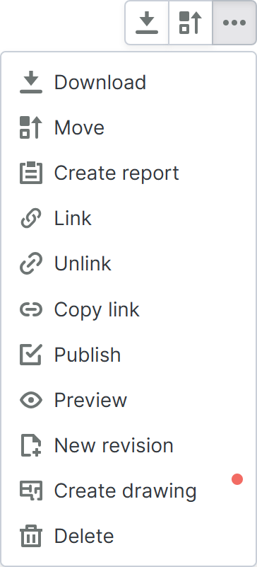

### 2.1 **Last ned**

Med Last ned-handlingen kan valgte elementer og deres innhold lastes ned ved å klikke på Last ned-ikonet øverst eller ved å åpne handlingsmenyen og klikke på Last ned-handlingen i rullegardinmenyen.

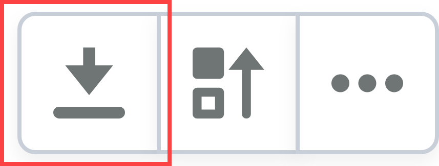

Du laster ned et enkelt dokument når én dokumentrad er valgt. Du laster ned en zip-fil som inneholder innholdet i utvalget når en mapperad eller flere rader er valgt. Navnene på de nedlastede filene kan påvirkes av alternativet [dokumentnedlastingstittel](https://support.catenda.com/nb/articles/8224886-organisasjonsalternativer#h_5564d6602f). Prosjekteieren konfigurerer dette alternativet for hele organisasjonen, så prosjektmedlemmer kan verken be om eller endre det selv. _Tilgang kreves:_ full tilgang til valgte dokument(er) og/eller mappe(r)

_Oppdage dokumenter_ Når du trykker på Last ned-knappen, åpnes en dialogboks nedover til venstre på siden. Først vil systemet begynne å oppdage de ulike filene for nedlasting. Slik kan dialogboksen for Klargjør nedlasting se ut:

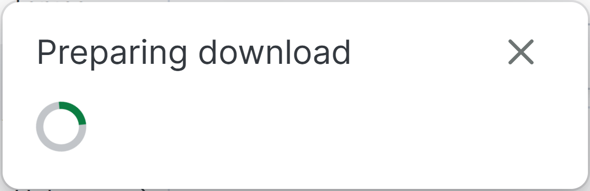

På dette punktet er det trygt å gå til en annen side på Catenda. Filene vil begynne å laste ned til det lokale systemet så snart nedlastingen er klargjort. Når flere nedlastinger startes samtidig, blir de lagt til samme dialogboks. Det er til og med trygt å slå av systemet helt og komme tilbake senere når nedlastingen er klargjort. Det er alltid mulig å laste ned de klargjorte dokumentene fra varselet som opprettes når nedlastingen er klargjort.

_Zipping-filer_ Så snart det totale antallet filer er blitt oppdaget, vises antallet filer som er oppført i dialogboksen. Utkast- eller tilbakekalt revisjoner er ikke inkludert i dette antallet. Catenda vil deretter begynne å sette filene sammen i en zippet fil som kan lastes ned når den er klargjort:

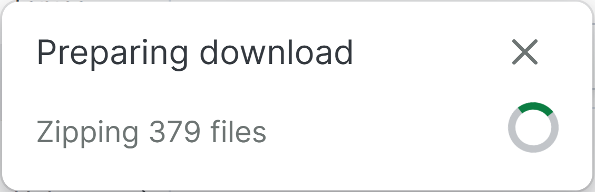

_Klart til nedlasting_ Når zip-filen er ferdig klargjort, åpnes filutforskeren på systemet. Utforskeren ber om å lagre zip-filen et sted på den lokale maskinen.

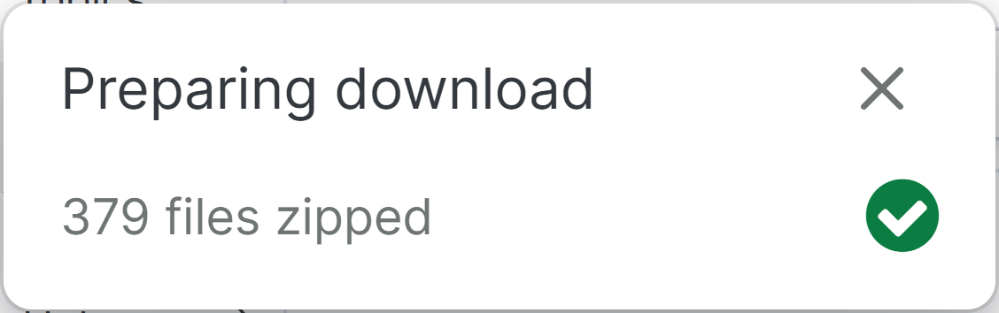

Når zipen er ferdig klargjort, sendes et varsel om at zip-nedlastingen er klar. Klikk på teksten i varselet som sier "Klikk for å laste ned (...MB)" for å laste ned dokumentet.

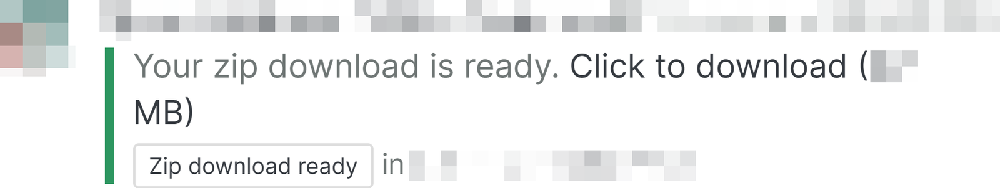

### 2.2 **Flytt**

Med Flytt-handlingen kan du flytte dokumentene dine til et annet sted enten ved å trykke på Flytt-ikonet øverst eller ved å klikke på Flytt-handlingen i hamburger-menyen.

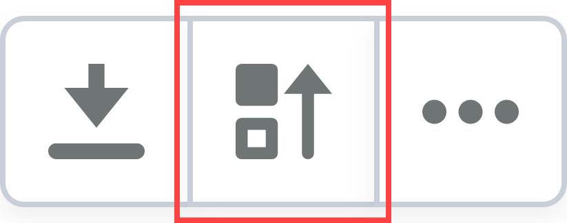

Etter å ha trykket på Flytt-knappen får du et vindu som spør deg hvor du vil flytte dokumentet(ene) og/eller mappen(e) til. _Nødvendig tilgang:_ Full tilgang til dine valgte dokument(er) og/eller mappe(r) og skrivetilgang til plasseringen du flytter til.

### 2.3 **Lenk og fjern lenke**

Når du velger et dokument, vil du se ikonene for Lenk og Fjern lenke ved siden av Last ned-ikonet eller i hamburger-menyen. Disse alternativene kan være nedtonet hvis du ikke har valgt en gjenstand av en modell i 3D-panelet.

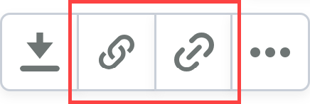

Etter å ha valgt dokument(er) i dokumentdelen av innholdspanelet og gjenstand(er) av modell(er) i 3D-visningsprogrammet, vil du kunne lenke og fjerne lenke for gjenstand(ene) til dokument(ene). _Nødvendig tilgang:_ Les- eller skrivetilgang til dine valgte dokument(er) og lesetilgang til minst ett dokument-modell

### 2.4 **Rapport**

Med rapporthandlingen kan du lage en rapport over dine valgte dokumenter. Denne handlingen er bare tilgjengelig på prosjekter der rapportsiden er aktivert. Rapportsiden kan forespørres å være aktivert på et per-prosjekt-basis.

Klikk [her](https://support.catenda.com/nb/articles/13973721-opprett-rapporthandling) _(for kunder som bruker rapporteditor)_ for å lese mer om rapporthandlingen. _Tilgang som kreves:_ Lesetilgang til dokumentet

### 2.5 **Publiser**

Med [revisjonspublisering](https://support.catenda.com/nb/articles/9874698-ny-statusarbeidsflyt-iso-19650) aktivert vises fanene arbeidsområde og publisert øverst på modellsiden.

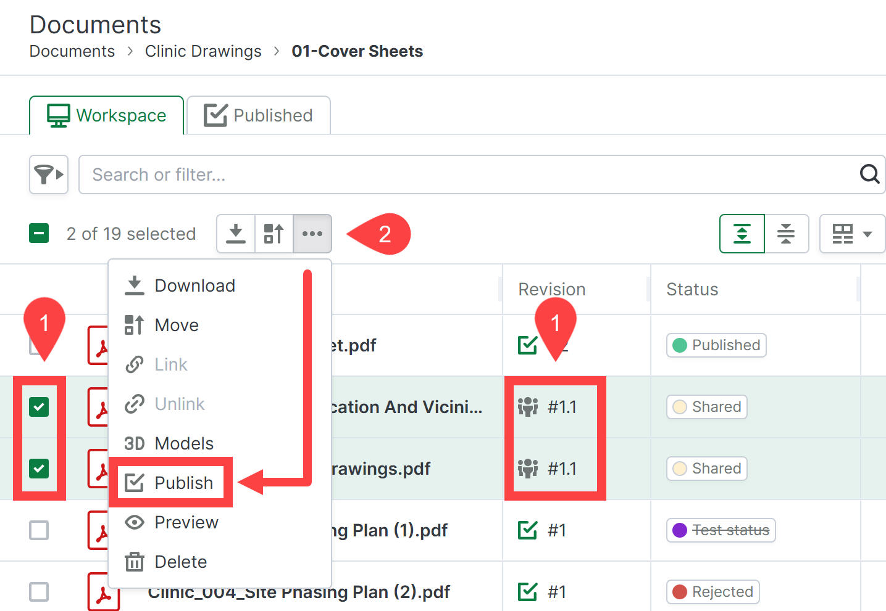

På fanen arbeidsområde vises delte revisjoner. Du kan skille delte revisjoner fra publiserte revisjoner på ikonet i revisjonskolonnen og på at de har et revisjonsnummer med lavere versjon (0.1, 0.2, 1.1 osv.). _Tilgang kreves:_ Vis delte revisjoner i tilgangsinnstillingene for dokument-modell. Etter at statusarbeidsflyten er aktivert, vil hver ny revisjon i et dokument starte som en delt revisjon som kan publiseres. Velg ett eller flere dokumenter der siste revisjon er en delt revisjon for å se publiseringshandlingen i handlingsmenyen. _Tilgang kreves:_ "Kan publisere" i tilgangsinnstillingene for dokumentet. Med publiseringshandlingen kan du publisere siste delte revisjon. Hvis du vil publisere en tidligere delt revisjon, kan du publisere den fra [revisjonsforhåndsvisningen](https://support.catenda.com/nb/articles/9323521-dokumentrevisjonshandlinger).

### 2.6 **Forhåndsvisning**

For å forhåndsvise ditt valgte dokument eller dine valgte dokumenter kan du enten klikke på Forhåndsvisning-handlingsknappen i hamburger-menyen eller klikke på ikonet for dokumentet i dokumentlisten. Du vil da få en forhåndsvisningsdialogboks som du kan bruke til å enkelt forhåndsvise de ulike dokumentene uten å måtte åpne siden for hvert dokument. Dette er spesielt fint hvis du prøver å forhåndsvise mange bilder, men kan også være nyttig hvis du trenger å se to dokumenter side ved side da du kan feste forhåndsvisningen slik at den forblir åpen. _Nødvendig tilgang:_ Lesetilgang

> **Merk:** Mapper og dokumentutkast kan ikke forhåndsvises i forhåndsvisningsdialogen. Dokumentutkast kan fortsatt forhåndsvises på deres [dokumentside](https://support.catenda.com/nb/articles/8461918-dokumentbanner-navigasjon).

### 2.7 **3D-modeller**

Hvis dokumentet ditt kan lastes inn i 3D-visningsprogrammet, kan du klikke på 3D-handlingsknappen for å laste de valgte dokument-modellene og/eller punktskyer inn i 3D-visningsprogrammet. Denne handlingen er bare tilgjengelig hvis du har valgt IFC-fil(er) (IFC og IFCZip) som er lenket til modeller i modellseksjonen, punktsky(er) (Las og e57) og/eller Gml-dokumenter Det er også mulig å laste forhåndsvisningen av ifc-dokumenter som ikke er lenket til modeller i 3D-visningsprogrammet, men de må lastes inn fra revisjonsrullegardinmenyen inne i dokumentet. _Nødvendig tilgang:_ Lesetilgang til ifc-, ifczip-, las-, e57- eller gml-dokumentet

### 2.8 **Ny revisjon**

Hvis du har valgt ett dokument, kan du laste opp en ny revisjon ved å klikke på Ny revisjon-handlingen i hamburger-menyen. Dette åpner filutforskeren, og der kan du velge filen du vil laste opp. Opplasting av en fil på denne måten vil opprette en ny revisjon og ikke et nytt dokument. Det er mulig å laste opp nye revisjoner til ett dokument om gangen med handlingsknappen. Hvis du ønsker å laste opp flere revisjoner til flere dokumenter i mappen, kan du gjøre det med Last opp-handlingsknappen. _Nødvendig tilgang:_ Skrivetilgang til det valgte dokumentet

### 2.9 **Opprett og fjern modell**

_Opprett modell_ Et valgt dokument med filendelsen `.ifc` eller `.ifczip` kan kobles til en modell i modellseksjonen med handlingen opprett modell. Første gang en modell-lenke opprettes for et dokument, vil modellen som vises på modellsiden ha samme navn som dokumentet den ble opprettet fra. Både navnet på modellen på modellsiden og navnet på dokumentet kan endres senere. Et dokument som tidligere har hatt en modell-lenke, husker hvilket navn den modellen hadde, og bruker det forrige navnet til den fjernede modellen når en ny modell-lenke opprettes, selv om dagens dokumentnavn er annerledes. _Tilgang kreves:_ Skrivetilgang til [opprett og fjern modeller](https://support.catenda.com/nb/articles/4670273-prosjektinnstillinger#h_f82a1850f3) i prosjektinnstillingene

_Fjern modell_ Lenken til et dokument som er lenket til en modell kan fjernes med Fjern modell-handlingen.

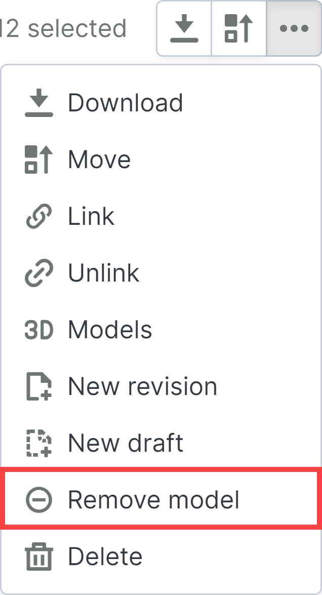

Når modell-lenken fjernes, forsvinner modellen fra modellseksjonen mens dokumentet forblir i dokumentseksjonen. En modell-lenke kan senere opprettes fra samme dokument igjen. _Tilgang kreves:_ Skrivetilgang til [opprett og fjern modeller](https://support.catenda.com/nb/articles/4670273-prosjektinnstillinger#h_f82a1850f3) i prosjektinnstillingene

### 2.10 **Opprett tegning**

Et valgt PDF-dokument kan gjøres om til en tegning som vises i Viser sammen med modellene. Handlingen Opprett tegning ber først om høyden til tegningen. Tegningen justeres deretter med **A**- og **B**-markørene, mot etasjekonfiguratoren, modellene, kjente koordinater eller en eksisterende tegning av samme etasje. Når tegningen er opprettet, viser PDF-en en **3D**-knapp som åpner den i Viser. Stegene er beskrevet i [2D-tegninger i Viser](https://support.catenda.com/nb/articles/18552923-2d-tegninger-i-3d-viseren). _Tilgang kreves:_ Skrivetilgang til det valgte dokumentet

### 2.11 **Kopier lenke**

Med handlingen kopier lenke kan en lenke som bare viser de valgte tabellradene kopieres. Klikk [her](https://support.catenda.com/nb/articles/14323982-kopier-lenkeslipp) for å lære mer om å kopiere lenker.

### 2.12 **Sletting og gjenoppretting**

Bruk Slett-handlingen på et valgt element for å slette det. Et vindu vises som ber om bekreftelse for å slette elementet(ene). _Nødvendig tilgang:_ Full tilgang til det/de valgte dokumentet(ene) Full tilgang til den/de valgte mappen(e) og deres innhold Slettede elementer kan gjenopprettes. Filtrer på slettet, velg elementet og bruk Gjenopprett-handlingen. _Nødvendig tilgang:_ Administrator

_Sakrelasjon_ Et slettet dokument som ble lenket til en sak er synlig som et spørsmålstegn i relatert dokumenter-området av en sak. Et gjenopprettet dokument vil igjen bli vist i saken.

_Modell-lenke_ Et slettet dokument som ble lenket til en modell, fjernes fra lenken ved sletting. Et gjenopprettet dokument vil derfor ikke lenger være lenket til en modell. Bruk Opprett modeller-handlingen en gang til for å koble den til en modell igjen. De tidligere modellinnstillingene som modellnavn og behandling lagres slik at de ikke trenger å bli omkonfigurert.

_Etasjeconfigurator_ Et slettet dokument som er konfigurert som et underlag for en etasje i etasjeconfigureren, forsvinner fra 2D-visningen for prosjektmedlemmer. Et gjenopprettet dokument som ble konfigurert som et underlag for en etasje i etasjeconfigureren vil igjen bli vist i 2D-visningen for denne etasjen.

_Objektrelasjoner_ Et slettet dokument som ble lenket til en gjenstand, fjernes fra lenken ved sletting. Et gjenopprettet dokument vil derfor ikke være lenket til noen gjenstander.

## 3. **Handlinger for gjeldende mappe**

Hvis du har åpnet en mappe, men ikke valgt noe, vil [høyre informasjonsmeny](https://support.catenda.com/nb/articles/8302244-hoyre-meny-for-en-revisjon-revisjonsinformasjon) vise handlinger for mappen du er i. Høyre informasjonsmeny kan være lukket, og du må kanskje klikke på pilen på høyre side for å åpne den. Disse handlingene kan se omtrent slik ut:

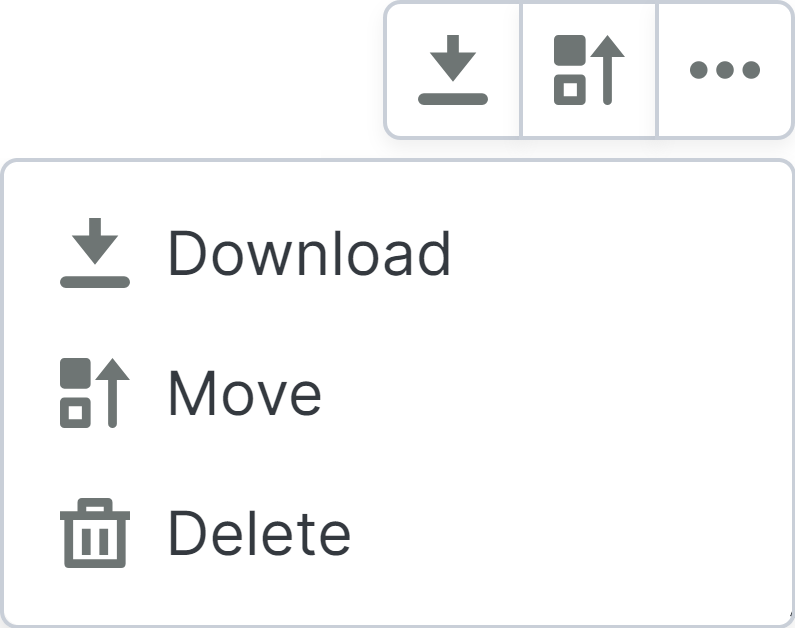

Siden du ikke har valgt noe, vises ikke handlingene for valgte elementer øverst i dokumenttabellen. I stedet kan du utføre handlinger på mappen du er i, med ikonene og hamburgermenyen i [høyre informasjonsmeny](https://support.catenda.com/nb/articles/8302244-hoyre-meny-for-en-revisjon-revisjonsinformasjon).

_Nødvendig tilgang:_ Last ned: Lesetilgang til gjeldende mappe Flytt: Full tilgang til gjeldende mappe og skrivetilgang til plasseringen du flytter mappen til. Slett: Full tilgang til gjeldende mappe og dens innhold.
