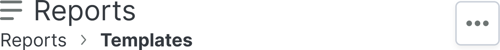
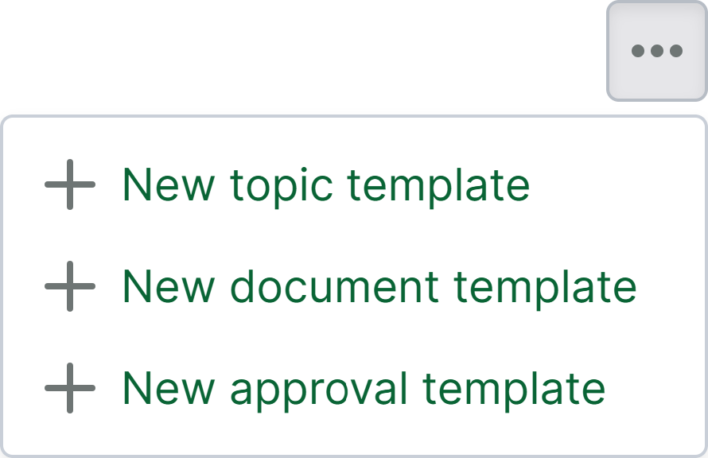
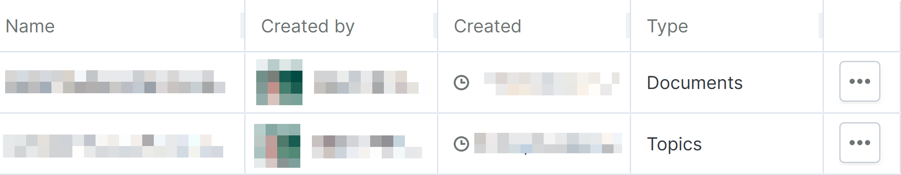
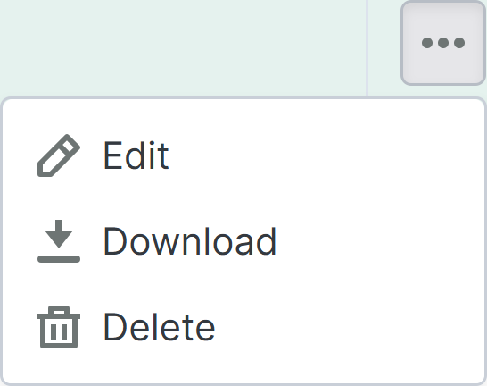

# Pagina met rapportsjablonen

> **Opmerking 1:** De rapportenpagina is een opt-in-functie die kan worden aangevraagd voor lopende projecten.
> **Opmerking 2:** Nieuwe projecten die zijn gemaakt op basis van een sjabloonproject waarbij deze functie is ingeschakeld, hebben deze functie niet ingeschakeld.

De rapportagesjablonenenpagina is te vinden als een subpagina van de [rapportages pagina](https://support.catenda.com/nl/articles/12303098-rapportenpagina) in het linkernavigatiemenu. Op de rapportagesjablonenpagina kunnen de document-, Topics- en goedkeuringsjablonen die beschikbaar zijn voor het project worden beheerd. _Vereiste toegang:_ Beheerder

Dit is hoe de pagina met rapportsjablonen er ongeveer uit kan zien:

## 1. **Acties op de pagina met rapportsjablonen**

De acties op de pagina met rapportsjablonen kunt u vinden door op het actiemenu rechtsboven op de pagina met rapportsjablonen te klikken. Dit is hoe de acties op de pagina met rapportsjablonen eruit kunnen zien:

Deze acties maken een volledig nieuw sjabloon aan, beginnend met een lege pagina. Het wordt aanbevolen om in plaats daarvan te beginnen met een van de kant-en-klare rapportagessjablonen en deze aan het project aan te passen. Deze kunnen worden gedownload van [Kant-en-klare rapportagessjablonen](https://support.catenda.com/nl/articles/17778911-kant-en-klare-rapportsjablonen) _(alleen voor klanten met rapportage-editor)_.

### 1.1 **Nieuw onderwerpsjabloon**

Gebruik de actie Nieuw onderwerpsjabloon om een nieuw onderwerpsjabloon te maken

### 1.2 **Nieuw documentsjabloon**

Gebruik de actie Nieuw documentsjabloon om een nieuw documentsjabloon te maken

### 1.3 **Nieuw goedkeuringssjabloon**

Gebruik de actie voor het nieuwe goedkeuringssjabloon om een nieuw goedkeuringssjabloon te maken voor rapporten over goedkeuringsverzoeken.

## 2. **Filteren op naam**

Typ in de zoekbalk om de tabel met rapportsjablonen op naam te filteren.

Tekstzoeking - `search=test`

## 3. **Tabel met rapportsjablonen**

Zodra een rapportsjabloon is gemaakt, verschijnt deze als een rij in de tabel met rapportsjablonen. Dit is hoe de tabel met rapportsjablonen er ongeveer uit kan zien:

Klik [hier](https://support.catenda.com/nl/articles/11748020-tabellen-op-catenda) voor meer informatie over het werken met tabellen in Catenda.

### 3.1 **Rijinhoud**

**Rapportrij** Hoewel het mogelijk is om op een rij te klikken om deze te selecteren en groen te markeren, kunnen er geen acties worden uitgevoerd door een rij te selecteren. De rij wordt geselecteerd wanneer het rijactiemenu in de rechterkolom wordt geselecteerd.

### 3.2 **Kolommen**

Op basis van de geconfigureerde kolomvolgorde worden de eerste kolommen weergegeven, terwijl de tabel mogelijk naar opzij moet worden verschoven om andere ingeschakelde kolommen weer te geven. De standaardvolgorde en zichtbaarheidsinstelling van de kolommen op de pagina met rapportsjablonen zijn als volgt:

Naam - _Standaard_ De naam van het rapportsjabloon

_Gemaakt door_ - _Standaard_ De maker van het rapportsjabloon

Gemaakt - _Standaard_ Het moment waarop het onderwerpsjabloon is gemaakt

Type - Standaard Het type rapportagesjabloon: Documenten, Topics of Goedkeuringen.

Actiemenu - Standaard Klik op het actiemenu in de actiemenulom om het rijactiemenu te openen. Dit is hoe het rijactiemenu voor rapportsjablonen eruit kan zien:

Bewerken Gebruik de bewerkingsactie om het geselecteerde rapportsjabloon te bewerken.

Downloaden Gebruik de downloadactie om het geselecteerde rapportsjabloon met de `.mrt`-bestandsindeling te downloaden, die opnieuw in elk ander project kan worden geïmporteerd.

Verwijderen Gebruik de verwijderactie om het geselecteerde rapportsjabloon te verwijderen.
