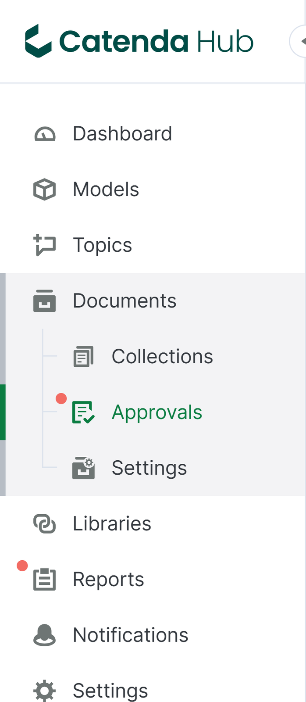
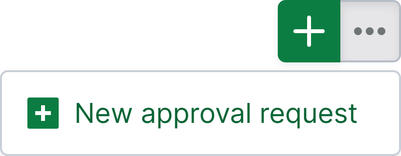
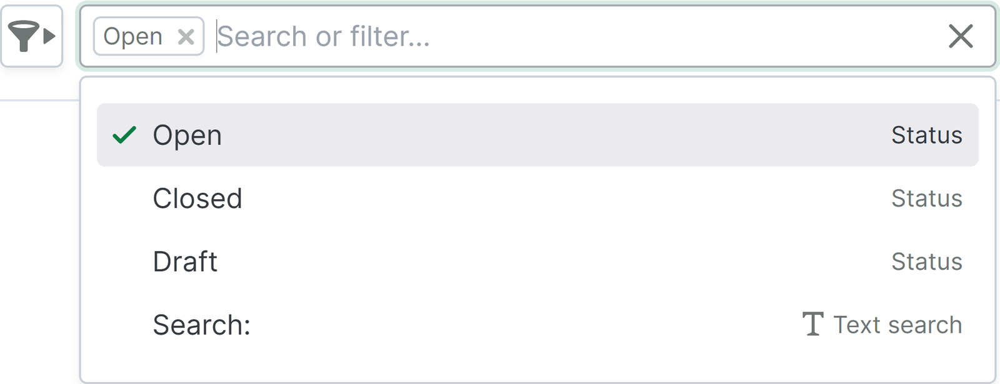
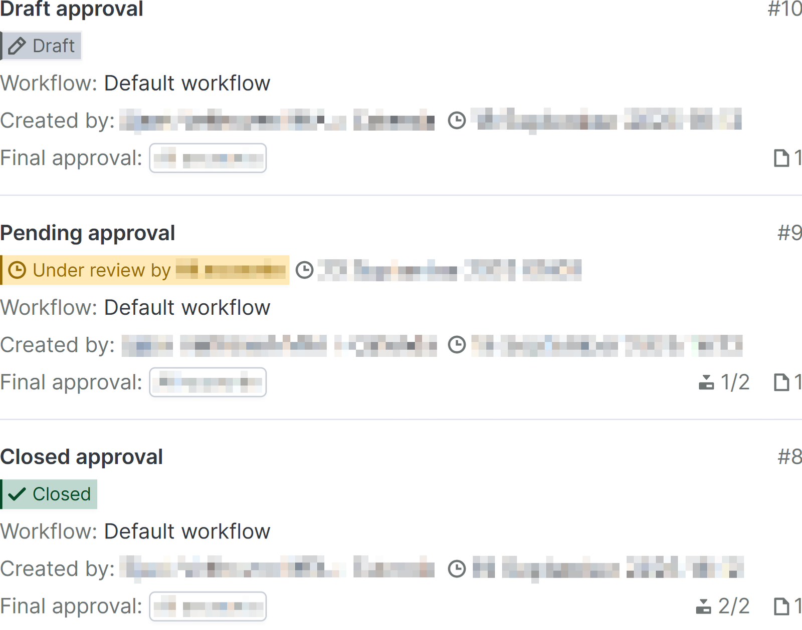
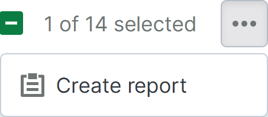
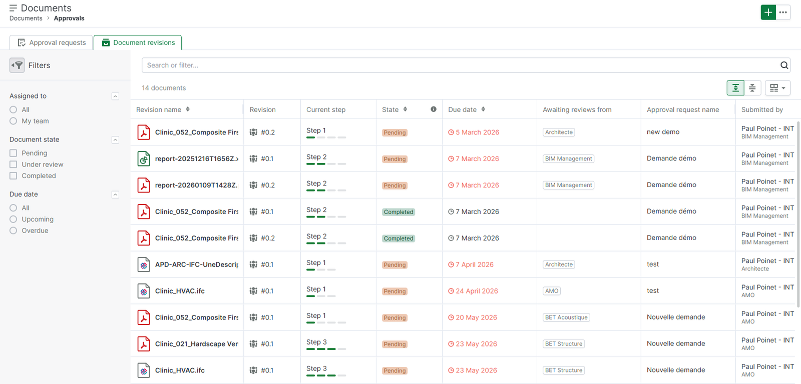
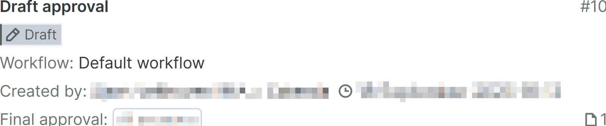
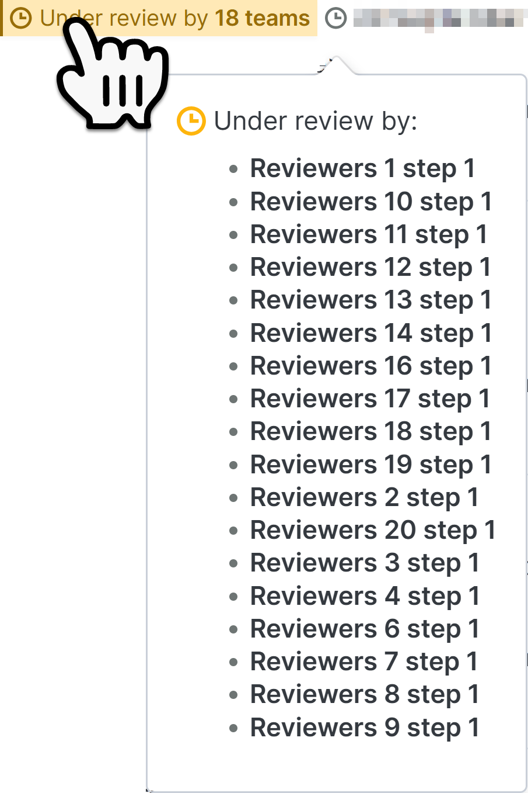
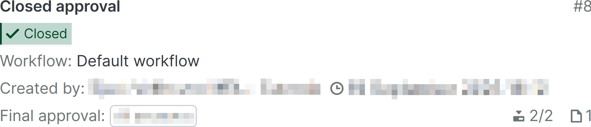

# Pagina Goedkeuringen

De pagina Goedkeuringen is te vinden als een subpagina van de [pagina Documenten](https://support.catenda.com/nl/articles/8204673-documentenpagina) in het linkernavigatiemenu. Hier vindt u een overzicht van de goedkeuringsaanvragen in het project.

Dit artikel bevat informatie over de volgende onderwerpen: _[Inschakelen](#h_263c9d1268) - [Acties](#h_39a97bd06a) - [Zoeken/filter](#h_95652579ee) - [Goedkeuringenlijst](#h_aa4dfe69f5) - [Rijen](#h_76de8831a3) - [Goedkeuringsaanvraagkaarten](#h_e99a80135a) -_ [Tabbladen Goedkeuringsaanvragen en Documentrevisies](#h_aae5976a1d)

Op de pagina Goedkeuringen kan het volgende worden gedaan:

- Elke goedkeuringsaanvraag kan door het team worden beoordeeld en gevalideerd voordat een eindvalidatie bepaalt of de revisies die goedkeuring aanvragen, al dan niet moeten worden goedgekeurd.
- Configuratie van het verloop en de uitkomst van een goedkeuring kan worden uitgevoerd.
- Nieuwe goedkeuringen kunnen worden aangemaakt.

## 1. **De pagina Goedkeuringen inschakelen**

De pagina Goedkeuringen is standaard verborgen. Schakel gedeelde revisies in in [documentinstellingen](https://support.catenda.com/nl/articles/7831371-pagina-documentinstellingen) om de pagina Goedkeuringen zichtbaar te maken. _Vereiste toegang:_ Projectbeheerder

> **Opmerking:** In projecten waar gedeelde revisies vóór 2 oktober 2025 werden ingeschakeld, wordt in plaats daarvan de [verouderde goedkeuringenpagina](https://support.catenda.com/nl/articles/8349340-goedkeuringspagina-legacy) weergegeven.

### 1.1 **Inschakelen vanuit sjabloonproject**

Projecten die zijn gemaakt op basis van een templateproject waarin gedeelde statusses waren ingeschakeld, krijgen gedeelde statusses ingeschakeld en de goedkeuringspagina wordt weergegeven bij aanmaak. De goedkeuringswerkflows en onderwerpsjablonen van het templateproject worden overgedragen naar het nieuwe project, zodat deze niet opnieuw hoeven te worden gemaakt voordat leden goedkeuringsaanvragen kunnen indienen.

## 2. **Nieuwe item-acties**

De nieuwe item-acties zijn te vinden in de rechterbovenhoek van de pagina.

### 2.1 **Nieuwe goedkeuringsaanvraag**

Klik [hier](https://support.catenda.com/nl/articles/12495005-een-nieuw-goedkeuringsverzoek-maken) voor meer informatie over het aanmaken van een nieuwe goedkeuringsaanvraag.

_Vereiste toegang:_ Lid van een indienerteam in een geconfigureerde workflow

## 3. **Opties voor zoeken of filteren**

Klik [hier](https://support.catenda.com/nl/articles/12495060-filteren-op-de-goedkeuringspagina) voor meer informatie over het filteren op de pagina Goedkeuringen.

## 4. **Goedkeuringenlijst**

Goedkeuringskaarten met visuele aanwijzingen over de inhoud van elke goedkeuringsaanvraag waarvan een lid deel uitmaakt, worden weergegeven in de goedkeuringenlijst.

Dit is hoe een goedkeuringsaanvraag met volledige activiteit er kan uitzien:

Activiteit die in de goedkeuring plaatsvindt, wordt met aantallen en pictogrammen op de goedkeuringskaart weergegeven.

Zichtbaarheid van aanvraag is op rollen gebaseerd: projectleden kunnen alleen aanvragen zien die zij persoonlijk hebben ingediend, actieve aanvragen toegewezen aan een beoordelaars- of eindbeoordelaars-team waarvan zij lid zijn, of alle projectaanvragen in het geval van projectbeheerders. _Vereiste toegang:_ Projectlid of projectbeheerder om alle aanvragen te zien

- Voor gedetailleerde operationele procedures voor het indienen van revisies, het toevoegen van beoordelingsmarkeringen en het verwerken van stapvalidaties of eindbesluiten, leest u meer [hier](https://www.google.com/search?q=).
- Voor administratieve richtlijnen over het configureren van goedkeuringssjablonen, het beheren van vergrendelde parameters en het oplossen van verbroken afhankelijkheden, leest u meer [hier](https://www.google.com/search?q=).

### 4.1 **Geselecteerde itemacties**

> **Opmerking:** Rapport maken is de enige geselecteerde itemactie op de goedkeuringspagina. Het menu geselecteerde itemacties is daarom alleen zichtbaar op projecten waarvoor de rapportpagina is ingeschakeld.

Wanneer u een of meer goedkeuringsaanvragen in de goedkeuringslijst selecteert, worden de geselecteerde itemacties boven aan de lijst weergegeven. Het selectievakje bovenaan selecteert alle goedkeuringsaanvragen in de lijst tegelijk. Dit is hoe het menu geselecteerde itemacties eruit kan zien:

**Rapport maken** Maakt een rapport van de geselecteerde goedkeuringsaanvragen, op basis van een goedkeuringssjabloon. Lees er meer over in [Actie Rapport maken](https://support.catenda.com/nl/articles/13973721-rapportactie-maken) _(alleen voor rapporteditorklanten)_.

## 5. **Documentrevisieslijst**

Het tweede tabblad biedt u een overzicht van alle documenten die worden gecontroleerd in alle geopende goedkeuringen.

De tabel geeft het volgende weer:

1. de naam van de revisie
1. het revisienummer
1. de huidige beoordelingsstap
1. de huidige status van de stap
1. de einddatum voor de beoordeling van de stap
1. de teams die het document nog moeten controleren
1. de naam van de goedkeuringsaanvraag
1. de indiener (individueel en team)
1. de indieningsdatum

### 5.1 Filteren

Met het linkerfilterpaneel kunt u de documenten ook filteren op:

1. Toewijzing: alle teams of specifiek uw team
1. Documentstatus: In behandeling, Onder controle, Voltooid
1. Einddatum: alles, komend, verlopen

### 5.2 Sorteren

Tot slot kunt u sorteren op:

1. Revisienaam
1. Status
1. Einddatum
1. Indieningsdatum

### 5.3 Zoeken

Met de tekstzoekopdracht kunt u zoeken op revisienaam en naam van de goedkeuringsaanvraag.

## 6. **Rij-inhoud**

### 6.1 **Open of gesloten goedkeuringrij**

Het openen van de inhoud van een goedkeuringrij die onder controle is of gesloten, opent de [goedkeuringspagina](https://support.catenda.com/nl/articles/12494960-open-of-gesloten-goedkeuringsverzoekaanvraag) voor die goedkeuring.

### 6.2 **Concept-goedkeuringrij**

Voor conceptgoedkeuringen wordt in plaats daarvan de [pagina voor conceptgoedkeuringsaanvraag](https://support.catenda.com/nl/articles/12495175-pagina-voor-conceptgoedkeuringsverzoe) geopend.

## 7. **Goedkeuringsaanvraagkaarten**

### 7.1 **Titel**

Goedkeuringtitel

### 7.2 **Conceptstatus**

Wanneer een goedkeuringsaanvraag de status concept heeft, is deze alleen zichtbaar voor de persoon die het concept heeft aangemaakt op de pagina Goedkeuringen.

De goedkeuringsaanvraag is niet zichtbaar in het goedkeuringenmenu van het rechtermenu van een revisie.

### 7.3 **Open goedkeuringsstatus**

Wanneer een goedkeuringsaanvraag de status open heeft, is deze zichtbaar voor alle leden die deel uitmaken van teams die bij de aanvraag betrokken zijn. Plaats de muis over statussen van goedkeuringen die door meer dan één team onder controle zijn om een pop-up te openen die aangeeft welk team nog hun beoordeling in de huidige beoordelingsstap moet indienen.

Teams die hun beoordeling al hebben gegeven, verschijnen niet in deze lijst en tellen niet mee voor het aantal Teams dat de goedkeuringsstap momenteel onder review heeft.

Rechts van de status van de openstaande goedkeuring worden de datum en tijd weergegeven waarop de goedkeuringsstap moet worden beoordeeld. Als automatische goedkeuring voor deze stap is ingesteld, gaat de goedkeuring op deze datum en tijd automatisch naar de volgende stap.

### 7.4 **Afgesloten status**

Wanneer een goedkeuringsverzoek zijn definitieve goedkeuringsstap bereikt, blijft het open. Op basis van de goedkeuringen en afwijzingen gegeven door elk van de Teams in elk van de goedkeuringsstappen, kan een lid van het definitieve goedkeuringsteam zijn definitieve goedkeuring of afwijzing geven. Wanneer het goedkeuringsverzoek uiteindelijk wordt goedgekeurd of afgewezen door het lid van het definitieve goedkeuringsteam, wordt het gesloten.

### 7.5 **Werkstroom**

De werkstroom die door de goedkeuring wordt gevolgd

### 7.6 **Gemaakt door**

Het lid dat de goedkeuring heeft gemaakt en de datum en tijd waarop dit is gebeurd.

### 7.7 **Definitieve goedkeuring**

Het definitieve goedkeuringsteam dat het laatste woord zal hebben over het publiceren van de gedeelde Documenten in de goedkeuring, geïnformeerd door de beoordelingen ingediend door de inzendteams in elk van de goedkeuringsstappen.

### 7.8 **Goedkeuringsnummer**

Het nummer van de goedkeuring

### 7.9 **Pictogrammen onderaan**

De huidige beoordelingsstap van de werkstroom die de goedkeuring volgt. Het totale aantal stappen dat de goedkeuring moet voltooien voordat de goedkeuring definitief is. Alleen zichtbaar bij openstaande en afgesloten goedkeuringen. Het aantal Documenten in de goedkeuring ongeacht de toegangsinstellingen.
