# 2D locatie van topics - Catenda Site

Locatie kan aan Topics worden toegekend door een markering te plaatsen op een x-, y-, z-coördinaat in de [2D Viewer](https://support.catenda.com/nl/articles/4854537-2d-viewer). Gekleurde stippen markeren de locatie van Topics in de 2D Viewer, wat direct visueel inzicht geeft in waar Topics zich bevinden, evenals hun Status en type. Met topiclocaties kan uw project een aanzienlijk verbeterde controle over de plaatsing van Topics krijgen. Deze functie vult de functionaliteit van onze browsertoepassing aan, [Catenda Hub](https://support.catenda.com/nl/articles/6530821-download-je-mobiele-app-catenda-site). Met markeringen krijgen projecten de mogelijkheid tot naadloze creatie, monitoring en beheer van Topics die in het veld worden aangemaakt en later achter het bureau worden verwerkt.

Dit is hoe markeringen er uit kunnen zien in de 2D viewer op Catenda Site:

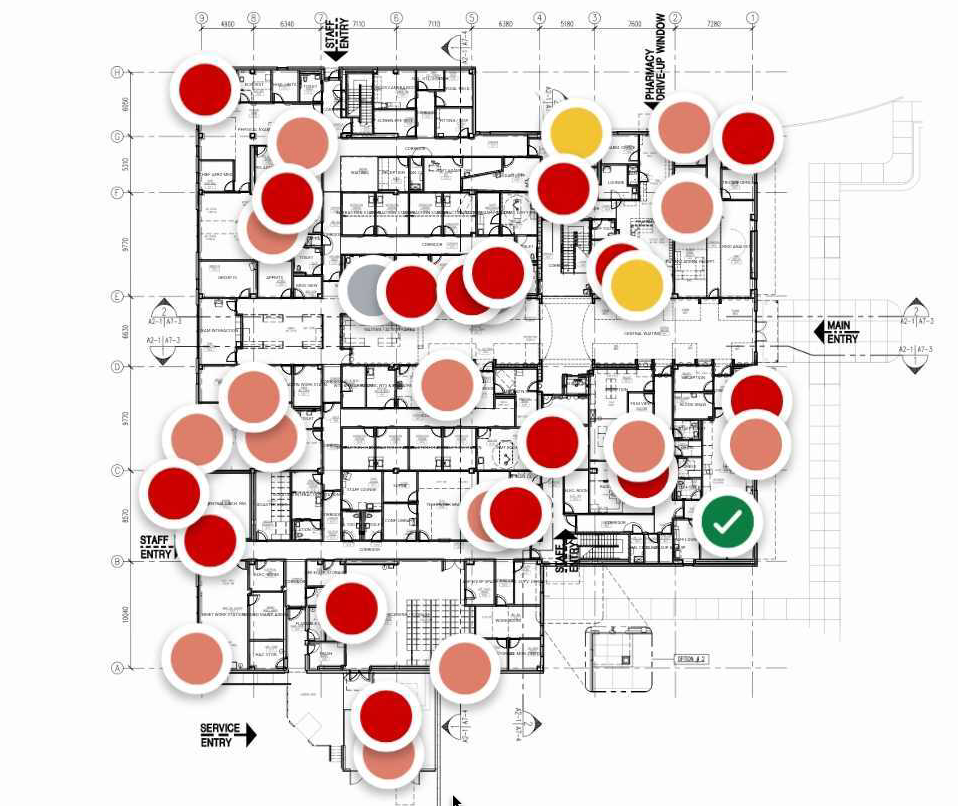

## 1. **Topics met bestaande markeringen**

### 1.1 **Interactie met markeringen**

Tik op een markering op Catenda Site om het topic-nummer en de titel van de topic waarvan de markering hoort weer te geven. Dit is hoe een aangetikte markering er uit kan zien in Catenda Site.

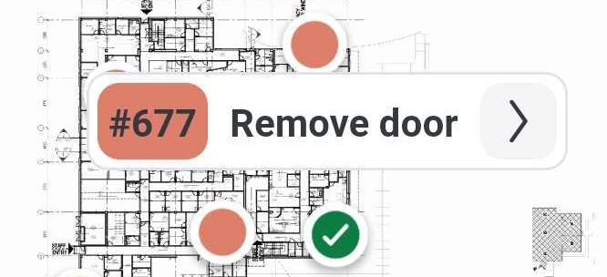

### 1.2 **Markeringen weergeven**

Om met topics en locaties te werken, opent u het 2D/3D viewer menu.

**Selecteer een topic board** Selecteer een topic board om de markeringen op de verdieping van dat topic board te zien.

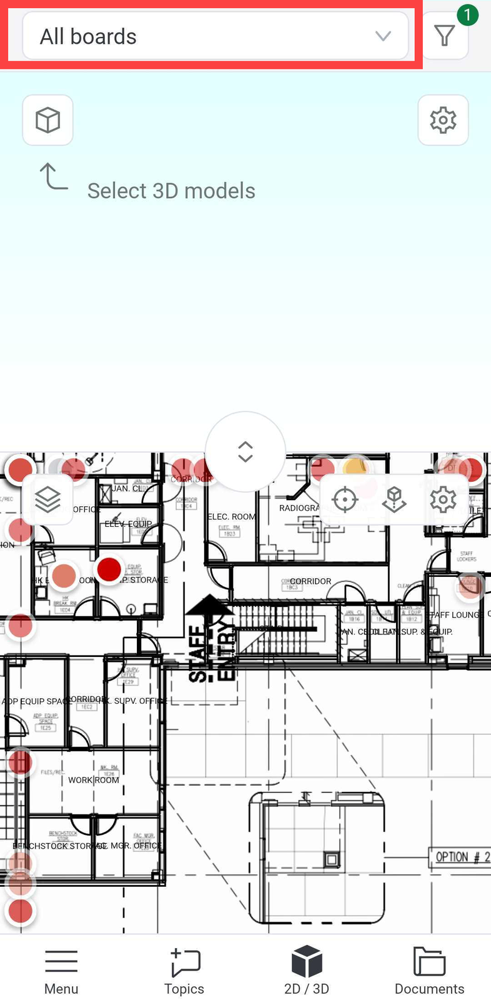

Als een verdieping is geconfigureerd in de verdiepingsconfiguratie, wordt de eerste verdieping van het eerste gebouw standaard geopend zodra het 2D/3D viewer menu werd geopend.

**Filter de topic board** Beperk het aantal markeringen op het scherm door de topic board te filteren.

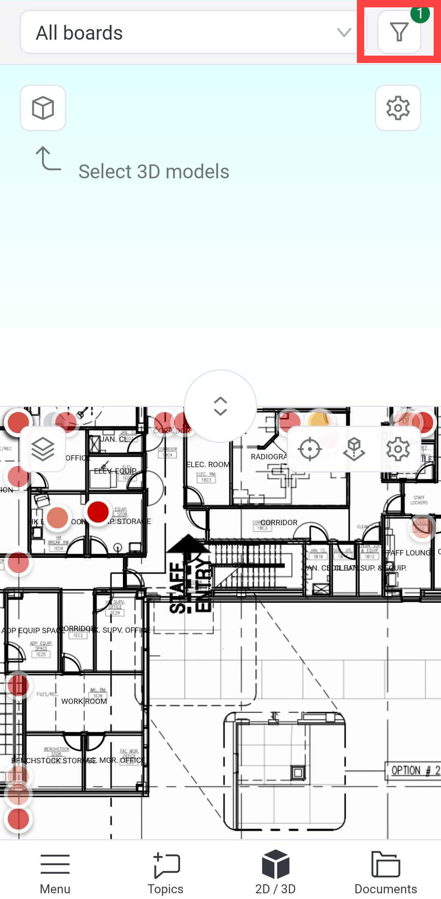

> **Waarschuwing 1:** Wanneer het menu Onderwerpen wordt geopend, worden markers van de eerste 250 onderwerpen in het resultaat bijgewerkt en opgeslagen. Wanneer de Viewer wordt geopend, worden markers van eerder bijgewerkte onderwerpen die overeenkomen met het resultaat in het menu Onderwerpen weergegeven. Opmerking: markers van onderwerpen kunnen verspreid zijn over verdiepingen anders dan de actieve verdieping.
> **Waarschuwing 2:** Wanneer er 250+ onderwerpen in het resultaat van het menu Onderwerpen zijn, kunnen markers niet zijn geladen of verouderd zijn. Scroll naar beneden in de lijst om hun markers ook weer te geven/bij te werken. Het filteren van het bord zodat er minder onderwerpen in het resultaat zijn, kan ook helpen om ervoor te zorgen dat markers van onderwerpen in het gefilterde resultaat aanvullend worden bijgewerkt en weergegeven.
> **Waarschuwing 3:** Wanneer u zich afmeldt en zich opnieuw aanmeldt, gaat de Geschiedenis van welke onderwerpen zijn geladen verloren en onderwerpen die eerder zijn geladen, moeten mogelijk opnieuw worden geladen.

**Breid de 2D weergave uit** Sleep op de scheidingslijn tussen de 2D en 3D viewers om deze uit te breiden.

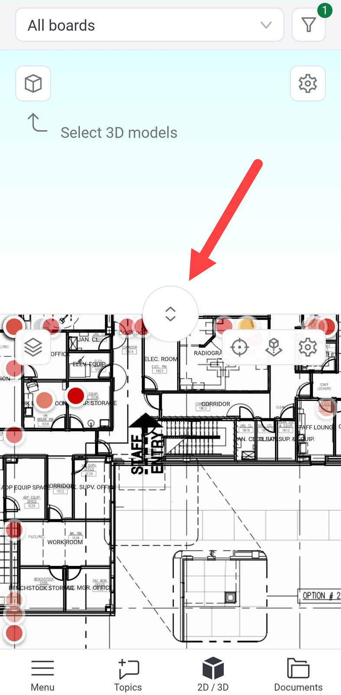

Selecteer een verdieping van een IFC-model of van een geconfigureerd gebouw door op het verdiepingsmenu linksboven te tikken.

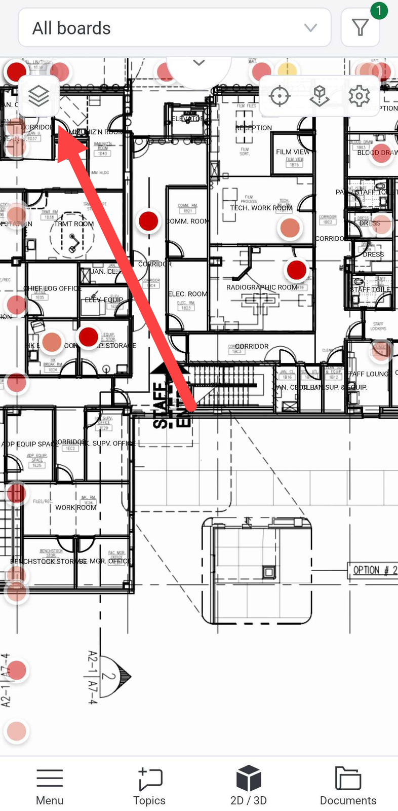

### 1.3 **Topics zoeken vanuit markeringen**

**Een topic zoeken vanuit een markering op een verdieping in de 2D weergave** Tik op een markering in de 2D weergave om het topic-nummer en de titel van de topic waarvan het hoort weer te geven. Tik op de pijl van de geselecteerde markering om de geselecteerde topic in de bijbehorende topic board op de topics pagina weer te geven.

**Een markering in de 2D viewer zoeken vanuit een topic** Zoek een topic die "Heeft locatie" zegt in het veld Locatie en tik erop.

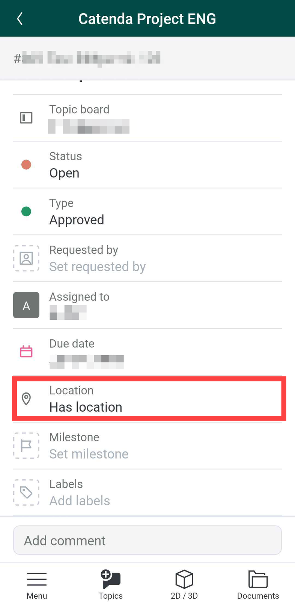

Tik in het menu dat verschijnt op "Locatie weergeven op 2D":

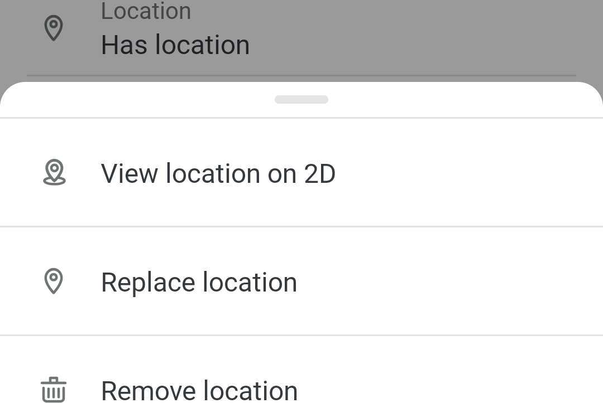

Wanneer een topic in een topic board wordt geopend, wordt de kleur van die markering groen gemarkeerd met een vinkje in het 2D/3D menu.

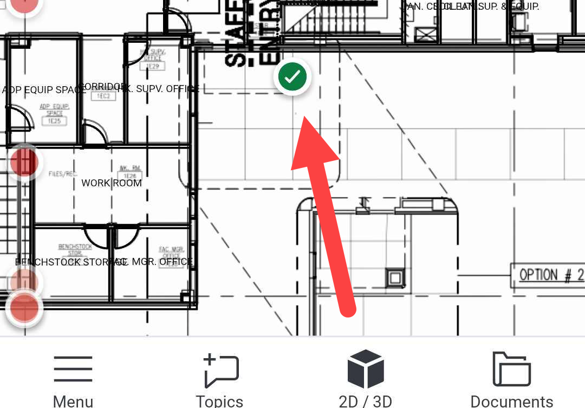

### 1.4 **Markeringen bewerken**

**Markeringen verplaatsen** Tik op het locatieveld in een topic en tik op locatie vervangen in het menu dat verschijnt. Sleep de markering met het anker naar de nieuwe locatie en bevestig.

**Markeringen verwijderen** Tik op het locatieveld in een topic en tik op locatie vervangen in het menu dat verschijnt. Tik op locatie verwijderen.

### 1.5 **Markeringsconfiguratie**

Tik op het tandwielpictogram in de 2D viewer om de Catenda Site 2D viewer [instellingen](https://support.catenda.com/nl/articles/7748370-2d-viewer-catenda-site#h_63e1728758) te openen

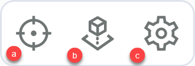

Hier kunnen verschillende 2D viewer-opties worden geconfigureerd.

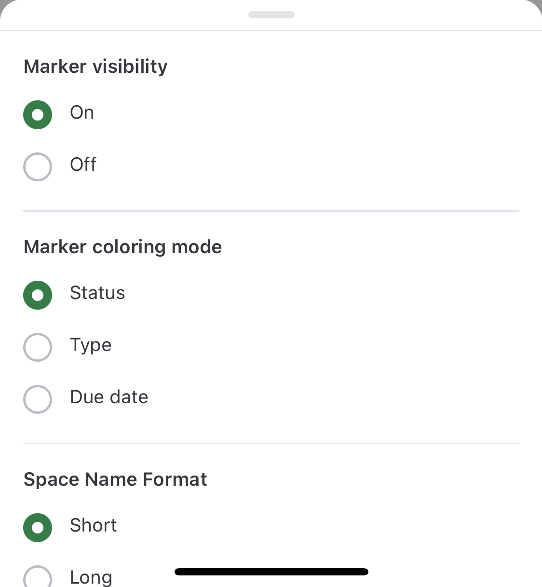

**Zichtbaarheid van markeringen** Markeringen in- of uitschakelen

**Markeringsmodus voor kleur** Wijzig het type kleur dat de markeringen moeten hebben

**Ruimtenaamindeling** Ruimten kunnen korte of lange namen hebben in een IFC-bestand

## 2. **Topics met nieuwe markeringen**

### 2.1 **Maak een nieuwe topic met een markering**

De groene plusknop in een topic board is niet de enige manier om een topic te maken. Tik ergens op de 2D viewer om op die locatie een topic te maken.

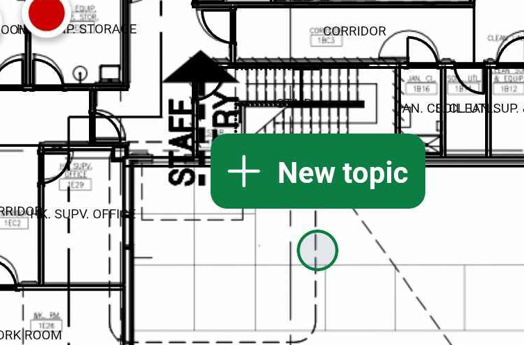

De topic die op deze manier wordt gemaakt, heeft automatisch de markering op die locatie toegepast.

### 2.2 **Markering toevoegen vanuit topic**

Maak een nieuwe topic of open een topic zonder markering en tik op "Locatie".

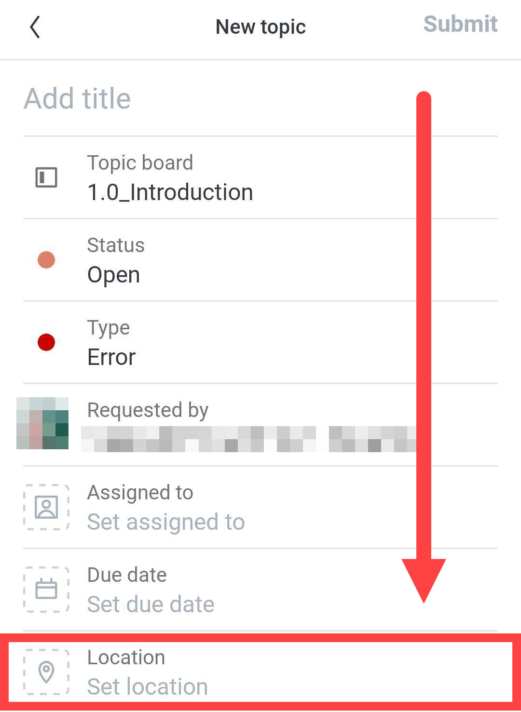

Het 2D/3D Menu verschijnt nu en een nieuwe markering met een anker wordt groen weergegeven:

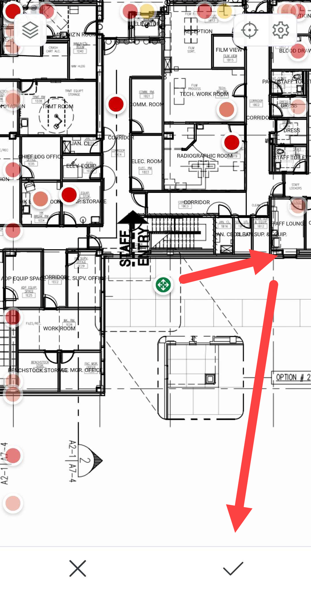

Zoom in op de 2D viewer door met twee vingers te knijpen en verplaats de markering naar de juiste locatie en klik op het vinkje om deze op zijn plaats vast te zetten.
