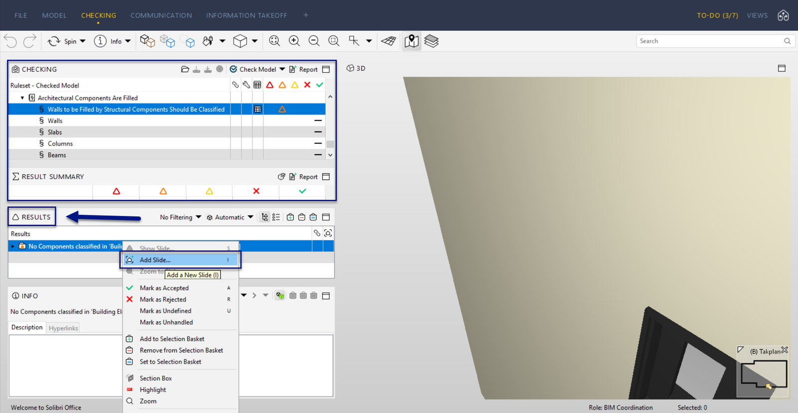
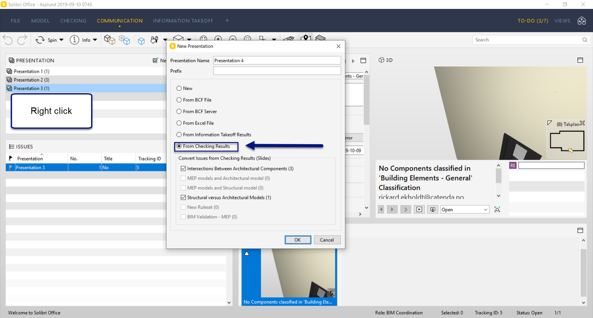
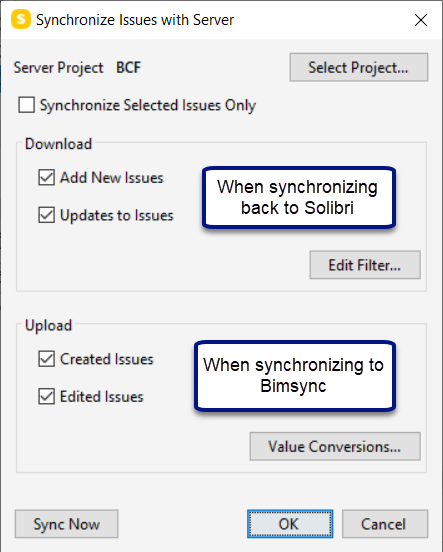
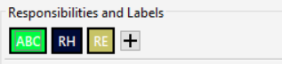
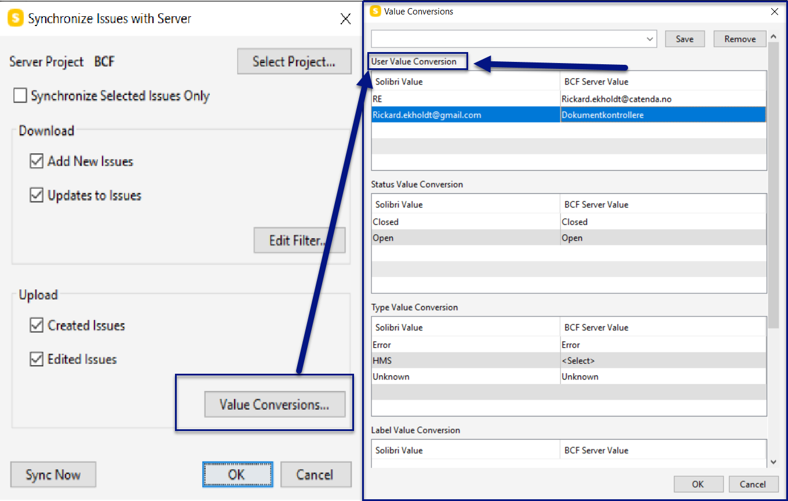

# Werkstroom Catenda Hub - Solibri

Dit is een document dat de optimale werkstroom uitlegt bij het werken met de BCF-server tussen Solibri en Catenda Hub.

1\. Begin met het verbinden met je Catenda Hub-project. [( zie hier )](https://support.catenda.com/nl/articles/4670340-solibri-topics-integratie) 2\. Zodra je verbonden bent, start je met het uitvoeren van je clash detection in Solibri en maak je een presentatie. Er zijn verschillende manieren om een presentatie in Solibri te maken, maar ik leg het type uit dat het beste werkt voor communicatie met Catenda Hub. A. Voer de controle uit met je ruleset. B. Zoek een Solibri-issue die je aan je presentatie wilt toevoegen. C. In plaats van naar communication te gaan en daar de slide aan je presentatie toe te voegen, klik je met de rechtermuisknop op het issue in de controleresultaten en kies je de knop “Add slide”. Op deze manier worden alle objecten in dat issue automatisch opgenomen in het issue in Catenda Hub en zijn ze makkelijker terug te vinden. Dit in combinatie met hide others en het transparant maken van andere objecten in Catenda Hub is een goede manier om nooit het overzicht te verliezen van welke objecten bij de issues horen. Wanneer je op deze manier een slide maakt, krijg je nog steeds dezelfde issue-indeling als in communication, waarbij je een titel, een beschrijving, extra afbeeldingen en opmerkingen kunt toevoegen. Hetzelfde geldt voor het toewijzen van personen aan het issue.

D. Wanneer u klaar bent met uw controle, gaat u naar communicatie en maakt u een presentatie van "controleresultaten". Vervolgens verschijnen alle problemen die u in de controleresultaten hebt gemaakt in uw nieuwe presentatie. Als u deze dia's aan een bestaande presentatie wilt toevoegen, klikt u met de rechtermuisknop op die presentatie en drukt u op "presentatie bijwerken vanuit resultaten". Op deze manier worden alle dia's die in resultaten zijn gemaakt, opgenomen in die presentatie.

3\. Nu u de presentatie hebt gemaakt, kunt u beginnen met synchroniseren met Catenda Hub. Wanneer u op "Presentatie synchroniseren" drukt, verschijnt een pop-upmenu. Hierin kunt u selectievakjes aanvinken om te bepalen op welke manier u wilt synchroniseren. Als u naar "Waardeconversie" gaat, kunt u verschillende waarden instellen die overeenkomen met de waarden in uw Catenda Hub-project.

4\. Waardeconversie. Als u bijvoorbeeld een probleem rechtstreeks in Solibri aan een persoon hebt toegewezen en het het probleem niet in Catenda Hub toewijst, is de reden dat de waardeconversie niet correct is ingesteld.

Deze verantwoordelijkheden die in het probleem zijn ingesteld, kunnen worden ingesteld om overeen te komen met de gebruikers in het Catenda Hub-project. Dit wordt hier gedaan in waardeconversie:

De knop Waardeconversie verschijnt in het pop-upmenu wanneer u met de rechtermuisknop op de presentatie klikt en op "Presentatie synchroniseren" drukt. Wanneer deze problemen in Solibri zijn toegewezen en zijn gesynchroniseerd met het Catenda Hub-project, ontvangen de toegewezen gebruikers notificaties als notificaties zijn ingeschakeld. Op deze manier hoeft u de problemen na synchronisatie met Solibri niet handmatig in Catenda Hub toe te wijzen.
