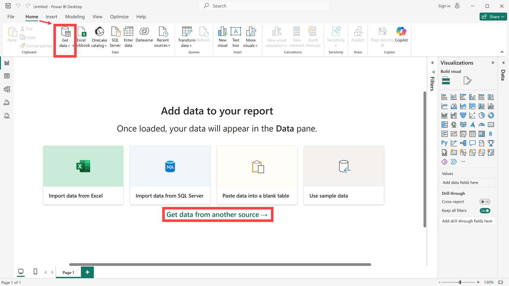
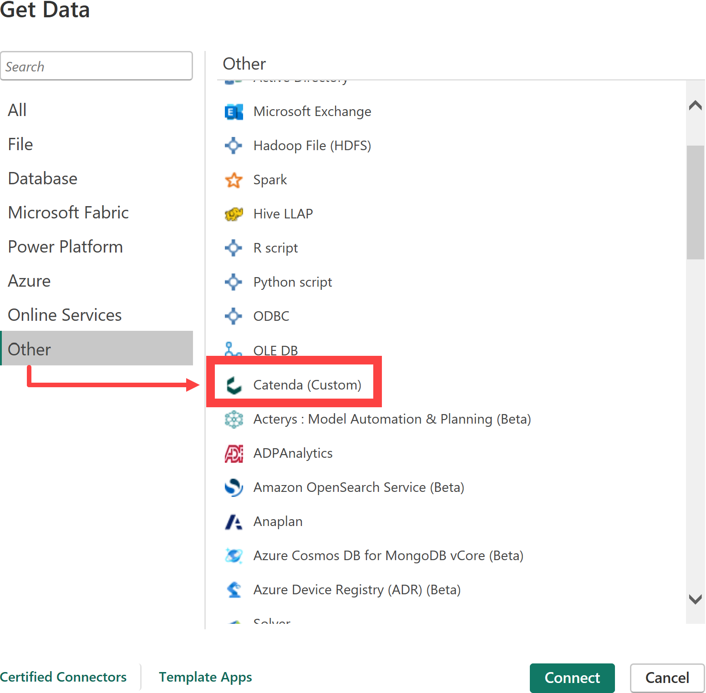
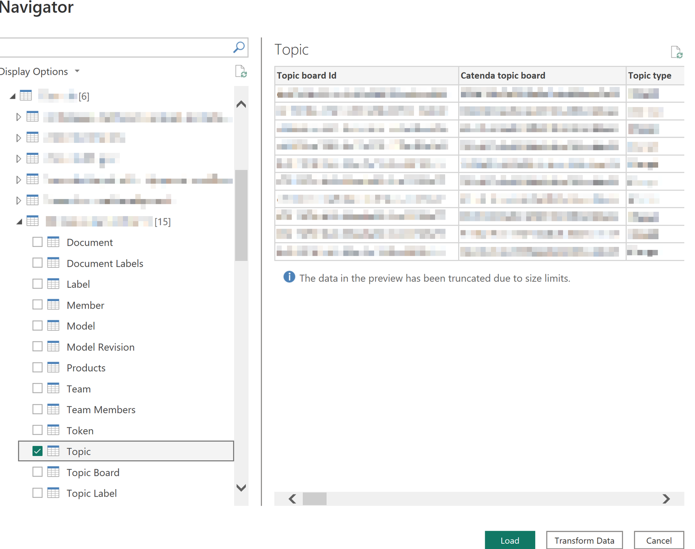
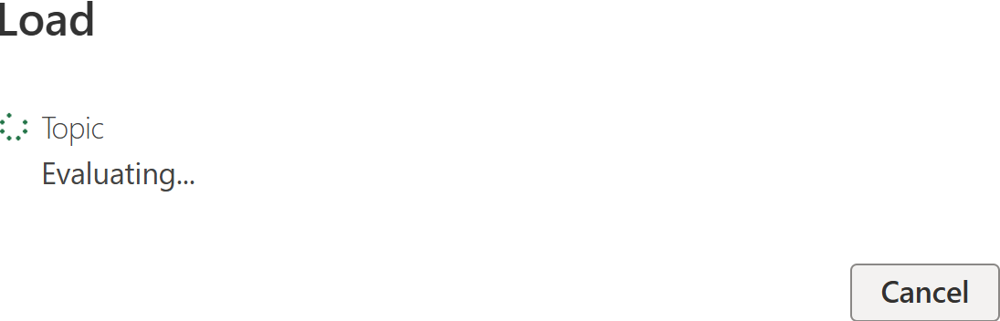
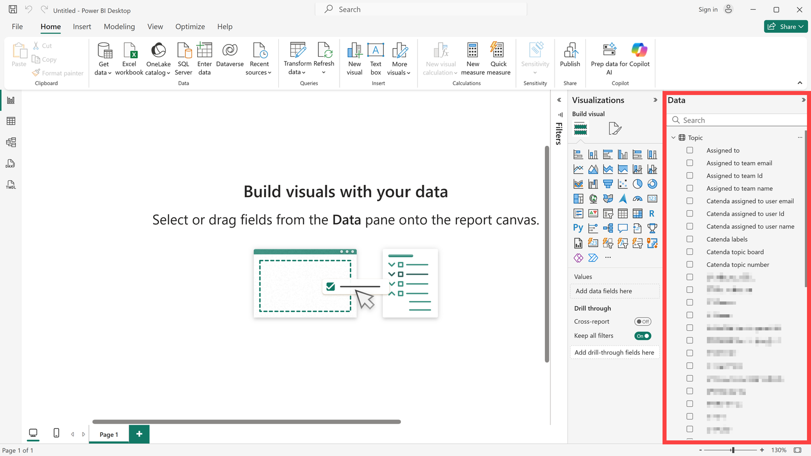
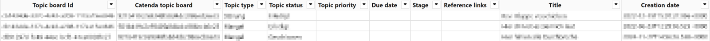
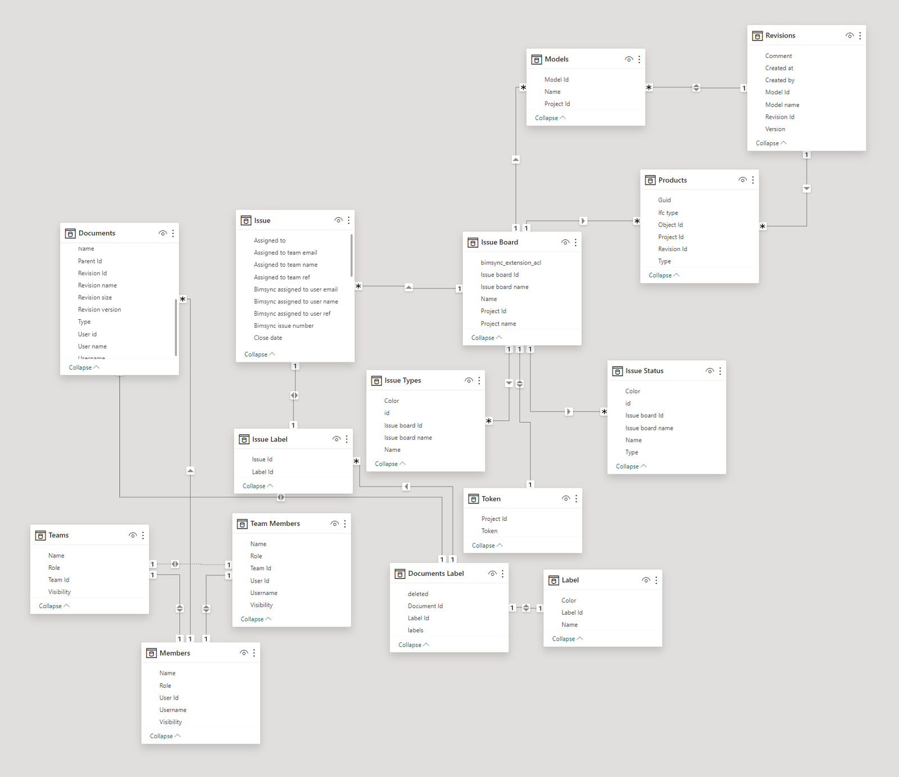

# Catenda Power BI Connector

> **Opmerking:** Het installatiebestand voor deze applicatie is te vinden [hier](https://support.catenda.com/nl/articles/8396532-catenda-invoegtoepassingen-integraties)

In dit artikel leggen we uit hoe de Catenda HUB-database kan worden gekoppeld met PowerBI. Door te koppelen kan directe toegang tot de gegevens op Catenda HUB worden verkregen in PowerBI. Deze gegevens kunnen vervolgens worden gebruikt om taken, Documenten of bijvoorbeeld Leden te evalueren.

## 1. **Installatie**

Wanneer de Catenda Desktop Connector op Windows wordt geïnstalleerd, verschijnen de installatiebestanden in de volgende map.

`C:\Users\<Username>\Documenten\Power BI Desktop\Custom connectors`

### 1.1 **Verwijderen**

Ga naar de installatiemap om de plugin te verwijderen en voer het volgende bestand uit:

`uninstall.exe`

Als de map is verwijderd en de plug-in nog steeds actief is, installeert u de plug-in opnieuw en verwijdert u deze met het verwijderingsbestand dat is gemaakt.

## 2. **Gegevens ophalen en verbinden**

Volg deze stappen om een verbinding van PowerBI naar de Catenda HUB-database tot stand te brengen: Open PowerBI en klik op "Gegevens uit een ander bron ophalen" in het midden van het scherm of gebruik de actie Gegevens ophalen in het startmenu van het lint bovenaan. Het lint moet mogelijk worden uitgebreid om de actie weer te geven.

Selecteer de doelbron onder Overige --> Catenda. Gebruik "_Verbinden_" om de verbinding met de database tot stand te brengen. Aanmelden bij Catenda en wat u moet doen wanneer aanmelden mislukt, worden beschreven in [Aanmelden bij Catenda vanuit Power BI](https://support.catenda.com/nl/articles/17778878-aanmelden-bij-catenda-vanuit-power-bi).

## 3. **Gegevens laden**

Een navigator wordt geopend waarin alle projecten waartoe u toegang hebt, worden weergegeven. Selecteer het overeenkomstige project en de tabel die moet worden gekoppeld. In ons voorbeeld willen we [Topics](https://support.catenda.com/nl/articles/4670271-pagina-topics) in PowerBI evalueren. Klik op "_Laden_" om de gegevensset te laden.

De volgende tabellen kunnen worden geladen:

| Tabel          | Inhoud                                                                 |
| -------------- | ---------------------------------------------------------------------- |
| Documenten     | De Documenten in het project.                          |
| Document Label | De Labels op elk Document.                             |
| Label          | De Labels die in het project worden gebruikt.          |
| Gebruiker      | De Leden van het project.                              |
| Model          | De modellen in het project.                            |
| Modelrevisie   | De revisies van elk model.                             |
| Producten      | De objecten in de modellen.                            |
| Team           | De Teams in het project.                               |
| Teamleden      | De Leden van elk Team.                                 |
| Token          | Een Viewer-token voor het project.                     |
| Topic          | De Topics in het project.                              |
| Topicbord      | De Topic boards in het project.                        |
| Topicliabel    | De Labels op elk Topic.                                |
| Topicstatus    | De Statussen die op de Topic boards worden gebruikt.   |
| Topictype      | De Topic-types die op de Topic boards worden gebruikt. |

Nadat u op Laden hebt geklikt, begint de PowerBI-connector met het ophalen van de topicgegevens uit de API.

De gegevens worden vervolgens aan de rechterkant weergegeven. Selecteer het gewenste gegevensveld en maak uw analyse.

> **Opmerking:** Laad verschillende gegevenssets en koppel deze aan elkaar. Hiermee kunt u interactieve dashboards maken die u een volledig overzicht geven.

Afhankelijk van welke gegevens in uw project aanwezig zijn en welke gegevens u laadt, worden automatisch verschillende relaties gemaakt.

## 4. **Tabel view**

Dit is hoe de topicgegevens er in tabel view kunnen uitzien:

## 5. **Modelweergave**

Hier is een overzicht van hoe de verbindingen er in model view uitzien wanneer alle informatie in uw project aanwezig is en u alle projectgegevens hebt geladen:

